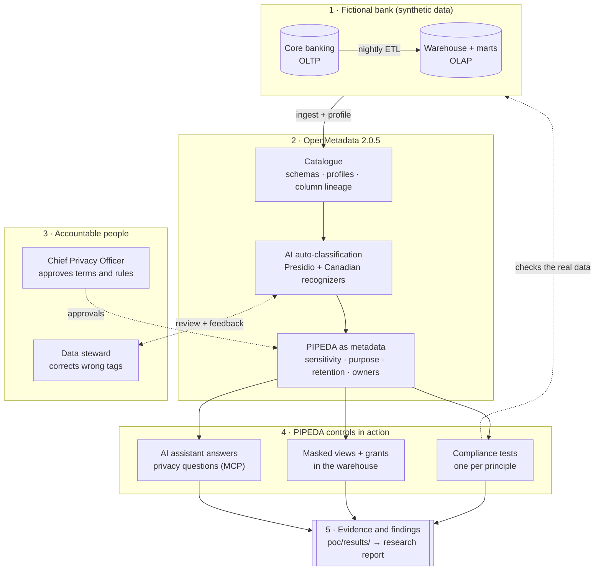

# ai-powered-data-governance

GNG/ELG 5301 team research project (University of Ottawa, Fall 2026):
**AI-powered data governance with OpenMetadata for PIPEDA compliance in a (fictional) Canadian bank.**

> **Research question:** How, and with what professional safeguards, can a Canadian bank use an open-source, AI-assisted metadata platform (OpenMetadata) to operationalize PIPEDA's fair information principles across its OLTP and OLAP data?

The project combines a structured literature review with a reproducible proof of concept (POC). The POC builds a fictional bank, "Borealis Bank of Canada", on synthetic data, governs it with OpenMetadata 2.0.5, and measures what the AI features get right and wrong.

## What the project does

Banks copy customer data from the systems that collect it into warehouses and marts for marketing, anti-money-laundering and analytics. Every copy is personal information under PIPEDA, yet most banks cannot say which columns hold it, why it is kept, who may read it, or when it must be deleted. This project tests whether an open-source metadata platform with AI features can close that gap, and what people still have to do.

The proof of concept runs the full governance cycle on a realistic bank, end to end, with one command:

1. **Builds the bank.** It generates 1 500 synthetic customers with accounts, cards, consents and transactions in an operational database (OLTP), then loads them through a nightly-style ETL into a star-schema warehouse with marketing and AML marts (OLAP). It plants the kinds of defects a privacy programme should catch: withdrawn consent ignored by the ETL, customers kept past retention, stored card CVVs and malformed postal codes.
2. **Catalogues it.** OpenMetadata ingests both databases, profiles them and records column-level lineage, so every copy of a customer's data can be traced.
3. **Finds personal information with AI.** Auto-classification (Microsoft Presidio and spaCy) scans column values and tags them. The POC adds Canadian recognizers (SIN, postal codes, account numbers, Ontario driver's licences, passports) and scores every run against a hand-labelled ground truth of 145 columns.
4. **Keeps people in charge.** Data stewards correct false positives through a feedback workflow, and the Chief Privacy Officer approves glossary terms. Every decision leaves an audit trail.
5. **Expresses PIPEDA as metadata.** Tables get owners, domains, processing purposes, retention periods and sensitivity tags, and each of the ten fair-information principles maps to a concrete control.
6. **Tests compliance continuously.** Data-quality tests named after the principle they check (for example `p4_3_consent_not_withdrawn`) run against the real data and open incidents when they fail.
7. **Enforces access.** Tag-based policies restrict the catalogue, and masked views and grants generated from the same tags protect the warehouse itself.
8. **Answers privacy questions.** An AI assistant queries the catalogue through the Model Context Protocol (MCP) server, for example "which tables hold high-risk identifiers?" or "where does a customer's e-mail address flow?".
9. **Produces evidence.** Every step writes results to [`poc/results/`](poc/results/), which feed a PIPEDA compliance summary and the research report.



**Headline results:** AI auto-classification F1 rose from **0.783** out of the box to **0.943** with Canada-tuned recognizers and **1.000** after one round of steward feedback (145 columns). The PIPEDA data-quality tests caught every planted defect: 55 customers still marketed to after withdrawing consent, 38 customers kept past retention in both the OLTP and the warehouse, 1 239 stored CVVs and 17 malformed postal codes. The overall finding is that the platform works as a *supervised* control system: it is strongest at inventory, purpose and lineage, can detect consent, retention and accuracy problems but not fix them, and protects the database only when its tags are wired into enforcement. Details: [Results and findings](docs/results.md) and [Research overview](docs/research.md#answer-in-brief).

## Quick start

Requires Docker Desktop with about 4 GB of memory for the VM.

```bash
cd poc && ./scripts/run_poc.sh
```

The run takes about 15–20 minutes. Then open http://localhost:8585 (login `admin@open-metadata.org` / `admin`, local only). Evidence is written to [`poc/results/`](poc/results/). See the [POC README](poc/README.md) and the [Operations guide](docs/operations.md) for configuration, resets and troubleshooting.

## Documentation

The full index with diagrams is in [`docs/README.md`](docs/README.md).

### Research

| Page | Covers |
|---|---|
| [Research overview](docs/research.md) | Problem, research question and sub-questions, scope, method, answer in brief, limitations |
| [PIPEDA principle mapping](docs/pipeda-mapping.md) | Each of the ten principles → control → code → evidence file |
| [Report guide](docs/report.md) | Report structure, building the PDF, keeping it in sync with the POC, submission checklist |

### Proof of concept

| Page | Covers |
|---|---|
| [Architecture](docs/architecture.md) | Containers, compose layering, volumes, database roles, authentication |
| [Pipeline walkthrough](docs/pipeline.md) | The 13 steps of `run_poc.sh`, the module behind each and what it writes |
| [Data model](docs/data-model.md) | OLTP and warehouse schemas, ETL, column lineage, planted defects |
| [Governance model](docs/governance-model.md) | PIPEDA as classifications, recognizers, teams, roles, policies, domains, glossary, data contract, tests |
| [AI auto-classification and evaluation](docs/classification.md) | The three classification runs, the `classify_with.py` workaround, ground truth, metrics |
| [Human-in-the-loop workflows](docs/human-in-the-loop.md) | Glossary approval and recognizer-feedback workflows |
| [Access control and enforcement](docs/enforcement.md) | Catalogue policies vs. warehouse access; masked views generated from tags |
| [AI assistant (MCP)](docs/mcp.md) | Querying the catalogue through the MCP server; security caveats |
| [Results and findings](docs/results.md) | Numbers from the last run, PIPEDA scorecard, product limitations found |
| [Operations guide](docs/operations.md) | Prerequisites, configuration, commands, troubleshooting, extending, upgrading |
| [Testing](docs/testing.md) | Unit and integration test suites, how to run them, what they check |

### Reference

| Page | Covers |
|---|---|
| [Glossary](docs/glossary.md) | Privacy, data and OpenMetadata terms |
| [Paper index](references/papers/README.md) | Research papers cited as evidence and where to get each one |
| [Contributing](CONTRIBUTING.md) | Commit message conventions and branch workflow |

## Repository layout

| Folder | Contents |
|---|---|
| [`docs/`](docs/README.md) | Detailed documentation (listed above), with Mermaid diagrams |
| [`poc/`](poc/README.md) | Docker proof of concept: OpenMetadata 2.0.5, the synthetic bank (OLTP + OLAP), governance automation and evaluation scripts; evidence in [`poc/results/`](poc/results/) |
| [`report/`](report/) | Final research report in IEEE format: [`main.tex`](report/main.tex), [`references.bib`](report/references.bib), compiled [`main.pdf`](report/main.pdf) |
| [`deliverables/`](deliverables/) | Team research and project proposal (search log and sources evaluation) |
| [`references/papers/`](references/papers/README.md) | Index of the research papers cited as evidence (PDFs are kept locally, not committed) |
| `Project.pdf` | Course project guidelines |

## Notes

- All data is synthetic and the bank is fictional; no human-participant data is used.
- The report is a **draft** prepared with generative-AI assistance. See the AI-use statement (report Appendix D) and the [submission checklist](docs/report.md#before-submission).
- PIPEDA mappings are the authors' reading of public guidance, not legal advice.
