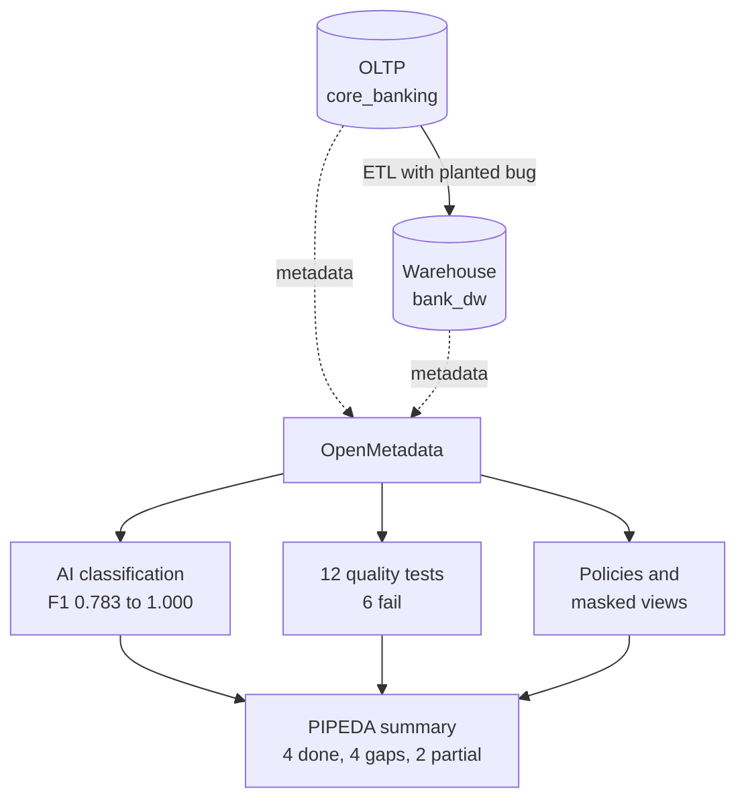
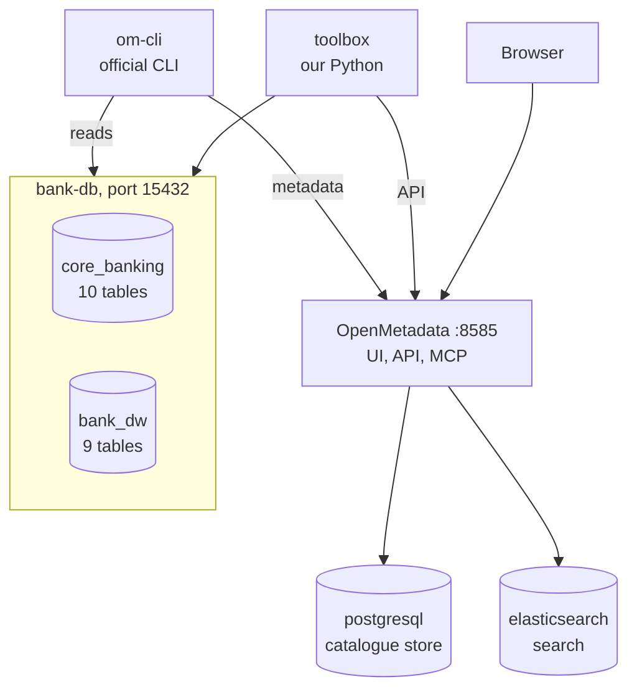
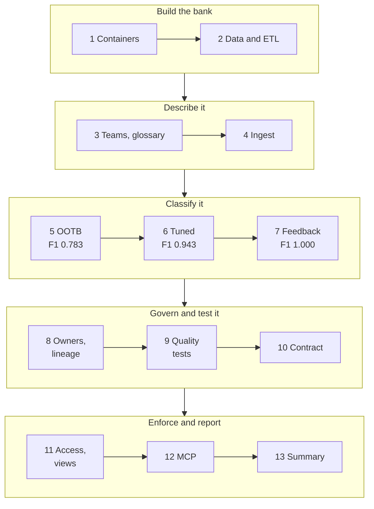
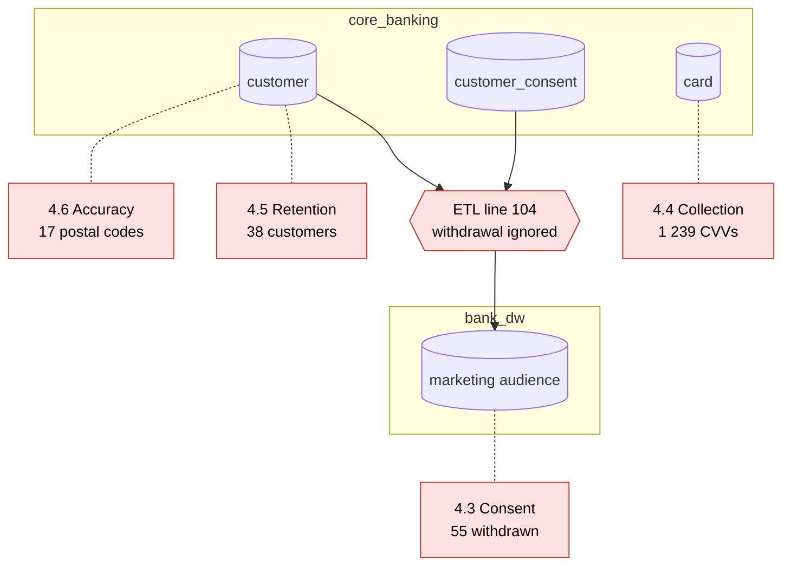
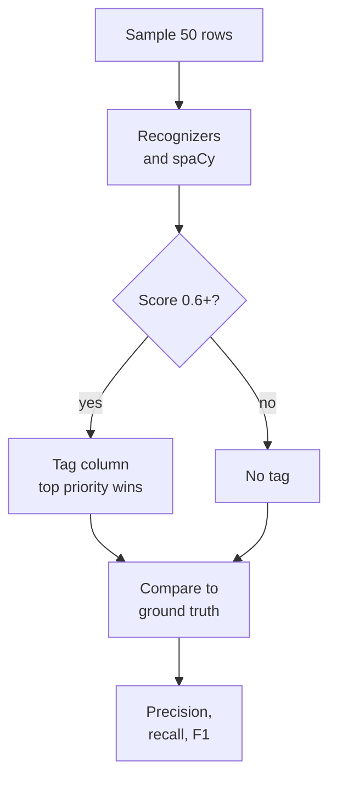
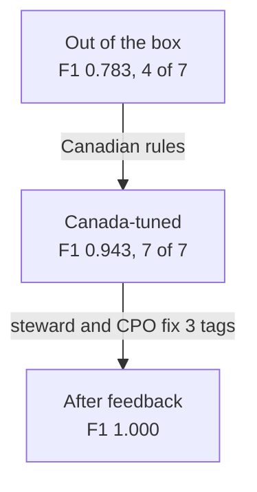
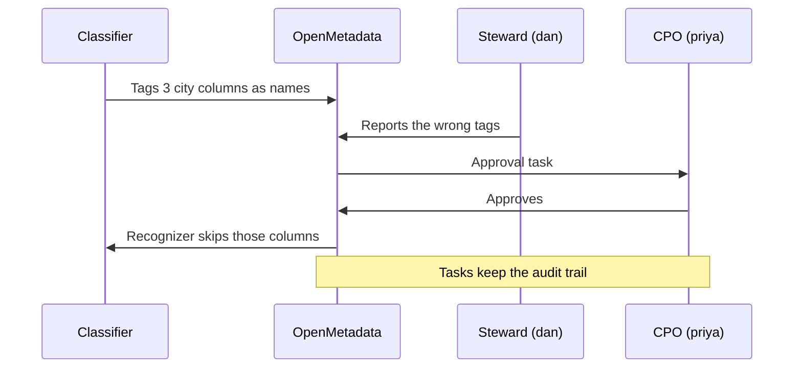
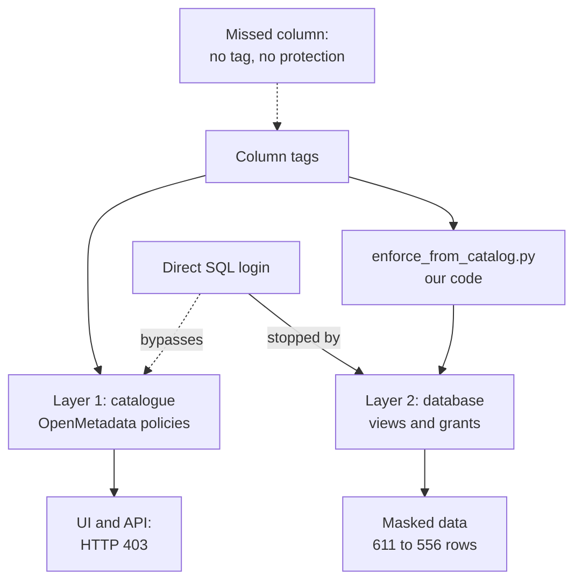
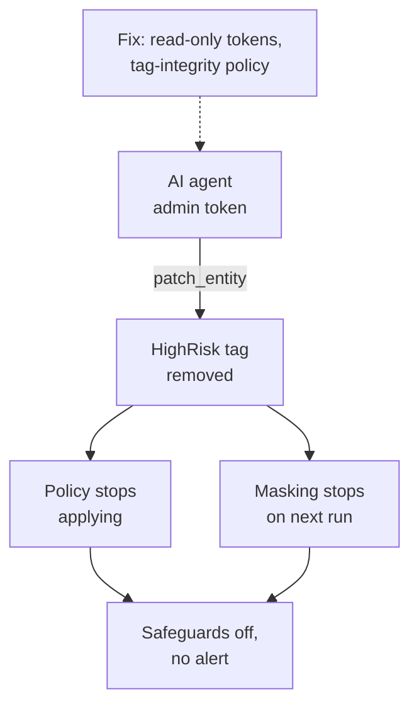

# Learning the OpenMetadata POC: roadmap

- **Who this is for:** every team member, learning the POC on your own before the team sync. Work through it by hand, without AI help.
- **Goal:** be able to say what each part does, why it exists, what result it produced, and what its limits are, without notes.
- **Time:** about 6–8 hours in total, split into 7 stages. Stages 0–3 are the minimum before the team sync (about 3 hours). For a shorter hands-on version, see [04_Self_Guided_POC_Walkthrough.md](04_Self_Guided_POC_Walkthrough.md).

> Terms in **bold** the first time they appear are defined in [02_Terminology_Appendix.md](02_Terminology_Appendix.md).

---

## Contents

- [The one-paragraph story (memorise this first)](#the-one-paragraph-story-memorise-this-first)
- [How the POC maps to the submitted proposal](#how-the-poc-maps-to-the-submitted-proposal)
- [Stage 0: Set up (30 min)](#stage-0-set-up-30-min)
- [Stage 1: The background concepts (60–90 min)](#stage-1-the-background-concepts-6090-min)
- [Stage 2: The architecture (45 min)](#stage-2-the-architecture-45-min)
- [Stage 3: Run it and follow the 13 steps (90 min, mostly waiting)](#stage-3-run-it-and-follow-the-13-steps-90-min-mostly-waiting)
- [Stage 4: The data and the planted defects (45 min)](#stage-4-the-data-and-the-planted-defects-45-min)
- [Stage 5: The AI classification experiment (60 min)](#stage-5-the-ai-classification-experiment-60-min)
- [Stage 6: Governance, people and access control (60 min)](#stage-6-governance-people-and-access-control-60-min)
- [Stage 7: MCP, limitations and the "so what" (45 min)](#stage-7-mcp-limitations-and-the-so-what-45-min)
- [Final self-test (do this without looking)](#final-self-test-do-this-without-looking)
- [Where everything lives](#where-everything-lives)

## The one-paragraph story (memorise this first)

Banks copy customer data from the system that collects it (**OLTP**) into a **data warehouse** (**OLAP**) through **ETL** pipelines, and more and more of that pipeline code is written with AI coding assistants. AI-written SQL can run without errors and still be wrong. Our proposal asks whether a **data governance** platform, **OpenMetadata**, can help a Canadian bank catch the security and data-quality problems this creates. The POC builds a fake bank ("Borealis Bank of Canada") with **synthetic data**, plants defects on purpose (an ETL job that ignores consent withdrawal, customers kept too long, stored card security codes, bad postal codes), and then checks which of them OpenMetadata finds. It also measures how well OpenMetadata's AI finds personal information in the columns (**auto-classification**). **Result in one line:** the platform finds problems and documents data well, but only with Canada-specific tuning and people reviewing it, and it does not fix anything or protect the database by itself.

**The story in one diagram:**



---

## How the POC maps to the submitted proposal

Read this table before anything else. The repo's README uses a slightly different research question (PIPEDA-focused) from the **submitted proposal**. For the team sync and the report, use the proposal's question and show the POC as evidence for it.

| Proposal sub-question | What in the POC answers it | Key number |
|---|---|---|
| Data quality and validation | Data-quality tests on the real data; the planted ETL consent bug | 12 tests: 6 pass, 6 fail; 55 withdrawn customers still in the marketing list |
| Data security | AI auto-classification; tag-based access policies; masked views in the warehouse | F1 0.783 → 0.943 → 1.000; 7/7 access checks as expected |
| Regulatory compliance | Each PIPEDA principle mapped to a control ([`docs/pipeda-mapping.md`](https://github.com/KshitijV97/ai-powered-data-governance/blob/master/docs/pipeda-mapping.md)) | 4 implemented, 4 gaps detected, 2 partial |
| Data governance and OpenMetadata | Lineage, classification, owners, purposes, retention, glossary | 14 tables fully documented |
| Limitations and human oversight | Steward/CPO workflows; product limitations found; MCP write-tool risk | 6 product limitations |

---

## Stage 0: Set up (30 min)

**Do:**
1. Start Docker Desktop. Settings → Resources → Memory: at least **4 GB** (on an 8 GB laptop, close browser tabs and other heavy apps while it runs).
2. Open a terminal, clone the repository and go into it:
   ```bash
   git clone https://github.com/KshitijV97/ai-powered-data-governance.git
   ```
   ```bash
   cd ai-powered-data-governance
   ```
3. Check Docker works:
   ```bash
   docker --version
   ```
   ```bash
   docker info
   ```
4. Skim the folder layout:
   ```bash
   ls poc poc/toolbox/poc poc/results
   ```

**You should be able to say:** "Everything runs in Docker containers, so nobody needs to install Python or a database."

---

## Stage 1: The background concepts (60–90 min)

Learn these in order. Each builds on the one before.

| # | Concept | Why it matters for the POC | Best free resource |
|---|---|---|---|
| 1 | Relational databases and SQL (tables, rows, joins, `WHERE`) | The bank is two Postgres databases; the bug is one missing `WHERE` condition | [SQLBolt interactive lessons 1–6](https://sqlbolt.com) |
| 2 | OLTP vs OLAP, data warehouse, star schema | The POC copies data from OLTP to a star-schema warehouse | [IBM "OLAP vs. OLTP"](https://www.ibm.com/think/topics/olap-vs-oltp) |
| 3 | ETL pipelines | The nightly job that copies data, and where the bug lives | [IBM "What is ETL?"](https://www.ibm.com/think/topics/etl) |
| 4 | Data quality dimensions and validation | DQ tests check accuracy, validity, uniqueness | Proposal refs [10] and [12] (IBM pages) |
| 5 | Personal information and PIPEDA's 10 principles | The yardstick the POC is measured against | [OPC "PIPEDA fair information principles"](https://www.priv.gc.ca/en/privacy-topics/privacy-laws-in-canada/the-personal-information-protection-and-electronic-documents-act-pipeda/p_principle/) |
| 6 | Data governance, data catalogues, metadata, lineage | What OpenMetadata is | [OpenMetadata docs home](https://docs.open-metadata.org/v2.0.x) |
| 7 | Precision, recall, F1 | How the AI classifier is scored | [Google ML Crash Course, "Classification: accuracy, precision, recall"](https://developers.google.com/machine-learning/crash-course/classification/accuracy-precision-recall) |
| 8 | Docker and Docker Compose | How the POC runs | [Docker "Get started" overview](https://docs.docker.com/get-started/) |
| 9 | Model Context Protocol (MCP) | How AI assistants talk to the catalogue | [modelcontextprotocol.io](https://modelcontextprotocol.io/introduction) |

**Self-check:** explain to yourself, out loud, why "the SQL ran with no errors" does not mean "the data is right". (Answer: the consent bug. The ETL query is valid SQL; it just forgets to exclude customers who withdrew consent.)

---

## Stage 2: The architecture (45 min)

**Read:** [`docs/architecture.md`](https://github.com/KshitijV97/ai-powered-data-governance/blob/master/docs/architecture.md), then [`poc/README.md`](https://github.com/KshitijV97/ai-powered-data-governance/blob/master/poc/README.md).

**The picture to draw from memory:**



| Container | One-line job |
|---|---|
| `openmetadata-server` | The catalogue: web UI, REST API, MCP endpoint |
| `postgresql` | Stores OpenMetadata's own metadata (not bank data) |
| `elasticsearch` | Search index for the UI |
| `bank-db` | The fake bank: both databases |
| `toolbox` | Our Python scripts (`poc/toolbox/poc/*.py`) |
| `om-cli` | OpenMetadata's official `metadata` command-line tool (ingest, classify, profile, test) |

**Key design choices to be able to justify:**
- The official OpenMetadata compose file is **unmodified**; our additions sit in an **overlay** file ([`docker-compose.poc.yml`](https://github.com/KshitijV97/ai-powered-data-governance/blob/master/poc/docker-compose.poc.yml)). Why: upgrades are a one-file swap, and nobody can say we tampered with the product.
- `om-cli` runs one-off instead of the Airflow scheduler. Why: saves about 1.5 GB RAM so it fits a 4 GB Docker VM.
- Fixed random seed (`POC_SEED=5301`). Why: same data and same numbers on every run, so results are reproducible.

**Commands to try (from [`poc/`](https://github.com/KshitijV97/ai-powered-data-governance/tree/master/poc)):**
```bash
cd poc
```
```bash
cat scripts/dc.sh
```
```bash
cat .env.example
```

---

## Stage 3: Run it and follow the 13 steps (90 min, mostly waiting)

**Read while it runs:** [`docs/pipeline.md`](https://github.com/KshitijV97/ai-powered-data-governance/blob/master/docs/pipeline.md).

**Run:**
```bash
cd poc
```
```bash
./scripts/run_poc.sh
```

The 13 steps in five phases:



What to say about each step:

| Step | What happens | What to say |
|---|---|---|
| 1 | Start all containers, wait for OpenMetadata | "Up to 15 min on first run; it downloads images." |
| 2 | Generate 1 500 synthetic customers; ETL into the warehouse | "The ETL contains a planted bug: it ignores consent withdrawal, like an AI-written query might." |
| 3 | Create teams, people (CPO, steward, analysts), roles, glossary | "This is the organisation: who is accountable." |
| 4 | Ingest metadata from both databases | "OpenMetadata now knows every table and column." |
| 5 | Baseline AI classification (built-in PII rules) | "Out of the box. F1 0.783." |
| 6 | Canada-tuned classification (our SIN, postal-code, licence, passport rules) | "F1 0.943, all 7 high-risk columns found." |
| 7 | Steward reports 3 wrong tags, CPO approves, re-run | "F1 1.000. A human fixed the AI's mistakes." |
| 8 | Owners, domains, purposes, retention, lineage | "Every table has an owner, a reason, an expiry." |
| 9 | Profiler + 12 data-quality tests | "6 tests fail on purpose; those are the findings." |
| 10 | Data products, glossary links, data contract | "A written agreement on the marketing list." |
| 11 | Access tests + generated masked views in the warehouse | "The catalogue blocks the marketing analyst; our generated views protect the actual database." |
| 12 | AI assistant asks 4 privacy questions through MCP | "An AI can answer 'where does a customer's e-mail go?'" |
| 13 | Write the compliance summary | "All evidence lands in [`poc/results/`](https://github.com/KshitijV97/ai-powered-data-governance/tree/master/poc/results)." |

**If a step fails:** read `poc/work/*.log`, fix, and resume, for example:
```bash
./scripts/run_poc.sh --from 8
```

**After the run:** your re-run overwrites [`poc/results/`](https://github.com/KshitijV97/ai-powered-data-governance/tree/master/poc/results). The numbers should match (same seed). To put the committed version back:
```bash
git -C .. restore poc/results
```

---

## Stage 4: The data and the planted defects (45 min)

**Read:** [`docs/data-model.md`](https://github.com/KshitijV97/ai-powered-data-governance/blob/master/docs/data-model.md).

**Open a SQL shell inside the bank database (from [`poc/`](https://github.com/KshitijV97/ai-powered-data-governance/tree/master/poc)):**
```bash
scripts/dc.sh exec bank-db psql -U postgres -d core_banking
```

Try these, one at a time (type `\q` to quit):

```sql
\dn
\dt core.*
SELECT customer_id, first_name, last_name, sin, email, postal_code FROM core.customer LIMIT 5;
```

**Where the planted defects sit:**



**See the planted defects with your own eyes:**

```sql
-- Stored card security codes (PIPEDA 4.4): expect 1239
SELECT count(*) FROM core.card WHERE cvv IS NOT NULL;

-- Customers closed more than 7 years ago and never purged (4.5): expect 38
SELECT count(*) FROM core.customer
WHERE customer_status = 'CLOSED' AND closed_at < now() - interval '7 years';
```

Then switch to the warehouse:
```bash
scripts/dc.sh exec bank-db psql -U postgres -d bank_dw
```
```sql
-- Customers in the marketing list who withdrew consent (4.3): expect 55
SELECT count(*) FROM mart.marketing_campaign_audience a
JOIN dw.dim_consent c ON c.customer_key = a.customer_key AND c.purpose = 'MARKETING_EMAIL'
WHERE NOT c.granted OR c.withdrawn_on IS NOT NULL;
```

**Find the bug in code:**
```bash
grep -n "BUG" toolbox/poc/etl_to_dw.py
```
Line 104: `WHERE cc.granted AND c.customer_status = 'ACTIVE'  -- BUG: withdrawn_at not checked`. The fix would add `AND cc.withdrawn_at IS NULL`.

**Be honest about this:** we did not use an AI to write the buggy ETL. We planted the bug to **simulate** the kind of error the literature (proposal ref [7]) says AI-generated SQL makes. Say "simulated" in the report.

---

## Stage 5: The AI classification experiment (60 min)

**Read:** [`docs/classification.md`](https://github.com/KshitijV97/ai-powered-data-governance/blob/master/docs/classification.md), then look at [`poc/toolbox/poc/ground_truth.py`](https://github.com/KshitijV97/ai-powered-data-governance/blob/master/poc/toolbox/poc/ground_truth.py).

**How it works:**



**In four sentences:**
1. OpenMetadata samples 50 rows from each table.
2. **Recognizers** (patterns, keyword context, column names, and a spaCy language model) score each column.
3. If the score is at least 0.6, the column gets a tag; if several tags match, the highest-priority one wins (HighRisk > DirectIdentifier > QuasiIdentifier > Financial).
4. We compare those tags with our hand-made **ground truth** for all 145 columns and compute precision, recall and F1.

**The results table (know it by heart):**

| Run | Precision | Recall | F1 | Missed (FN) | Wrong (FP) | High-risk found |
|---|---|---|---|---|---|---|
| Out of the box | 0.857 | 0.720 | 0.783 | 7 | 3 | 4 of 7 |
| Canada-tuned | 0.893 | 1.000 | 0.943 | 0 | 3 | 7 of 7 |
| + steward feedback | 1.000 | 1.000 | 1.000 | 0 | 0 | 7 of 7 |

**Work out F1 yourself once** (baseline): precision = 18/(18+3) = 0.857; recall = 18/(18+7) = 0.720; F1 = 2 × 0.857 × 0.720 / (0.857 + 0.720) = 0.783.

**How the score moved:**



**The three stories worth telling:**
- **Right for the wrong reason.** Out of the box, SINs were caught only because an *Australian tax number* and a *US bank routing number* pattern happened to match nine digits.
- **Product bug we found.** `metadata classify` hard-codes the built-in `PII` classification, so our PIPEDA rules were silently ignored. Our 20-line workaround is [`poc/om-ext/classify_with.py`](https://github.com/KshitijV97/ai-powered-data-governance/blob/master/poc/om-ext/classify_with.py).
- **The 1.000 is not proof.** The feedback was scored on the same columns it corrected. It shows known errors can be removed, not that the classifier generalises.

**Look at the evidence file:**
```bash
python3 -m json.tool results/classification_baseline_ootb.json | head -60
```

---

## Stage 6: Governance, people and access control (60 min)

**Read:** [`docs/governance-model.md`](https://github.com/KshitijV97/ai-powered-data-governance/blob/master/docs/governance-model.md), [`docs/human-in-the-loop.md`](https://github.com/KshitijV97/ai-powered-data-governance/blob/master/docs/human-in-the-loop.md), [`docs/enforcement.md`](https://github.com/KshitijV97/ai-powered-data-governance/blob/master/docs/enforcement.md).

**Personas (fake people):**

| User | Role | What they show |
|---|---|---|
| `priya.cpo` | Chief Privacy Officer | Approves glossary terms and classifier corrections (accountability) |
| `dan.steward` | Data steward | Reports wrong AI tags (human oversight) |
| `maya.marketing` | Marketing analyst | Gets blocked from sensitive data (need-to-know) |
| `femi.aml` | Anti-money-laundering analyst | Allowed to see what AML work needs |
| `eli.engineer` | Data engineer | Builds pipelines |

**How a wrong tag gets fixed (human in the loop):**



**The two layers of protection (the most important idea in this stage):**



| Layer | Who protects it | Result |
|---|---|---|
| 1. The catalogue (OpenMetadata UI and API) | OpenMetadata tag-based policies | Marketing analyst gets HTTP 403 on sensitive tables |
| 2. The actual database | **Not OpenMetadata.** Our script [`enforce_from_catalog.py`](https://github.com/KshitijV97/ai-powered-data-governance/blob/master/poc/toolbox/poc/enforce_from_catalog.py) reads the tags and generates masked views + SQL grants | Marketing analyst sees hashed e-mails, high-risk columns are dropped, and the 55 withdrawn customers are filtered out (611 → 556 rows) |

**Say it plainly:** "OpenMetadata policies protect OpenMetadata. Someone with a SQL login bypasses them entirely. We had to wire the tags into the database ourselves."

**Fails open:** if the AI misses a column, it has no tag, so no policy, no masking, and no alert. That is why recall on high-risk columns matters more than precision.

**Try the warehouse protection yourself (after step 11):**
```bash
scripts/dc.sh exec bank-db psql -U marketing_analyst -d bank_dw -c "SELECT email FROM governed_marketing_analyst.dim_customer LIMIT 3"
```
```bash
scripts/dc.sh exec bank-db psql -U marketing_analyst -d bank_dw -c "SELECT email FROM dw.dim_customer LIMIT 1"
```
The first returns hashes; the second is denied.

---

## Stage 7: MCP, limitations and the "so what" (45 min)

**Read:** [`docs/mcp.md`](https://github.com/KshitijV97/ai-powered-data-governance/blob/master/docs/mcp.md), [`docs/results.md`](https://github.com/KshitijV97/ai-powered-data-governance/blob/master/docs/results.md) (section "Product limitations found"), [`docs/research.md`](https://github.com/KshitijV97/ai-powered-data-governance/blob/master/docs/research.md) (sections "Risks" and "Limitations").

**MCP in one breath:** OpenMetadata exposes 15 tools to AI assistants; 11 read, 4 write (`create_entity`, `patch_entity`, `create_lineage`, `create_test_case`). An AI agent holding an admin token could remove a `HighRisk` tag, and every downstream safeguard would quietly switch off. Fix: least-privilege tokens and the organisation-wide tag-integrity policy.

**Why the write tools matter:**



**The six product limitations (know at least four):**
1. `metadata classify` ignores custom classifications (workaround written).
2. No built-in recognizer for Canadian identifiers.
3. Sample-data access policy checks table-level tags only, so column tags had to be rolled up to the table.
4. No Luhn checksum validation of SINs in the open-source engine.
5. Catalogue policies do not reach the database.
6. The MCP server exposes write tools.

**The honest limits of our own study:**
- Same people wrote the data, the defects, the rules and the tests, so scores are optimistic.
- 145 columns, 25 positives: one miss moves recall by 4 points.
- One product, one version, default settings; no comparison with another tool.
- Lineage was **declared by our code** (from the ETL's column mappings), not discovered automatically by OpenMetadata.
- Personas are scripts, not real reviewers; synthetic data, not production.

---

## Final self-test (do this without looking)

1. What are OLTP and OLAP, and which databases play each role?
2. What does the planted ETL bug do, and which test catches it? How many rows?
3. Why is a false negative more dangerous than a false positive here?
4. What raised F1 from 0.783 to 0.943? From 0.943 to 1.000?
5. Why did we have to write [`classify_with.py`](https://github.com/KshitijV97/ai-powered-data-governance/blob/master/poc/om-ext/classify_with.py)?
6. Why does a marketing analyst with a SQL login bypass OpenMetadata's policies, and what did we do about it?
7. Why does the retention failure appear twice (38 + 38)?
8. Why did the e-mail format test fail even though no e-mail defect was planted?
9. What can an over-privileged AI agent do through MCP?
10. Name three reasons our 1.000 F1 does not prove the tool works in a real bank.

Answers are in the docs above and in the "Check your understanding" section of [04_Self_Guided_POC_Walkthrough.md](04_Self_Guided_POC_Walkthrough.md).

---

## Where everything lives

| Need | File |
|---|---|
| One-command run | [`poc/scripts/run_poc.sh`](https://github.com/KshitijV97/ai-powered-data-governance/blob/master/poc/scripts/run_poc.sh) |
| Fake data generator | [`poc/toolbox/poc/generate_data.py`](https://github.com/KshitijV97/ai-powered-data-governance/blob/master/poc/toolbox/poc/generate_data.py) |
| ETL with planted bug | [`poc/toolbox/poc/etl_to_dw.py`](https://github.com/KshitijV97/ai-powered-data-governance/blob/master/poc/toolbox/poc/etl_to_dw.py) (line 104) |
| Database tables | [`poc/bank-db/init/sql/01_core_banking_oltp.sql`](https://github.com/KshitijV97/ai-powered-data-governance/blob/master/poc/bank-db/init/sql/01_core_banking_oltp.sql), [`02_bank_dw_olap.sql`](https://github.com/KshitijV97/ai-powered-data-governance/blob/master/poc/bank-db/init/sql/02_bank_dw_olap.sql) |
| Whole governance model as data | [`poc/toolbox/poc/governance_model.py`](https://github.com/KshitijV97/ai-powered-data-governance/blob/master/poc/toolbox/poc/governance_model.py) |
| Data-quality tests | `DATA_QUALITY` in [`poc/toolbox/poc/workflows.py`](https://github.com/KshitijV97/ai-powered-data-governance/blob/master/poc/toolbox/poc/workflows.py) |
| Ground-truth labels | [`poc/toolbox/poc/ground_truth.py`](https://github.com/KshitijV97/ai-powered-data-governance/blob/master/poc/toolbox/poc/ground_truth.py) |
| Scoring | [`poc/toolbox/poc/evaluate_classification.py`](https://github.com/KshitijV97/ai-powered-data-governance/blob/master/poc/toolbox/poc/evaluate_classification.py) |
| Warehouse enforcement | [`poc/toolbox/poc/enforce_from_catalog.py`](https://github.com/KshitijV97/ai-powered-data-governance/blob/master/poc/toolbox/poc/enforce_from_catalog.py) |
| MCP demo | [`poc/toolbox/poc/mcp_demo.py`](https://github.com/KshitijV97/ai-powered-data-governance/blob/master/poc/toolbox/poc/mcp_demo.py) |
| All results | [`poc/results/`](https://github.com/KshitijV97/ai-powered-data-governance/tree/master/poc/results) (start with [`pipeda_compliance_summary.md`](https://github.com/KshitijV97/ai-powered-data-governance/blob/master/poc/results/pipeda_compliance_summary.md)) |
