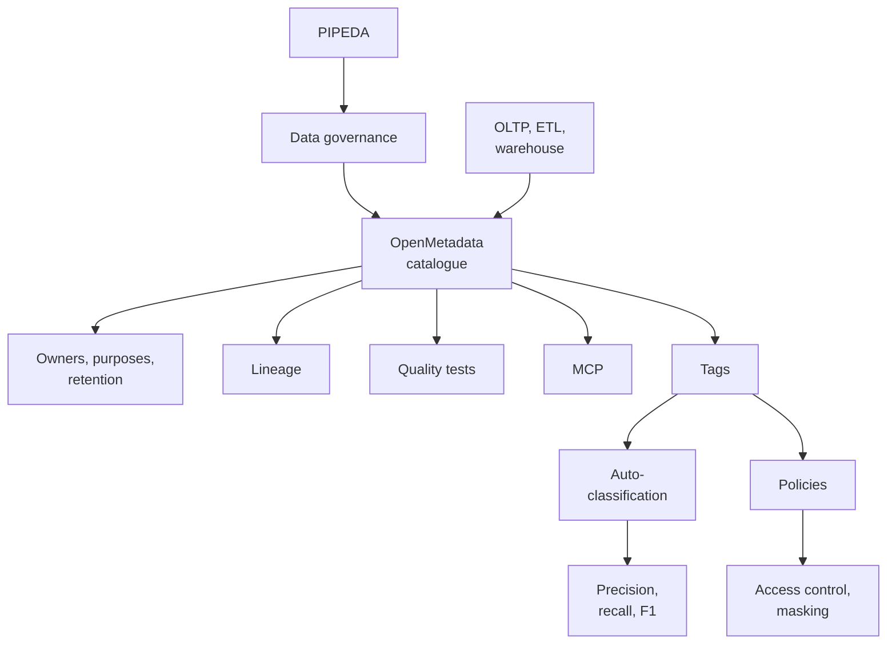

# Appendix: terminology, jargon and acronyms

Every term used in the proposal, the POC, the docs and the walkthrough, in plain language. Grouped by topic; the acronym index at the end points back here.

**How to use it:** while you work through the POC, keep sections A–F open. For the report, the team may build its own glossary appendix from this. Rewrite the definitions in your own words and cite a source for any definition you take from one (the course AI rules apply).

---

**How the main ideas connect:**

## Contents

- [A. Canadian banking, regulation and law](#a-canadian-banking-regulation-and-law)
- [B. PIPEDA's ten principles (and the POC control for each)](#b-pipedas-ten-principles-and-the-poc-control-for-each)
- [C. Privacy and personal-information concepts](#c-privacy-and-personal-information-concepts)
- [D. Data, databases and SQL](#d-data-databases-and-sql)
- [E. Data governance and metadata](#e-data-governance-and-metadata)
- [F. OpenMetadata-specific terms](#f-openmetadata-specific-terms)
- [G. AI, ML and NLP](#g-ai-ml-and-nlp)
- [H. Evaluation and measurement](#h-evaluation-and-measurement)
- [I. Security terms](#i-security-terms)
- [J. Docker, tooling and the repo](#j-docker-tooling-and-the-repo)
- [K. Research-method and course terms](#k-research-method-and-course-terms)
- [L. POC-specific names (quick lookup)](#l-poc-specific-names-quick-lookup)
- [Acronym index](#acronym-index)

## A. Canadian banking, regulation and law

| Term | Plain meaning | Where it shows up |
|---|---|---|
| **PIPEDA** | *Personal Information Protection and Electronic Documents Act* (S.C. 2000, c. 5). Canada's federal privacy law for private-sector organisations, including banks. | Proposal ref [18]; the yardstick for the whole POC |
| **Schedule 1** | The part of PIPEDA that lists the ten fair information principles. | [`docs/pipeda-mapping.md`](https://github.com/KshitijV97/ai-powered-data-governance/blob/master/docs/pipeda-mapping.md) |
| **Fair information principles** | Ten rules, numbered 4.1–4.10, from the CSA Model Code (CAN/CSA-Q830-96). See section B. | Test names start with them (`p4_3_…`) |
| **CSA Model Code** | The Canadian Standards Association privacy code PIPEDA adopted as Schedule 1. | Background |
| **OPC** | Office of the Privacy Commissioner of Canada. Investigates PIPEDA complaints, publishes guidance. | Desjardins finding [19], consent guidelines [28], sensitive-information bulletin [29] |
| **OSFI** | Office of the Superintendent of Financial Institutions. Federal regulator of banks. | Refs [8], [16], [17] |
| **OSFI Guideline B-13** | *Technology and Cyber Risk Management* (2022). Expectations for IT and cyber controls, including data classification and access control. | Ref [17] |
| **OSFI Integrity and Security Guideline** | OSFI guidance on integrity and security, including a section on data and information. | Ref [16] |
| **OSFI Guideline E-23** | Model risk management guideline; covers AI/ML models. Relevant if the classifier is treated as a "model". | Repo docs |
| **FCAC** | Financial Consumer Agency of Canada. Consumer-protection regulator; co-authored the 2024 AI risk report with OSFI. | Ref [8] |
| **FINTRAC** | Financial Transactions and Reports Analysis Centre of Canada. Anti-money-laundering regulator; sets record-keeping periods. | `mart.aml_large_cash_txn`, retention assumption |
| **LCTR** | Large Cash Transaction Report: banks report cash deposits of $10 000 or more to FINTRAC. | Test `fintrac_lctr_min_amount` |
| **AML** | Anti-money laundering. | `femi.aml` persona, AML mart |
| **KYC** | Know your customer: verifying a customer's identity (ID documents). | Schema `core_banking.kyc` |
| **Breach of Security Safeguards Regulations** | SOR/2018-64. PIPEDA rules for reporting and recording privacy breaches. | Ref [27] |
| **RROSH** | Real risk of significant harm. The PIPEDA test for when a breach must be reported. | PIPEDA glossary in the POC |
| **Bill C-36** | Proposed federal privacy reform (2026). Treated as forthcoming, not law. | Repo docs only |
| **Quebec Law 25** | Quebec's private-sector privacy law. Out of scope. | Scope |
| **BCBS 239** | Basel Committee *Principles for Effective Risk Data Aggregation and Risk Reporting* (2013). International standard for accurate, traceable bank data. | Refs [1], [13], [14] |
| **Basel Committee (BCBS)** | Basel Committee on Banking Supervision, the international standard-setter for bank regulation, hosted by the BIS. | Ref [1] |
| **CFPB** | US Consumer Financial Protection Bureau. Fined TD Bank's US arm in 2024 for inaccurate credit reporting. | Ref [15] |
| **SEC Form 8-K, Item 1.05** | US public-company filing for material cybersecurity incidents. Source for the 2026 Community Bank AI incident. | Ref [9] |
| **Desjardins breach** | 2019 insider breach affecting about 9.7 million people; OPC found accountability, access-control and retention failures. | Ref [19] |
| **ISO/IEC 27701** | International standard for privacy information management systems. | Ref [30] |
| **ISO/IEC 42001** | International standard for AI management systems. | Ref [31] |
| **Federally regulated financial institution (FRFI)** | Banks and other institutions OSFI supervises. | Ref [8] |

---

## B. PIPEDA's ten principles (and the POC control for each)

| # | Principle | Plain meaning | POC control | POC status |
|---|---|---|---|---|
| 4.1 | Accountability | Someone named is responsible for personal information. | Privacy Office team; CPO owns the classification; every table has an owner | Implemented |
| 4.2 | Identifying purposes | Say why you collect data, before or when you collect it. | `PIPEDAPurpose` tags; data contract | Implemented |
| 4.3 | Consent | Get consent; respect withdrawal. | Consent DQ tests; consent row filter | Gap detected (55) |
| 4.4 | Limiting collection | Collect only what you need. | HighRisk inventory; no-CVV test | Gap detected (1 239) |
| 4.5 | Limiting use, disclosure and retention | Use only for stated purposes; delete when no longer needed. | `retentionPeriod`; retention test on OLTP and warehouse | Gap detected (38 + 38) |
| 4.6 | Accuracy | Keep data accurate and up to date. | Format and uniqueness tests | Gap detected (17; e-mail rule) |
| 4.7 | Safeguards | Protect data according to its sensitivity. | Tag-based policies; generated masked views | Implemented (POC scope) |
| 4.8 | Openness | Make your privacy practices available. | Approved PIPEDA glossary | Implemented |
| 4.9 | Individual access | People can ask what you hold about them and where it went. | Column lineage; MCP lineage query | Partial |
| 4.10 | Challenging compliance | People can complain; you must have a process. | Recognizer-feedback workflow; audit trail | Partial (internal only) |

"Gap detected" is the *good* outcome: the defect was planted, and the control found it.

---

## C. Privacy and personal-information concepts

| Term | Plain meaning |
|---|---|
| **Personal information (PI)** | Information about an identifiable individual (PIPEDA's term). Broader than PII. |
| **PII** | Personally identifiable information. US term; used by Presidio and OpenMetadata's built-in `PII` classification. |
| **Sensitive information** | PI whose exposure causes greater harm. The OPC says sensitivity depends on context, not just data type. |
| **Direct identifier** | Identifies or contacts a person on its own: name, e-mail, phone, address, postal code, date of birth. POC tag `PIPEDA.DirectIdentifier`. |
| **Quasi-identifier** | Identifies a person only in combination with other data: city, province, birth year, occupation. POC tag `PIPEDA.QuasiIdentifier`. |
| **High-risk identifier** | Exposure creates real risk of significant harm: SIN, card number, CVV, account number, government ID number. POC tag `PIPEDA.HighRisk`. |
| **SIN** | Social Insurance Number. Canada's 9-digit government identifier. |
| **CVV** | Card verification value, the 3-digit code on a card. Must not be stored after a payment is authorised. Planted in `core.card`. |
| **PAN** | Primary account number: the long number on a payment card. |
| **Transit number** | Five-digit Canadian bank branch number. Column `transit_number`. |
| **FSA** | Forward sortation area: the first 3 characters of a Canadian postal code (e.g., `K1N`). The warehouse keeps only this, as data minimisation. |
| **Consent / express consent / withdrawal** | Agreement to use data for a purpose; express means explicitly given; withdrawal means taking it back, which must be honoured. |
| **Purpose limitation** | Using data only for the reasons stated when collected. |
| **Data minimisation** | Keeping only the data you need, at the least detailed level that works (FSA instead of full postal code). |
| **Retention period** | How long data may be kept. POC assumption: 7 years after the relationship ends. |
| **Purge** | Permanently deleting data that has passed its retention period. |
| **Pseudonymisation** | Replacing an identifier with a code (e.g., a hash). Still personal information because it can be reversed or linked. |
| **Anonymisation** | Changing data so it can no longer identify anyone. Hard to achieve (ref [25]). |
| **Hash / md5** | A one-way function that turns a value into a fixed-length code. md5 is weak: common values can be guessed by dictionary attack. A keyed hash or tokenisation is better. |
| **Tokenisation** | Replacing a sensitive value with a random token stored in a secure vault. |
| **Masking** | Hiding all or part of a value when displaying it. |
| **k-anonymity** | A privacy model where each record is indistinguishable from at least k−1 others on quasi-identifiers (ref [24]). |
| **Re-identification** | Working out who an "anonymous" record belongs to by combining data (ref [25]). |
| **Privacy by design** | Building privacy controls into systems from the start. |

---

## D. Data, databases and SQL

| Term | Plain meaning |
|---|---|
| **Relational database** | Data stored in tables (rows and columns) linked by keys. |
| **PostgreSQL (Postgres)** | Open-source relational database. Used for the bank and for OpenMetadata's own store. |
| **Schema (database)** | A named folder of tables inside a database (`core`, `kyc`, `ops`, `dw`, `mart`). |
| **Schema (structure)** | The design of tables and columns. Context tells you which meaning. |
| **Table / row / column** | A grid of data / one record / one field. |
| **Primary key (PK)** | Column that uniquely identifies a row (`customer_id`). |
| **Foreign key (FK)** | Column that points to another table's primary key (`account.customer_id`). |
| **SQL** | Structured Query Language, used to read and change relational data. |
| **SELECT / WHERE / JOIN** | Read columns / filter rows / combine tables on a matching key. |
| **INSERT … SELECT** | Copy the result of a query into another table. How the POC's ETL loads the warehouse. |
| **View** | A saved query that behaves like a table. The POC's masked views are views. |
| **GRANT / REVOKE** | SQL commands that give or remove a database user's permissions. |
| **Role (database)** | A database login or permission group (`marketing_analyst`, `om_reader`). |
| **DDL** | Data definition language: SQL that creates tables (`CREATE TABLE`). Files in [`poc/bank-db/init/sql/`](https://github.com/KshitijV97/ai-powered-data-governance/tree/master/poc/bank-db/init/sql). |
| **DML** | Data manipulation language: SQL that changes rows (`INSERT`, `UPDATE`, `DELETE`). |
| **Regex (regular expression)** | A text pattern, e.g. for a postal code `[A-Z]\d[A-Z] \d[A-Z]\d`. Used in recognizers and format tests. |
| **Luhn checksum** | Simple check-digit formula used by card numbers and SINs. OpenMetadata OSS cannot run it in recognizers. |
| **OLTP** | Online transaction processing: the operational system that records day-to-day activity. POC: `core_banking` (10 tables). |
| **OLAP** | Online analytical processing: systems built for reporting and analysis. POC: `bank_dw` (9 tables). |
| **Data warehouse** | Central analytical database fed from operational systems. |
| **Star schema** | Warehouse design with a central fact table joined to dimension tables. |
| **Fact table** | Records events or measurements (`fact_transaction`). |
| **Dimension table** | Describes the who/what/where of facts (`dim_customer`, `dim_account`, `dim_date`). |
| **Kimball** | Ralph Kimball's widely used dimensional-modelling method for star schemas. |
| **Data mart** | Subject-specific slice of the warehouse (`mart.marketing_campaign_audience`, `mart.aml_large_cash_txn`, `mart.monthly_branch_activity`). |
| **ETL** | Extract, transform, load: copy data from source, reshape it, load it into the target. POC: [`etl_to_dw.py`](https://github.com/KshitijV97/ai-powered-data-governance/blob/master/poc/toolbox/poc/etl_to_dw.py). |
| **ELT** | Same steps, but transform after loading into the warehouse. |
| **Data pipeline** | Any automated flow that moves and transforms data (ETL is one kind). |
| **Batch job** | A pipeline that runs on a schedule (e.g., nightly) rather than continuously. |
| **Legacy system / legacy import** | Old system or data still in use. POC: `ops.legacy_member_import` with meaningless column names `fld_01…fld_04`. |
| **Synthetic data** | Generated data that represents no real person. |
| **Seed (random)** | Starting number for a random generator; same seed → same data. POC: `5301`. |
| **Data quality** | How well data fits its intended use. IBM's six dimensions: accuracy, completeness, consistency, timeliness, uniqueness, validity (ref [10]). |
| **Data validation** | Checking data against rules before it is used (ref [12]). |
| **Data reconciliation** | Comparing two copies of data to make sure they agree. |
| **Planted defect** | A deliberate problem in the synthetic data, used to test whether controls catch it. |

---

## E. Data governance and metadata

| Term | Plain meaning |
|---|---|
| **Data governance** | The decision rights, roles, policies and processes that control how data is managed and used. A system of people and rules, not just a tool. |
| **Metadata** | Data about data: table names, column types, owners, tags, descriptions, lineage. |
| **Data catalogue** | Searchable inventory of an organisation's data assets and their metadata. OpenMetadata is one. |
| **Data lineage** | Record of where data came from and where it goes. **Column-level lineage** traces individual columns. In the POC, lineage was declared by our code from the ETL mappings, not discovered automatically. |
| **Provenance** | Origin and history of a piece of data; close cousin of lineage (ref [39]). |
| **Data owner** | Team or person accountable for a dataset. |
| **Data steward** | Person responsible for day-to-day data quality and correct classification. POC: `dan.steward`. |
| **CPO** | Chief Privacy Officer. Accountable for PIPEDA compliance. POC: `priya.cpo`. |
| **CDO** | Chief Data Officer. |
| **Domain** | Business area that owns data (RetailBanking, RiskCompliance, Marketing). |
| **Data product** | A curated set of data assets published for a specific use (Customer360, FINTRACLargeCashReporting, EmailCampaignAudience). |
| **Business glossary** | Agreed definitions of business terms. POC: 13-term PIPEDA glossary, approved by the CPO. |
| **Data contract** | Machine-readable agreement about a dataset: owner, purpose, terms of use, quality rules, security, SLA. POC: one on the marketing mart. |
| **SLA** | Service-level agreement (e.g., refreshed daily). |
| **Tier** | OpenMetadata label for how business-critical a table is. |
| **Policy as code** | Writing governance rules as code so they can be versioned, tested and applied automatically. |
| **Collibra / Apache Atlas / Amundsen** | Other governance or catalogue tools. Not tested; mentioned only for context (refs [21], [22], [38]). |

---

## F. OpenMetadata-specific terms

| Term | Plain meaning |
|---|---|
| **OpenMetadata** | Open-source metadata and governance platform: catalogue, lineage, data quality, classification, workflows, MCP server. POC uses **2.0.5**. |
| **OSS** | Open-source software. "OpenMetadata OSS" means the free edition, not the commercial one. |
| **Collate** | The company behind OpenMetadata; sells a commercial edition with extra AI features. |
| **Service (OpenMetadata)** | A registered connection to a data source. POC has two: `borealis_core_banking_oltp` and `borealis_enterprise_dw_olap`. |
| **Connector** | The code that reads a given source type (Postgres connector). |
| **Ingestion** | Reading databases, schemas, tables and columns into the catalogue (`metadata ingest`). |
| **Workflow YAML** | Configuration file that tells the `metadata` CLI what to do. Generated into `poc/work/workflows/`. |
| **`metadata` CLI** | OpenMetadata's command-line tool: `ingest`, `classify`, `profile`, `test`. Runs in the `om-cli` container. |
| **Profiler** | Computes column statistics (counts, nulls, min/max, distinct values) (`metadata profile`). |
| **Sample data** | A few example rows stored in the catalogue for preview. A privacy risk in itself, which is why access to it is restricted. |
| **Classification** | A family of tags (e.g., `PIPEDA`, `PIPEDAPurpose`, built-in `PII`). |
| **Tag** | A label from a classification on a table or column (e.g., `PIPEDA.HighRisk`). |
| **Mutually exclusive classification** | Only one tag from that family can be on an asset at a time. |
| **Label type: Automated / Manual** | Whether a tag was applied by the AI or by a person. |
| **Tag state: Suggested / Confirmed** | AI tags start as suggestions until a person confirms them. |
| **Auto-classification** | OpenMetadata's AI feature: samples values, runs recognizers, applies tags (`metadata classify`). |
| **Recognizer** | A detection rule attached to a tag: a regex pattern, a column-name pattern, context words, or an NER entity type. |
| **Context words** | Words near a value or in a column name that raise the recognizer's confidence (e.g., `sin`, `social`, `postal`). |
| **Confidence threshold** | Minimum score to apply a tag. POC: 0.6. |
| **Conflict resolution: highest_priority** | When several tags match, the one with the highest priority wins (HighRisk 100 > DirectIdentifier 80 > QuasiIdentifier 50 > Financial 40). |
| **Exception list** | Columns a recognizer must skip, added when a CPO approves steward feedback. |
| **Recognizer feedback** | Built-in workflow where a steward reports a wrong tag and a reviewer approves the correction. |
| **Roll-up** | Copying a table's most sensitive column tag to the table itself. Needed because one policy endpoint checks only table tags. |
| **Policy / rule / condition** | OpenMetadata access rules. A rule allows or denies operations on resources when a condition holds. |
| **`matchAnyTag()`** | Policy condition function: true if the asset has any listed tag. |
| **Role (OpenMetadata)** | A bundle of policies assigned to users (`PrivacyOfficer`, `MarketingAnalyst`). |
| **Team / BusinessUnit** | Organisational groups; a policy on the BusinessUnit applies to everyone in it. |
| **Persona** | A user profile representing a job function. |
| **Task** | A to-do item a workflow assigns to a reviewer (approve a term, approve feedback). Resolved tasks form the audit trail. |
| **Governance workflow** | Built-in process with human tasks: `GlossaryTermApprovalWorkflow`, `RecognizerFeedbackReviewWorkflow`. |
| **Ingestion bot** | Service account whose token lets the CLI push metadata. |
| **JWT** | JSON Web Token, the login token sent with each API call. |
| **REST API** | The web API (HTTP GET/PUT/PATCH/POST) our Python uses to configure OpenMetadata. |
| **HTTP 200 / 403** | Request allowed / forbidden. Used in the access-control tests. |
| **Permission debugger** | OpenMetadata UI tool that predicts whether a user can do something; disagreed with the actual endpoint in the POC (limitation 3). |
| **Test case / test suite / test definition** | A single data-quality check / a group of checks / the reusable type of check (e.g., `columnValuesToMatchRegex`, `tableCustomSQLQuery`). |
| **Incident** | Record OpenMetadata opens when a DQ test fails. |
| **Knowledge graph** | OpenMetadata 2.0's linked view of assets and their relationships, used as AI context. |
| **Airflow** | Scheduler OpenMetadata normally uses to run ingestion; switched off in the POC to save memory. |
| **Elasticsearch** | Search engine behind the OpenMetadata UI. |

---

## G. AI, ML and NLP

| Term | Plain meaning |
|---|---|
| **AI-assisted development** | Using AI tools (e.g., GitHub Copilot, ChatGPT, Claude) to write, debug or migrate code. The risk the proposal starts from. |
| **Generative AI** | AI that produces text, code or images. |
| **LLM** | Large language model: the kind of generative AI behind coding assistants. |
| **Text-to-SQL / LLM-generated SQL** | An LLM writing SQL from a description. Can execute and still return wrong results (ref [7]). |
| **Metamorphic testing / prompting** | Checking outputs by comparing results of related inputs instead of knowing the right answer (ref [7]). |
| **Microsoft Presidio** | Open-source library for detecting and anonymising PII; powers OpenMetadata's auto-classification (ref [45]). |
| **spaCy** | Open-source NLP library; supplies the pre-trained language model Presidio uses. |
| **NLP** | Natural language processing. |
| **NER** | Named-entity recognition: finding names of people, places and organisations in text. Why spaCy wrongly tagged `city` columns. |
| **Pre-trained model** | A model trained by someone else and reused as is. |
| **Pattern recognizer** | Rule-based detector using regex, not machine learning. |
| **MCP** | Model Context Protocol: open standard for connecting AI assistants to external tools and data. |
| **MCP server / client / tool** | The service exposing tools (OpenMetadata at `/mcp`) / the AI app connecting to it (Claude, Cursor) / a callable function (`search_metadata`, `patch_entity`). |
| **JSON-RPC** | The simple request/response message format MCP uses. |
| **AI agent** | An AI system that takes actions through tools, not just answers. |
| **Least privilege** | Give a user or agent only the permissions it needs. Key MCP mitigation. |
| **Automation bias** | Over-trusting automated suggestions (refs [32], [33]). Reason human review must be designed, not assumed. |
| **Human-in-the-loop (HITL)** | A person reviews or approves an automated decision before it takes effect. |
| **Human oversight** | Broader: people monitor, can override and are accountable for automated systems. |
| **Hallucination** | An AI confidently producing something false (e.g., a fake citation). Why every AI-suggested source must be verified. |
| **AI governance** | Organisational structures and processes for responsible AI use (refs [34], [35]). |
| **Semantic search / embeddings** | Search by meaning using numeric vectors of text. Exists in OpenMetadata; not central to the POC. |

---

## H. Evaluation and measurement

| Term | Plain meaning | POC example |
|---|---|---|
| **Ground truth** | The known correct answer used for scoring. | Hand-labelled sensitivity of all 145 columns ([`ground_truth.py`](https://github.com/KshitijV97/ai-powered-data-governance/blob/master/poc/toolbox/poc/ground_truth.py)) |
| **Labels H / D / Q / F / N** | High-risk / Direct identifier / Quasi-identifier / Financial / Not personal. | 7 H + 18 D = 25 positives |
| **Positive class** | What counts as "should be flagged". | H or D |
| **True positive (TP)** | Flagged and really sensitive. | 18 at baseline |
| **False positive (FP)** | Flagged but not sensitive (false alarm). | 3 `city` columns |
| **False negative (FN)** | Sensitive but missed. The dangerous one: it gets no protection and nobody notices. | 7 at baseline |
| **True negative (TN)** | Not flagged and not sensitive. | |
| **Precision** | TP / (TP + FP): of what was flagged, how much was right. | 0.857 → 0.893 → 1.000 |
| **Recall** | TP / (TP + FN): of what is sensitive, how much was found. | 0.720 → 1.000 → 1.000 |
| **F1 score** | 2 × P × R / (P + R): one number balancing precision and recall. | 0.783 → 0.943 → 1.000 |
| **High-risk recall** | Share of the 7 high-risk columns found. | 4/7 → 7/7 → 7/7 |
| **Exact-class accuracy** | Does the 5-level tag match the 5-level label exactly. | Has a known scoring bug (see [`docs/testing.md`](https://github.com/KshitijV97/ai-powered-data-governance/blob/master/docs/testing.md)) |
| **Held-out set** | Data kept aside and never used for tuning, to test generalisation. Not used in the POC (a limitation). | |
| **Generalisation** | Whether results hold on new, unseen data. | |
| **Overfitting** | Tuning so closely to test data that it does not work elsewhere. | Risk for the 1.000 |
| **Reproducibility** | Anyone can re-run and get the same numbers. | One command, fixed seed |
| **Fail open / fail closed** | When a control misses something, it lets it through / blocks it. | Tag-driven safeguards fail open |

---

## I. Security terms

| Term | Plain meaning |
|---|---|
| **CIA triad** | Confidentiality, integrity, availability: the three goals of information security (ref [16]). |
| **Access control** | Rules for who can see or change what. |
| **RBAC** | Role-based access control: permissions attached to roles. |
| **ABAC / tag-based access control** | Permissions based on attributes such as tags. The POC's policies are tag-based. |
| **Need-to-know** | Access only to the data your job needs. |
| **Data segregation** | Keeping sensitive data separate. A Desjardins failure. |
| **Audit trail / audit log** | Record of who did what and when. |
| **Tamper-evident** | An audit log that shows if it has been altered. OpenMetadata's task history is not, unless exported. |
| **DLP** | Data-loss prevention: tools that stop sensitive data leaving the organisation. |
| **Encryption at rest / in transit / in use** | Protecting data while stored / sent over a network / processed. |
| **Insider threat** | Harm caused by someone with legitimate access (Desjardins). |
| **Shadow AI** | Staff using unapproved AI tools with company data (the Community Bank incident, ref [9]). |
| **Attack surface** | Everything an attacker could target. The catalogue is a map of sensitive data, so it adds to the attack surface. |
| **Token (access)** | Credential that lets a user, bot or AI agent call an API. |
| **Superuser** | Database user with all permissions (`postgres`). |

---

## J. Docker, tooling and the repo

| Term | Plain meaning |
|---|---|
| **Docker** | Runs software in isolated **containers**, so nobody has to install it locally. |
| **Image** | Packaged software template a container starts from (`postgres:16-alpine`, `openmetadata/ingestion:2.0.5`). |
| **Container** | A running instance of an image. |
| **Docker Compose** | Starts several containers together from a YAML file. |
| **Compose overlay** | A second compose file that adds or overrides services without editing the first. POC: [`docker-compose.poc.yml`](https://github.com/KshitijV97/ai-powered-data-governance/blob/master/poc/docker-compose.poc.yml) over the official file. |
| **Profile (compose)** | Optional group of services started only on request (`tools`, `airflow`). |
| **Volume** | Storage that survives container restarts. [`reset.sh`](https://github.com/KshitijV97/ai-powered-data-governance/blob/master/poc/scripts/reset.sh) deletes them. |
| **Port mapping** | Exposes a container port on your machine: 8585 (OpenMetadata UI), 15432 (bank database). |
| **`.env` file** | Local configuration values (passwords, memory, seed). Copied from [`.env.example`](https://github.com/KshitijV97/ai-powered-data-governance/blob/master/poc/.env.example). |
| **Idempotent** | Running it twice gives the same result. POC steps are, so `--from N` is safe. |
| **[`run_poc.sh`](https://github.com/KshitijV97/ai-powered-data-governance/blob/master/poc/scripts/run_poc.sh) / [`dc.sh`](https://github.com/KshitijV97/ai-powered-data-governance/blob/master/poc/scripts/dc.sh) / [`reset.sh`](https://github.com/KshitijV97/ai-powered-data-governance/blob/master/poc/scripts/reset.sh)** | Run everything / wrapper for docker compose / delete everything (including [`poc/results/`](https://github.com/KshitijV97/ai-powered-data-governance/tree/master/poc/results)). |
| **toolbox** | Our Python container that runs `python -m poc.<module>`. |
| **pytest / unit test / integration test** | Python test runner / tests of single functions / tests of a completed run's outputs. Different from the PIPEDA DQ tests. |
| **CI (GitHub Actions)** | Automatically runs tests on every push. |
| **Ruff / pre-commit** | Python linter / Git hook that runs checks before each commit. |
| **Git / branch / commit / PR** | Version control / parallel line of work / saved change / pull request for review. |
| **Mermaid** | Text-to-diagram syntax used in the docs. |
| **LaTeX / IEEEtran / Tectonic** | Document typesetting system / IEEE paper template / LaTeX compiler. Used by the draft in [`report/`](https://github.com/KshitijV97/ai-powered-data-governance/tree/master/report). |

---

## K. Research-method and course terms

| Term | Plain meaning |
|---|---|
| **POC / PoC** | Proof of concept: a small working build that tests whether an idea works. Not a production system. |
| **Research question (RQ) / sub-question (SQ)** | The main question the report answers / the smaller questions under it. |
| **Scope / assumptions / boundaries** | What is in / what is taken as given / where the study stops. |
| **Search log** | Record of each database, query string, date and number of hits. Required by the course. |
| **Search string / Boolean operators** | The exact query, combined with AND / OR / NOT. |
| **Inclusion / exclusion criteria** | Rules for keeping or dropping a source. |
| **Screening register** | Record of which sources were kept or dropped and why. |
| **Evidence table / evidence map** | Table of sources with type, focus, key finding, relevance, limitation and theme. |
| **Coding (qualitative)** | Tagging each source with themes. Not programming. |
| **Theme** | A recurring idea across sources. The proposal has five (4.1–4.5). |
| **Synthesis** | Combining sources to show agreement, disagreement, patterns and gaps, rather than summarising them one by one. Worth 30% of the report mark. |
| **Triangulation** | Checking a claim against several kinds of evidence (literature, regulation, POC). |
| **Evidence gap** | Something the evidence does not yet show (e.g., how often AI-generated pipeline errors occur in Canadian banks). |
| **Grey literature** | Non-peer-reviewed but credible sources: regulator reports, technical docs, standards. |
| **Peer-reviewed** | Checked by independent experts before publication. |
| **Generalisability** | Whether findings apply beyond the study's setting. |
| **Stakeholder** | Anyone affected: customers, banks, developers, regulators, shareholders. |
| **Risk register** | Table of project risks with likelihood, impact and mitigation. |
| **Executive summary** | One-page overview a decision-maker can act on. |
| **APA / IEEE citation style** | Author–date style (APA, which the course asks for in the final report) / numbered style (IEEE, used in the proposal). |
| **AI-use statement** | Required disclosure of AI tool, date, purpose and how the output was verified. |

---

## L. POC-specific names (quick lookup)

| Name | What it is |
|---|---|
| Borealis Bank of Canada | The fictional bank |
| `core_banking` | OLTP database (schemas `core`, `kyc`, `ops`) |
| `bank_dw` | Warehouse database (schemas `dw`, `mart`, plus generated `governed_*`) |
| `core.customer`, `core.account`, `core.card`, `core.transaction`, `core.customer_consent`, `core.branch` | Main OLTP tables |
| `kyc.identity_document` | Driver's licence / passport numbers |
| `ops.support_ticket.agent_notes` | Free-text notes containing PI |
| `ops.legacy_member_import` (`fld_01…fld_04`) | Hidden name, SIN, postal code under meaningless names |
| `ops.fx_rate` | Exchange rates; a non-personal control table |
| `dw.dim_customer`, `dw.dim_account`, `dw.dim_consent`, `dw.fact_transaction` | Warehouse star schema |
| `governed_marketing_analyst`, `governed_fraud_analyst` | Generated schemas of masked views per role |
| `PIPEDA` classification | HighRisk, DirectIdentifier, QuasiIdentifier, Financial, NonPersonal |
| `PIPEDAPurpose` classification | AccountServicing, RegulatoryReporting, FraudPrevention, Marketing, Analytics |
| `PIPEDASafeguardsNeedToKnow` | Policy: marketing analysts denied sample data on HighRisk/DirectIdentifier tables |
| `PIPEDAClassificationIntegrity` | Policy on the whole bank: only Privacy Office / Data Governance Office may edit tags on PIPEDA-tagged tables |
| `p4_3_consent_not_withdrawn` etc. | DQ test names start with the PIPEDA principle number |
| `P7Y`, `P90D`, `P0D` | ISO 8601 durations: 7 years, 90 days, 0 days (retention values) |
| [`classify_with.py`](https://github.com/KshitijV97/ai-powered-data-governance/blob/master/poc/om-ext/classify_with.py) | Our workaround for the hard-coded `PII` filter |
| [`enforce_from_catalog.py`](https://github.com/KshitijV97/ai-powered-data-governance/blob/master/poc/toolbox/poc/enforce_from_catalog.py) | Generates masked views and grants from catalogue tags |

---

## Acronym index

AML · ABAC · API · BCBS · CDO · CFPB · CI · CIA · CLI · CPO · CSA · CVV · DDL · DLP · DML · DQ · DW · ELT · ETL · FCAC · FINTRAC · FK · FN · FP · FRFI · FSA · HITL · HTTP · ISO/IEC · JWT · KYC · LCTR · LLM · MCP · ML · NER · NLP · OLAP · OLTP · OPC · OSFI · OSS · PAN · PI · PII · PIPEDA · PK · POC · RBAC · REST · RQ · RROSH · SEC · SIN · SLA · SQ · SQL · TN · TP · YAML

(YAML: a human-readable configuration file format. API: application programming interface. CLI: command-line interface. DQ: data quality. DW: data warehouse. ML: machine learning.)
