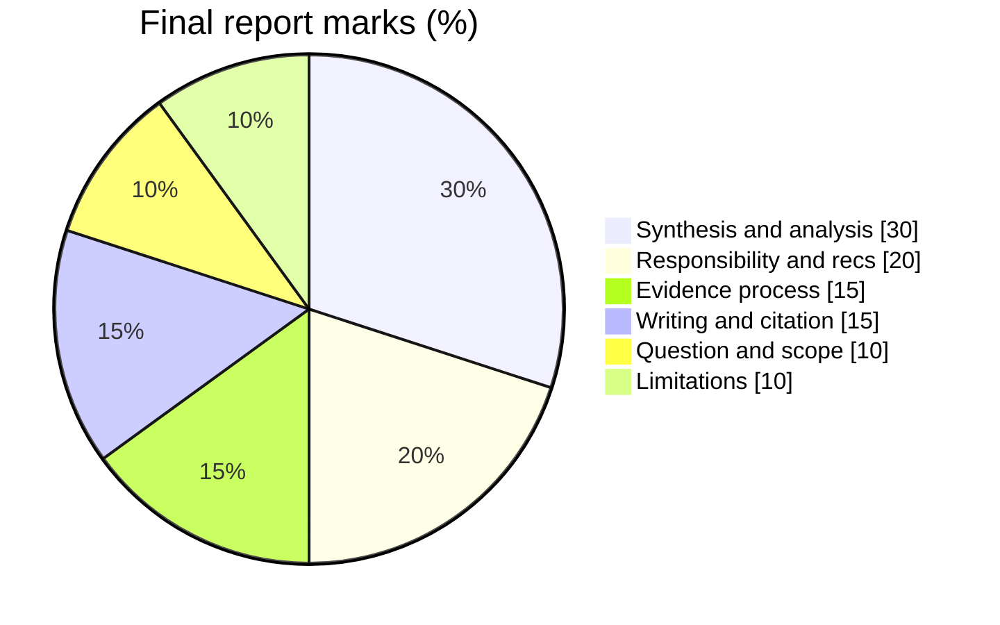

# Final Report: Drafting Content Pack

**GNG/ELG 5301 Team 2. Raw material for the team to write the report itself**  
_Prepared 20 November 2026. Report due 9 December 2026, 11:59 PM_

## Contents

- [0. Read this first](#0-read-this-first)
- [1. Rubric and structure](#1-rubric-and-structure)
- [2. Executive summary (section 1)](#2-executive-summary-section-1)
- [3. Introduction and problem context (section 2)](#3-introduction-and-problem-context-section-2)
- [4. Research question and scope (section 3)](#4-research-question-and-scope-section-3)
- [5. Method / evidence process (section 4), 15% criterion](#5-method--evidence-process-section-4-15-criterion)
- [6. Literature / evidence synthesis (section 5), part of the 30% criterion](#6-literature--evidence-synthesis-section-5-part-of-the-30-criterion)
- [7. Analysis (section 6), the most important part](#7-analysis-section-6-the-most-important-part)
- [8. Professional responsibility implications (section 7)](#8-professional-responsibility-implications-section-7)
- [9. Recommendations (section 8), part of the 20% criterion](#9-recommendations-section-8-part-of-the-20-criterion)
- [10. Limitations (section 9), 10% criterion](#10-limitations-section-9-10-criterion)
- [11. Visuals available](#11-visuals-available)
- [12. Evidence appendix (section 11): checklist](#12-evidence-appendix-section-11-checklist)
- [13. AI-use statement: what it must contain](#13-ai-use-statement-what-it-must-contain)
- [14. Final pre-submission checklist (course guideline §20)](#14-final-pre-submission-checklist-course-guideline-20)

## 0. Read this first

### 0.1 What this pack is and is not

- **It is:** a working file of facts, numbers, source pointers, rubric requirements and open questions, organised by report section.
- **It is not:** report text. Nothing here is written to be pasted. Every sentence in the report must be written by the team.
- **Why:** the course guidelines (section 17) say AI may support brainstorming, language editing, format checking and alternative explanations, but **cannot replace student analysis, source evaluation, professional judgment, interpretation or authorship**. The "Questions the team must answer" boxes in each section are exactly the parts graders reward and AI must not do for you.
- **Your obligations:** verify every fact, number and citation in this pack against its source before using it; declare AI use (section 13 of this pack lists what the statement must cover).

### 0.2 Decisions to make before anyone writes

| # | Issue | Why it matters | Options | Decide by |
|---|---|---|---|---|
| D1 | **Research question.** The submitted proposal asks how banks can use governance frameworks such as OpenMetadata to manage *data security and validation risks of AI-assisted pipeline development*. The repo README and [`report/main.tex`](https://github.com/KshitijV97/ai-powered-data-governance/blob/master/report/main.tex) use a different, PIPEDA-focused question. | "Question and scope" is 10% of the mark; the grader will compare with the proposal. | (a) Keep the proposal question and present PIPEDA as the regulatory yardstick (lowest risk). (b) Refine the question and explain the refinement in the Method section. | Team, at the sync |
| D2 | **Citation style.** Course guideline section 15 asks for APA in the final report. The proposal used IEEE numbering. | Part of the 15% "citation" criterion. | Ask the professor/TA, or switch to APA. | This week |
| D3 | **The existing draft in [`report/main.tex`](https://github.com/KshitijV97/ai-powered-data-governance/blob/master/report/main.tex).** It was prepared with generative-AI assistance. | Submitting it, or paraphrasing it closely, would break the authorship rule. | Treat it as a list of facts only, or do not open it. Write fresh. | Before writing starts |
| D4 | **How the POC relates to "AI-assisted development".** The planted ETL bug was written by us to *simulate* an AI-generated SQL error; no AI wrote the buggy ETL. | Overclaiming is an integrity and limitations risk. | State clearly in Method and Limitations that the defect is simulated. | Today |
| D5 | **Page budget and owners** per section (see 1.2). | 12–15 pages excluding references and appendices. | Assign at the sync. | At the sync |

## 1. Rubric and structure

### 1.1 What is graded

| Criterion | Weight | What earns marks (from the course guidelines) |
|---|---|---|
| Question and scope | 10% | Focused question; clear in/out of scope; assumptions; boundaries |
| Transparent evidence process | 15% | Documented search strategy, search log, screening decisions, evidence organisation, coding categories |
| Synthesis and analysis | 30% | Organised by themes, patterns, relationships, disagreements, risks, gaps; judgment, not source-by-source summary |
| Responsibility implications and actionable recommendations | 20% | Ethics, privacy, security, accountability, professional obligations; specific, realistic actions with who/what/when |
| Limitations | 10% | Honest evidence, scope, method, data and generalisability limits, explained |
| Organization, writing, citation, visuals | 15% | Professional structure, readable for a non-specialist, consistent citations, interpreted and cited visuals |

The rubric note: *50 references are not automatically better than 25 excellent ones; what matters is a defensible argument.*

### 1.2 Required structure and a suggested page budget

| # | Section (required by guideline §15) | Suggested pages | Owner (fill in) |
|---|---|---|---|
| 1 | Executive summary | 1 | |
| 2 | Introduction and problem context | 1.5 | |
| 3 | Research question and scope | 0.75 | |
| 4 | Method / evidence process | 1.5 | |
| 5 | Literature / evidence synthesis | 3 | |
| 6 | Analysis | 2.5 | |
| 7 | Professional responsibility implications | 1.5 | |
| 8 | Recommendations | 1.5 | |
| 9 | Limitations | 1 | |
| 10 | References (APA) | not counted | |
| 11 | Evidence appendix | not counted | |
| | **Total** | **14.25** | |

Sections 5 + 6 + 7 + 8 carry 50% of the mark between them; give them the most pages and the best writers.

## 2. Executive summary (section 1)

**Rubric asks for:** the problem, the research question, major findings, key implications, most important recommendations. A decision-maker should get the whole message from this page.

**Raw material:**

- Problem: AI coding tools are used to build and modernise bank data pipelines; AI-generated SQL can execute yet return wrong results [7]; data quality and security failures already cost banks (TD Bank US$28M [15]; Desjardins 9.7M people [19]); OSFI–FCAC flag data quality, privacy and governance as AI risks [8].
- RQ: proposal section 2 (decide D1).
- Method: literature and regulatory review + POC on OpenMetadata 2.0.5 with a synthetic bank (1 500 customers, 19 tables, 145 columns).
- Headline numbers: classification F1 0.783 → 0.943 → 1.000; 6 of 12 PIPEDA DQ tests failed, catching all 5 planted defects (55 / 1 239 / 38 + 38 / 17) and one wrong rule; 7/7 catalogue and 7/7 warehouse access checks as expected; 6 product limitations.

**Questions the team must answer (write these yourselves):**

- In one sentence, what is our answer to the RQ?
- Which two or three recommendations matter most, and to whom?
- Write this section **last**.

## 3. Introduction and problem context (section 2)

**Rubric asks for:** the problem, context, significance, stakeholders, objectives.

**Raw material already in the proposal (sections 1.1–1.4):** banking data infrastructure [1], [2]; AI-assisted development [3]–[6]; data quality dimensions [10]–[12]; BCBS 239 [1], [13], [14]; TD Bank [15]; OSFI–FCAC [8]; OSFI on data security [16], [17]; PIPEDA [18]; Desjardins [19]; AI-related security risk and the 2026 Community Bank incident [9]; limits of existing practice [8], [20].

**Stakeholders (proposal 1.3):** customers; banks; software developers and data engineers; regulators (OSFI, OPC); shareholders and investors. Consider adding: privacy officers and data stewards (the POC shows they carry the review workload); AI-tool vendors.

**Objectives (from proposal section 7):** evaluate which security and validation risks governance tools mitigate, which need extra controls or human oversight, and turn that into recommendations.

**Questions the team must answer:**

- What changed since the proposal? (The POC is now finished; feedback received on the proposal, if any.)
- Does the TD Bank example support our argument, or only show that data quality matters? (The proposal itself notes it does not show AI caused the errors.) Keep that caveat.
- Shorten: the proposal's problem section is about 3 pages; the report can afford about 1.5.

## 4. Research question and scope (section 3)

**Raw material (proposal sections 2–3):**

- Primary RQ and five sub-questions: data quality and validation; data security; regulatory compliance; data governance and OpenMetadata; limitations and human oversight.
- In scope: relational data, OLTP and warehouse, OpenMetadata 2.0.5 open source, lineage, classification, quality validation, access control, monitoring, human oversight, Canadian banking.
- Out of scope: unstructured data, non-relational databases, AI model development, unrelated AI uses, production deployment, real customer data, full compliance audits, Quebec Law 25, legal advice. Collibra [21] and Apache Atlas [22] named but not tested.
- Assumptions: banks use relational databases, SQL and pipelines; AI-assisted development introduces risk; public evidence suffices; POC retention assumption of 7 years after relationship end (FINTRAC minimum is 5 for most records).

**Questions the team must answer:**

- Map each sub-question to the report section that answers it (a small table helps the grader).
- If D1 = refine, write the justification here.

## 5. Method / evidence process (section 4), 15% criterion

**Rubric asks for:** search strategy, source-selection process, evidence organisation, analytical approach, coding categories.

**Raw material:**

- Databases (proposal §5): IEEE Xplore, Scopus, uOttawa Omni, Google Scholar, ACM Digital Library, Springer (Empirical Software Engineering), Canadian regulator and government sites, official OpenMetadata docs, GitHub. The earlier proposal docx (`deliverables/Team research and project proposal_Team 2.docx`) also lists OpenAlex, Crossref, arXiv and Google Patents and contains the **search log and per-source evaluation**.
- Search terms (proposal §5): AI governance, banking, data security, data validation, AI-assisted software development, metadata, data lineage, access control, OpenMetadata; Boolean AND/OR; focus 2021–2026 plus foundational work.
- Screening criteria: relevance, credibility, publication quality, methodological limitations, applicability; priority to peer-reviewed research, official regulation, technical documentation and primary source code; exclude unsupported claims.
- Organisation: screening register and evidence-analysis table (objective, method, verified findings, limitations, theme); five themes (see section 6 of this pack).
- AI in the search: proposal states ChatGPT supported source discovery and all AI-suggested sources were independently verified.
- POC method (proposal §6.2–6.3): synthetic bank; planted defects; ten PIPEDA principles as the evaluation frame; distinguish documented features from demonstrated ones.

**POC method facts to report precisely:**

| Item | Value |
|---|---|
| Platform | OpenMetadata 2.0.5 open source, Docker Compose, official compose file unmodified plus overlay |
| Data | 1 500 synthetic customers, seed 5301; `core_banking` OLTP 10 tables; `bank_dw` warehouse 9 tables (star schema + 3 marts); 145 columns |
| Planted defects | ETL ignores consent withdrawal; stored CVVs; customers past retention; malformed postal codes; PI hidden in `fld_*` columns; PI in free-text notes |
| Ground truth | All 145 columns hand-labelled H/D/Q/F/N; positives = H or D = 25 (7 H) |
| Classifier runs | 3: built-in PII; Canada-tuned PIPEDA recognizers; tuned + steward feedback |
| Metrics | Precision, recall, F1, high-risk recall |
| DQ tests | 12 test cases across 7 suites, named after PIPEDA principles |
| Access tests | 7 catalogue (HTTP status per persona); 7 warehouse (SQL per role) |
| MCP | 4 privacy questions through 15 exposed tools |
| Reproducibility | One command ([`poc/scripts/run_poc.sh`](https://github.com/KshitijV97/ai-powered-data-governance/blob/master/poc/scripts/run_poc.sh)), about 15–20 min; evidence in [`poc/results/`](https://github.com/KshitijV97/ai-powered-data-governance/tree/master/poc/results) |

**Questions the team must answer:**

- How many sources were found, screened and kept? (Count them from your register. Do not reuse numbers from repo docs without recounting.)
- What coding categories did you actually use? Are they the proposal's five themes?
- How did you combine literature, regulation and POC evidence? (Triangulation; say how disagreements were handled.)
- Put the full search log and evidence table in the appendix; summarise here.

### 5.1 Success criteria for evaluating the tool (TA feedback)

**TA feedback:** "No success criteria are set for evaluating the tool." The report gives numbers, but it never says what result counts as success. Fix: state the criteria in §4 Method, then give the Results / Analysis table a **Met?** column.

**Draft criteria. The thresholds are suggestions; the team decides and justifies each one.**

| # | Sub-question | Criterion (suggested threshold) | Justification, independent of the result | POC result | Met? |
|---|---|---|---|---|---|
| SC1 | AI classification | High-risk recall = 100% (no SIN, card or ID column missed) | One missed HighRisk column leaves sensitive PI unprotected (PIPEDA 4.7) | Built-in 4/7 · Tuned 7/7 | Built-in **No** · Tuned Yes |
| SC2 | AI classification | Recall ≥ 0.95 and precision ≥ 0.85 over all PI columns | A miss costs more than a false alarm; a steward can clear false alarms | Built-in 0.720 / 0.857 · Tuned 1.000 / 0.893 | Built-in **No** · Tuned Yes |
| SC3 | Data quality and validation | Every planted defect is caught by at least one DQ test | Detecting AI-introduced pipeline errors is the proposal's core concern | 5/5 planted defects detected | Yes |
| SC4 | Data quality and validation | No false alarms from the DQ rules | A noisy tool gets ignored | 1 false alarm (e-mail regex rejects accented letters, 240 rows) | **Partly** |
| SC5 | Data security | 100% of access checks give the expected allow or deny | One wrong "allow" counts as a breach | Catalogue 7/7 · Warehouse 7/7 | Yes, but only with the table-level roll-up and generated views |
| SC6 | Data security | Catalogue policies reach the database with no custom code | Tests whether the tool alone enforces safeguards | Out of the box they don't; SQL users bypass them | **No** (views-and-grants workaround) |
| SC7 | Compliance | Each of the 10 PIPEDA principles has at least one demonstrated control | Coverage of the proposal §6.3 evaluation frame | 8 full, 2 partial (4.9, 4.10) | **Partly** |
| SC8 | Human oversight | Every AI tag change has a human decision and an audit record; steward feedback removes known errors | Proposal: AI must not act unsupervised | False positives 3 → 0; audit in `workflow_audit.json` | Yes |
| SC9 | AI assistant (MCP) | Answers the PIPEDA questions from catalogue facts, using least-privilege access | Usefulness and safety of the agent | 4/4 answered; write tools exposed by default | Usefulness Yes · Least privilege **No** |
| SC10 | Feasibility | Reproducible in one command on modest hardware | Adoptable by a small team | One script, about 15–20 min, 4 GB Docker VM, fixed seed 5301 | Yes |

Sources: `poc/results/summary.json`, `poc/results/pipeda_compliance_summary.md`, `docs/results.md`.

**Facts to handle carefully:**

- The criteria are being set after the results exist. The report must say so, and justify each threshold with the "Justification" column, not with the result.
- The "No" and "Partly" rows (SC1/SC2 built-in, SC4, SC6, SC7, SC9) are findings. Each should trace to a recommendation in section 8.
- 25 positive columns: one miss = 4 points of recall. The tuned and steward-feedback runs were scored on the same columns they were tuned on (no held-out set). See section 10.

**Questions the team must answer:**

- Do we accept these thresholds? Which ones would a Canadian bank's privacy office set differently, and why?
- Overall verdict rule: does the tool "succeed" only if every criterion is met, or is it success with conditions (needs tuning, workarounds and human review)?
- Where does each criterion appear in the report: §4 (definition), §6 (Met? table), §8 (recommendation per failure)?

## 6. Literature / evidence synthesis (section 5), part of the 30% criterion

**Rubric asks for:** organisation by themes, patterns, relationships, disagreements, risks, evidence gaps. **Not** source-by-source.

### 6.1 Synthesis grid: facts per theme

Fill the last column yourselves. That column is the synthesis.

| Theme (proposal §4) | Literature says | Regulation / standards say | POC shows | Agreement, tension or gap? (team) |
|---|---|---|---|---|
| T1 Data security and validation problems | Data accuracy and traceability essential [1], [10]–[13]; sensitive-data detection hard in finance, labelled data scarce [23]; anonymisation fragile [24], [25]; LLM SQL can run and be wrong [7] | BCBS 239 accuracy and reconciliation [1]; OSFI CIA of data [16] | Simulated ETL consent bug put 55 withdrawn customers in a marketing list; DQ test caught it; e-mail regex rule itself was wrong (240 rows) | |
| T2 Canadian laws and regulation | — | PIPEDA principles [18]; breach regulations [27]; meaningful consent [28]; sensitivity is contextual [29]; OSFI B-13 [17]; OSFI–FCAC AI risks [8]; ISO/IEC 27701, 42001 [30], [31] | 10 principles mapped: 4 implemented, 4 gaps detected, 2 partial; tooling supports but does not establish compliance | |
| T3 Oversight of AI-assisted development | Automation bias [32], [33]; AI code vulnerabilities [20]; secure coding with AI [4]; AI governance definitions and gaps [34], [35]; generative AI for governance [36] | OSFI–FCAC on oversight [8] | Steward + CPO review took precision 0.893 → 1.000; workflows leave an audit trail; personas were scripted, so real reviewer behaviour untested | |
| T4 Governance tools as a solution | Catalogue capabilities and limits [37]; OpenMetadata vs Amundsen [38]; provenance [39]; vendor docs on classification, policies, contracts, MCP [40]–[43] | — | Column lineage showed the same 38 past-retention customers in OLTP and warehouse; 14 tables with owner, purpose, retention; catalogue policies do not reach the database | |
| T5 Implementation findings | Presidio [45]; MCP security threats [46]; OpenMetadata source code [44] | — | F1 0.783 → 0.943 → 1.000; SINs found only via Australian TFN / US ABA patterns; `classify` hard-codes PII; MCP exposes 4 write tools | |

### 6.2 Prompts for finding relationships

- Where does the **POC confirm** a claim from the literature or docs? (e.g., [46] on MCP risk ↔ write tools observed.)
- Where does the **POC contradict or qualify** documentation? (e.g., docs describe custom-classification auto-classification; the CLI silently ignores it [44].)
- Where do **documented features differ from demonstrated ones**? (Proposal §6.3 promised this distinction.)
- What **risk keeps recurring** across themes? (Candidates: silent failure / false negatives; controls that look compliant but are not wired to data.)
- What **evidence is missing**? (Frequency of AI-generated pipeline failures in Canadian banks, flagged in proposal §4.1; real reviewer behaviour; production scale.)
- Do sources **assume** different things? (e.g., vendor docs assume tags are correct; automation-bias literature assumes reviewers miss errors.)

## 7. Analysis (section 6), the most important part

**Rubric asks for:** interpretation in relation to the RQ, showing judgment, considering alternative interpretations.

### 7.1 Evidence bank: the POC numbers and facts to build the analysis on

#### 7.1.1 AI auto-classification: how well OpenMetadata found personal information (145 columns, 25 sensitive, 7 high-risk)

| Run | Precision | Recall | F1 | TP | FP | FN | High-risk recall |
|---|---|---|---|---|---|---|---|
| Out-of-the-box PII | 0.857 | 0.720 | 0.783 | 18 | 3 | 7 | 4/7 |
| Canada-tuned PIPEDA | 0.893 | 1.000 | 0.943 | 25 | 3 | 0 | 7/7 |
| Tuned + steward feedback | 1.000 | 1.000 | 1.000 | 25 | 0 | 0 | 7/7 |

- Baseline misses: 2 × `account_number`, 2 × `date_of_birth`, `postal_code`, `identity_document.document_number`, legacy `fld_03`.
- False positives: 3 `city` columns (spaCy location NER).
- Source: `poc/results/classification_*.json`; figure [`poc/results/figures/classification_comparison.png`](https://github.com/KshitijV97/ai-powered-data-governance/blob/master/poc/results/figures/classification_comparison.png).

#### 7.1.2 Data-quality tests: which planted defects the 12 PIPEDA test cases caught

| PIPEDA | Test | Result | Rows |
|---|---|---|---|
| 4.3 | `p4_3_consent_not_withdrawn` | Failed | 55 (planted ETL bug) |
| 4.4 | `p4_4_limiting_collection_no_cvv_stored` | Failed | 1 239 (planted) |
| 4.5 | `p4_5_retention_closed_customers_purged` (OLTP) | Failed | 38 (planted) |
| 4.5 | same, warehouse | Failed | 38 (same customers, copied) |
| 4.6 | `p4_6_accuracy_postal_code_format` | Failed | 17 (planted) |
| 4.6 | `p4_6_accuracy_email_format` | Failed | 240 (rule wrong: rejects accented letters) |
| 4.3, 4.4, 4.6, FINTRAC | 6 other tests | Passed | — |

#### 7.1.3 Access control: what each persona could see in the catalogue and in the warehouse

- Catalogue: `maya.marketing` 403 on sample data of HighRisk/DirectIdentifier tables, 200 on an aggregate table; 403 on adding or removing tags on `core.customer`; AML analyst and CPO 200 with masked cells.
- Warehouse (generated views): marketing role sees md5-hashed e-mails where purpose does not match, clear e-mails on the marketing mart, 556 rows instead of 611 (withdrawn customers filtered), denied on raw `dw` schema; fraud role sees clear names on AML mart, `account_number` dropped.
- Source: [`poc/results/workflow_audit.json`](https://github.com/KshitijV97/ai-powered-data-governance/blob/master/poc/results/workflow_audit.json), [`poc/results/enforcement.json`](https://github.com/KshitijV97/ai-powered-data-governance/blob/master/poc/results/enforcement.json).

#### 7.1.4 AI assistant access (MCP): what an AI agent can read and change in the catalogue

15 tools (11 read, 4 write: `create_entity`, `patch_entity`, `create_lineage`, `create_test_case`); 4 PIPEDA questions answered from catalogue (6 HighRisk tables; downstream lineage of `core.customer`; consent quality status; glossary definition). Source: [`poc/results/mcp_transcript.json`](https://github.com/KshitijV97/ai-powered-data-governance/blob/master/poc/results/mcp_transcript.json).

#### 7.1.5 Product limitations found in OpenMetadata 2.0.5 (open source) during the POC

1. `metadata classify` hard-codes the PII classification; custom recognizers ignored (workaround [`poc/om-ext/classify_with.py`](https://github.com/KshitijV97/ai-powered-data-governance/blob/master/poc/om-ext/classify_with.py)).
2. No built-in recognizers for Canadian identifiers.
3. Sample-data endpoint checks `matchAnyTag()` on table tags only; permission debugger disagreed with the endpoint.
4. No custom Python recognizers in OSS, so no SIN Luhn check.
5. Catalogue policies do not reach the database.
6. MCP exposes write tools.

#### 7.1.6 Other facts worth using: lineage, the tag choke point, failing open, detection vs remediation

- Lineage in the POC was published by our code from the ETL's declared column mappings; OpenMetadata did not infer it from SQL.
- AI never changes a control directly; it changes tags, and tags drive policies and generated views. Human review therefore sits at one choke point.
- Tag-driven safeguards fail open: a missed column gets no tag, no policy, no masking and no alert.
- Detection is not remediation: no defect was fixed by the platform.

### 7.2 Questions the team must answer to turn the evidence into judgment (this is what gets graded)

- **Direct answer to the RQ:** given the evidence, *how* can banks use OpenMetadata to manage security and validation risks of AI-assisted pipelines? Under what conditions does it help, and when does it not?
- **Validation risk:** would OpenMetadata have caught the consent bug *without* someone first writing a business-rule test for it? What does that imply about who must write the tests, and whether AI can write them?
- **Security risk:** is a tool that protects only its own catalogue a security control at all? What else must be in place?
- **Accuracy claims:** what does a jump from 0.783 to 1.000 really show, given the same people built the data, rules and tests? What would convince a sceptical bank?
- **Alternative interpretations:** could a plain regex scanner or database-native controls have done the same? (No comparator was tested; say so.) Could the e-mail rule failure be read as a strength (tests surface their own errors) or a weakness (false alarms erode trust)?
- **Weighing:** which findings would change a bank's decision, and which are product bugs likely to be fixed in the next release?
- **Link to AI-assisted development specifically:** where does governance tooling add something that code review and unit tests do not?

## 8. Professional responsibility implications (section 7)

**Rubric asks for:** the responsibilities genuinely relevant to the problem; not all equally.

**Raw material by responsibility:**

| Responsibility | Evidence and hooks |
|---|---|
| Privacy | PIPEDA 4.3 (consent withdrawal ignored), 4.4 (CVVs stored), 4.5 (retention), 4.7 (safeguards proportional to sensitivity); OPC sensitivity bulletin [29] |
| Security | Catalogue as high-value target (sample data, tags, lineage map where sensitive data sits); admin/bot/MCP tokens; Desjardins insider case [19]; shadow AI incident [9]; B-13 [17] |
| Accountability | PIPEDA 4.1 (named person); CPO approves corrections; delegating classification to AI does not delegate accountability; audit trail not tamper-evident unless exported |
| Professional obligations of engineers | Duty to review and test AI-generated code [4], [7], [20]; automation bias [32], [33]; engineers' codes of ethics on public welfare (cite PEO or Engineers Canada if used; verify the source) |
| Organisational / public impact | Customer harm from breaches and inaccurate records [15], [19]; trust; regulatory penalties |
| Ethics of the study itself | Synthetic data only; no human participants (course rule); fictional bank |

**Questions the team must answer:**

- Which two or three responsibilities are central to *our* problem? Justify the choice.
- Who is responsible when an AI-written pipeline leaks or corrupts data: the developer, the reviewer, the data owner, the vendor? What does the evidence suggest?
- Does a governance tool create a false sense of compliance? What duty does that create?

## 9. Recommendations (section 8), part of the 20% criterion

**Rubric asks for:** specific, realistic, supported by findings, clear on who acts and what they do; ideally split into immediate, medium-term and longer-term.

**Raw material: findings and candidate actions.** The team must choose, rewrite, justify and prioritise. Add or drop options as your analysis leads.

| Finding (evidence) | Candidate actions (options, not final wording) | Possible owner | Possible horizon |
|---|---|---|---|
| Default classifier misses Canadian identifiers (F1 0.783, 4/7 high-risk) | Measure on own labelled sample before use; recall on high-risk as acceptance criterion; add Canadian recognizers; re-test after every upgrade | CDO / data platform | Immediate |
| Human review fixed false positives (0.893 → 1.000) but reviewers can over-trust | Keep AI tags as "suggested"; targeted review queues; sample-based audits of confirmed tags | CPO / stewards | Immediate |
| DQ tests caught planted defects only because someone wrote the business rule | Express consent, retention and accuracy rules as tests and data contracts; require tests for every pipeline that moves PI, including AI-written ones; name incident owners | Data engineering / stewards | Medium |
| Catalogue policies do not reach the database; safeguards fail open | Generate database controls from tags; treat untagged columns as sensitive by default; alert on untagged new columns | Data platform / security | Medium |
| Lineage exposed copied defects (38 + 38) | Register lineage for every PI pipeline; drive purges and access requests from lineage; prefer automated lineage over hand-declared | Data engineering | Medium |
| MCP write tools; catalogue as target | Read-only, least-privilege tokens for AI agents; org-wide tag-integrity policy; monitor agent edits | Security | Immediate |
| Product bugs and workarounds | Track vendor fixes; avoid relying on internal classes; evaluate a comparator tool | Architecture | Longer-term |
| Evidence gaps | Pilot on a real (de-identified) schema with independent labellers and a held-out set; measure AI pipeline defect rates | Bank + researchers | Longer-term |

**Questions the team must answer:**

- Which recommendation answers which sub-question? Every recommendation should trace to a finding.
- Is each one realistic for a Canadian bank (cost, skills, regulator expectations)?
- What is the single most important action, and why?

## 10. Limitations (section 9), 10% criterion

**Facts to explain (in your words):**

- Synthetic data and a fictional bank; no production scale or messiness.
- Same team built the generator, defects, recognizers, ground truth and tests: optimistic scores.
- Steward feedback scored on the evaluation set; no held-out set; 1.000 shows known errors can be removed, not generalisation.
- Small sample: 145 columns, 25 positives; one miss = 4 points of recall.
- Planted defects: tests show the mechanism works, not that it finds unknown defects.
- Simulated AI error: the consent bug was written by us, not generated by an AI tool.
- No comparator tool or plain scanner tested.
- One product, one version (2.0.5 OSS), default configuration; commercial AI features not tested.
- Lineage declared by code, not auto-discovered.
- Scripted personas; no real reviewer behaviour or automation-bias measurement.
- Structured data only.
- PIPEDA mapping is the team's reading, not legal advice.
- Literature: few column-level evaluations of PII classifiers on banking data; little public data on how often AI-generated pipeline errors occur in Canadian banks.
- Evidence process limits (fill in: databases not searched, date ranges, language, paywalled sources).

**Question the team must answer:** for each limitation, how does it change how far a reader should trust the related finding?

## 11. Visuals available

> The Mermaid diagrams in these team-prep guides are study aids made with AI help. If the team wants one in the report, redraw it yourselves (for example in draw.io) and decide what it should show, or declare it in the AI-use statement.

| Visual | File | Use for |
|---|---|---|
| Classification bar chart | [`poc/results/figures/classification_comparison.png`](https://github.com/KshitijV97/ai-powered-data-governance/blob/master/poc/results/figures/classification_comparison.png) | Analysis, classification finding |
| Architecture diagram | [`docs/architecture.md`](https://github.com/KshitijV97/ai-powered-data-governance/blob/master/docs/architecture.md) (Mermaid) | Method: redraw simply |
| OLTP → warehouse lineage | [`docs/data-model.md`](https://github.com/KshitijV97/ai-powered-data-governance/blob/master/docs/data-model.md) (Mermaid) | Synthesis T4 / analysis |
| Two-layer enforcement diagram | [`docs/enforcement.md`](https://github.com/KshitijV97/ai-powered-data-governance/blob/master/docs/enforcement.md) (Mermaid) | Analysis, security finding |
| PIPEDA scorecard table | [`docs/results.md`](https://github.com/KshitijV97/ai-powered-data-governance/blob/master/docs/results.md) §4 | Analysis or appendix |

Rubric reminder: every visual must be readable, cited and interpreted in the text. Do not add charts without commentary.

## 12. Evidence appendix (section 11): checklist

- [ ] Search log (database, date, exact string, hits, kept)
- [ ] Screening / inclusion-exclusion decisions
- [ ] Evidence table (source, type, focus, key finding, relevance, limitation, theme)
- [ ] PIPEDA principle → control → evidence file → status table
- [ ] Full classification results table
- [ ] Full DQ test results table
- [ ] Access-control test results (catalogue and warehouse)
- [ ] POC reproduction instructions and repository link [26]
- [ ] Team contribution record (the course says marks may differ by contribution)
- [ ] AI-use statement

## 13. AI-use statement: what it must contain

Course section 17 requires: **tool used; date; purpose; how the output was verified or revised.** List at least:

| Tool | When | Purpose | Verification (team to describe) |
|---|---|---|---|
| ChatGPT (OpenAI) | Oct–Nov 2026 | Language editing, grammar, source discovery (from proposal) | |
| Claude Code (Anthropic) | Oct–Nov 2026 | Coding and debugging the POC (from proposal) | |
| Claude Code (Anthropic) | 20 Nov 2026 | Study guide, terminology list and this report-planning pack (facts and structure only, no report text) | |
| Any other tool used while drafting | | | |

Write the statement yourselves and make sure it matches what actually happened.

## 14. Final pre-submission checklist (course guideline §20)

- [ ] Problem clearly defined; scope realistic; stakeholders identified
- [ ] RQ focused and consistent with the proposal (or refinement explained)
- [ ] Search process documented; sources credible and quality evaluated
- [ ] Synthesis, not summaries
- [ ] Success criteria stated in Method and each marked met / not met in Results (TA feedback; see 5.1)
- [ ] Analysis answers the RQ; claims supported; alternatives considered
- [ ] Limitations identified
- [ ] Responsibilities relevant to the problem considered
- [ ] Recommendations specific, realistic, evidence-based, with who/what/when
- [ ] Executive summary readable by a non-specialist
- [ ] Visuals readable, cited, interpreted
- [ ] Every citation and number verified against its source
- [ ] Consistent citation style (APA unless the professor says otherwise)
- [ ] AI-use statement included and accurate
- [ ] No confidential or restricted information uploaded to public AI tools
- [ ] Individual contributions documented
- [ ] 12–15 pages excluding references and appendices
