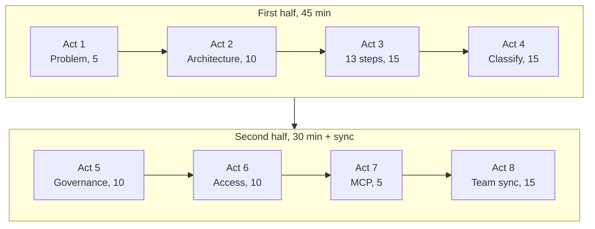
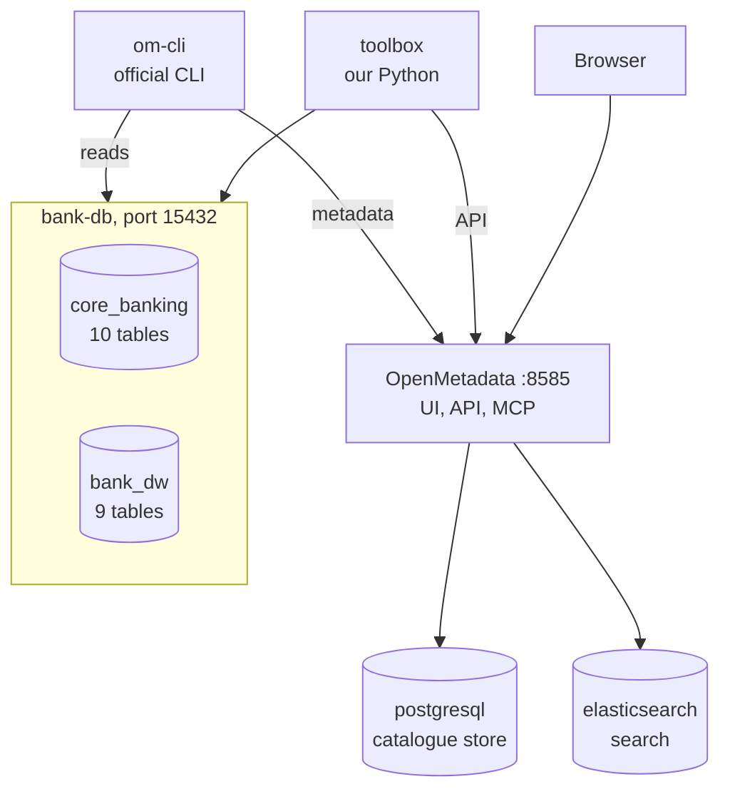
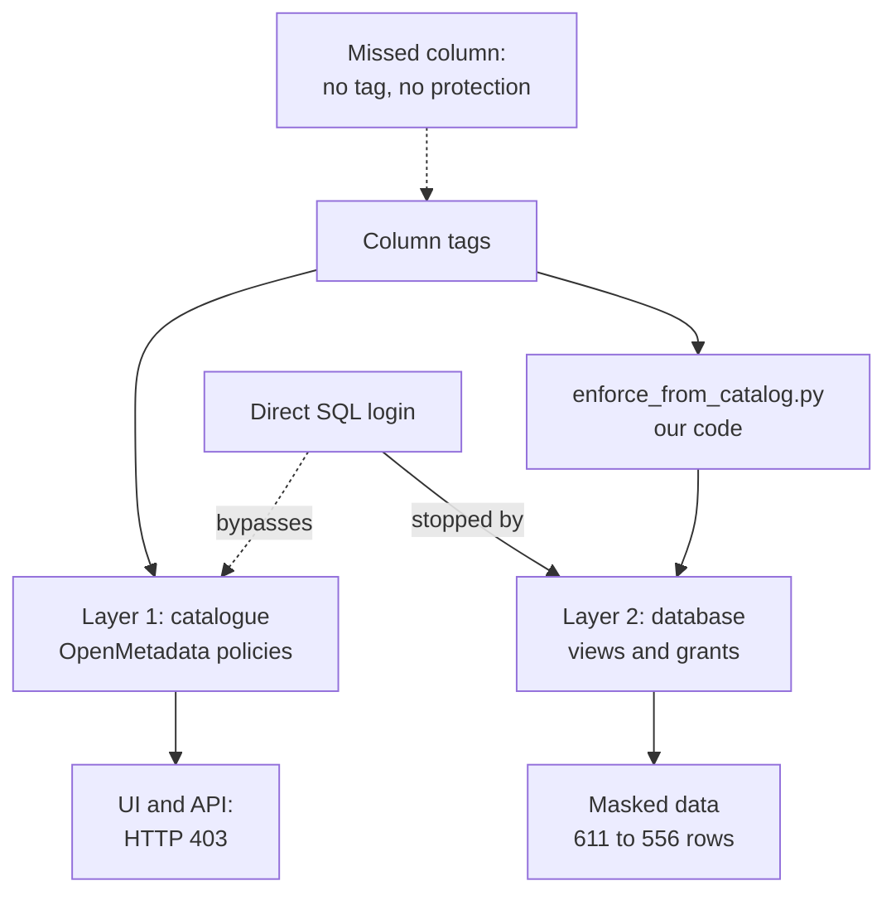

# Self-guided walkthrough: the POC from zero to hero

- **For:** every team member (Victor, Mustafa, Khang, Kshitij), working on your own laptop now that you have access to the repository.
- **Length:** about 75 minutes of hands-on work after the first run finishes, plus a 15-minute team sync to plan the report.
- **How to use it:** run everything yourself, by hand, from a terminal and a browser. Terms are in [02_Terminology_Appendix.md](02_Terminology_Appendix.md); keep it open in a second window. Questions you can't answer from the docs go to the team chat or the sync.

---

## Contents

- [Part A: Set up and run the POC](#part-a-set-up-and-run-the-poc)
- [Part B: The walkthrough](#part-b-the-walkthrough)
- [Part C: Check your understanding](#part-c-check-your-understanding)
- [Part D: Troubleshooting](#part-d-troubleshooting)
- [Part E: No Docker? Read the committed results](#part-e-no-docker-read-the-committed-results)
- [Part F: Cleanup](#part-f-cleanup)

## Part A: Set up and run the POC

### A1. Get the code

```bash
git clone https://github.com/KshitijV97/ai-powered-data-governance.git
```
```bash
cd ai-powered-data-governance/poc
```

All commands below run from this [`poc/`](https://github.com/KshitijV97/ai-powered-data-governance/tree/master/poc) folder unless they say otherwise.

### A2. Prepare your laptop (10 min)

1. Install Docker Desktop. Settings → Resources → Memory **≥ 4 GB** (6 GB if you can). On an 8 GB laptop, quit browser tabs, chat apps and IDEs you don't need while it runs.
2. Free ports 8585 and 15432 (nothing else should be using them).
3. Open three terminal tabs in `poc/`: one for commands, one for a SQL shell, one for logs if needed.
4. Keep these files open in an editor: [`scripts/run_poc.sh`](https://github.com/KshitijV97/ai-powered-data-governance/blob/master/poc/scripts/run_poc.sh), [`toolbox/poc/etl_to_dw.py`](https://github.com/KshitijV97/ai-powered-data-governance/blob/master/poc/toolbox/poc/etl_to_dw.py), [`results/pipeda_compliance_summary.md`](https://github.com/KshitijV97/ai-powered-data-governance/blob/master/poc/results/pipeda_compliance_summary.md).

### A3. The first run

The first run downloads several GB of Docker images (OpenMetadata server, ingestion, Elasticsearch, Postgres) and then takes 15–20 minutes. Start it well before you plan to do the walkthrough, ideally on a good connection. If Docker won't start or your laptop struggles, skip to Part E.

```bash
docker info
```
```bash
./scripts/run_poc.sh
```

Watch for `Done. Open http://localhost:8585 …` at the end. If a step fails, read the newest file in `work/` and resume from that step, for example:
```bash
ls -t work | head
```
```bash
./scripts/run_poc.sh --from 9
```

Check your numbers match the committed ones:
```bash
git diff --stat results/
```
Small differences in timestamps are fine. Headline numbers (F1, row counts) should be the same because the seed is fixed. If they aren't, post the diff in the team chat.

Already ran it before and stopped the containers? Start them again with `scripts/dc.sh start` (about 10 minutes until healthy).

### A4. Sixty-second sanity check

```bash
scripts/dc.sh ps
```
All long-running services (`openmetadata-server`, `postgresql`, `elasticsearch`, `bank-db`) should be `Up` / `healthy`. Then log in at http://localhost:8585 as `admin@open-metadata.org` / `admin` (local only).

---

## Part B: The walkthrough



Times are rough guides. Each act has: **Key points** (what to understand), **Try it** (what to run or click), **Think about** (a question to answer for yourself before moving on; bring any you can't answer to the sync).

### Act 1. The problem and the question (5 min)

**Key points:**
- Banks move customer data from the operational system (OLTP) to a warehouse (OLAP) through ETL pipelines.
- More of that pipeline code is now written with AI assistants. Research (our ref [7]) shows AI-written SQL can run without errors and still be wrong.
- Real costs of bad data and weak security: TD Bank US$28M (inaccurate credit reporting), Desjardins 9.7M people (insider breach), Community Bank 2026 (customer data in an unauthorised AI app).
- Our proposal's question: *How can Canadian banks use data governance frameworks such as OpenMetadata to manage data security and validation risks while adopting AI-assisted tools to build and modernise their data pipelines?*
- The POC is our experiment: build a fake bank, plant the kinds of mistakes an AI-written pipeline could make, and see what OpenMetadata catches.

**Think about:** "What's the difference between a query that *runs* and a query that's *right*?"

### Act 2. The architecture in one picture (10 min)

**Try it:** study this diagram, then run the commands below it:



```bash
scripts/dc.sh ps
```
```bash
cat scripts/dc.sh
```

**Key points:**
- Everything is Docker, so anyone can reproduce it with one command.
- The official OpenMetadata file is untouched; our additions are in an "overlay" ([`docker-compose.poc.yml`](https://github.com/KshitijV97/ai-powered-data-governance/blob/master/poc/docker-compose.poc.yml)). Upgrading means swapping one file, and nobody can say we modified the product.
- Fixed random seed 5301, so the same data and same numbers every time.
- No real people: generic names, `example.com` e-mails, fake 555 phone numbers, random SINs that belong to no one. The course bans human-participant data.

**Think about:** "Why does reproducibility matter for a research report?"

### Act 3. The 13 steps and the fake bank (15 min)

**Try it:**
```bash
grep -n '^step' scripts/run_poc.sh
```

Read each step and say in one sentence what it does (the table in [01_POC_Learning_Roadmap.md](01_POC_Learning_Roadmap.md), Stage 3, has the answers). Then open the bank:

```bash
scripts/dc.sh exec bank-db psql -U postgres -d core_banking
```
```sql
\dn
\dt core.*
SELECT customer_id, first_name, last_name, sin, email, postal_code FROM core.customer LIMIT 5;
```

**Now find the planted defects one by one.** Guess each count before you run the query.

```sql
-- 1. Card security codes stored (should never be kept)   → 1239
SELECT count(*) FROM core.card WHERE cvv IS NOT NULL;

-- 2. Customers closed > 7 years ago, never deleted        → 38
SELECT count(*) FROM core.customer
WHERE customer_status = 'CLOSED' AND closed_at < now() - interval '7 years';

-- 3. Hidden personal data under meaningless column names
SELECT * FROM ops.legacy_member_import LIMIT 3;
\q
```

Then the warehouse:
```bash
scripts/dc.sh exec bank-db psql -U postgres -d bank_dw
```
```sql
-- 4. People who withdrew consent but are still on the marketing list → 55
SELECT count(*) FROM mart.marketing_campaign_audience a
JOIN dw.dim_consent c ON c.customer_key = a.customer_key AND c.purpose = 'MARKETING_EMAIL'
WHERE NOT c.granted OR c.withdrawn_on IS NOT NULL;

-- 5. Same 38 expired customers copied into the warehouse
SELECT count(*) FROM dw.dim_customer WHERE closed_on < current_date - interval '7 years';
\q
```

**Find the bug in code** (commands tab):
```bash
sed -n 96,105p toolbox/poc/etl_to_dw.py
```

**Key points:**
- Line 104 checks `granted` but never checks `withdrawn_at`. Perfectly valid SQL, wrong result. That is the "AI-generated pipeline error" we simulate.
- Be honest: we wrote this bug ourselves to imitate one. No AI produced it.
- The 38 customers exist in **both** databases. If you only purge one, you're still non-compliant. That is why lineage matters.

**Think about:** "If this ETL passed code review and unit tests, who would ever notice the 55?"

### Act 4. The AI classification experiment (15 min)

**Key points (how it works):**
1. OpenMetadata samples 50 rows per table.
2. Recognizers (patterns, column names, context words, and a spaCy language model via Microsoft Presidio) score each column.
3. Score ≥ 0.6 → tag. Highest priority wins: HighRisk > DirectIdentifier > QuasiIdentifier > Financial.
4. We hand-labelled all 145 columns (the "ground truth") and scored three runs.

**Try it:** open [`results/pipeda_compliance_summary.md`](https://github.com/KshitijV97/ai-powered-data-governance/blob/master/poc/results/pipeda_compliance_summary.md) §1 (or the chart [`results/figures/classification_comparison.png`](https://github.com/KshitijV97/ai-powered-data-governance/blob/master/poc/results/figures/classification_comparison.png)).

| Run | Precision | Recall | F1 | High-risk found |
|---|---|---|---|---|
| Out of the box | 0.857 | 0.720 | 0.783 | 4 of 7 |
| Canada-tuned | 0.893 | 1.000 | 0.943 | 7 of 7 |
| + human feedback | 1.000 | 1.000 | 1.000 | 7 of 7 |

Work one out yourself: precision 18/21 = 0.857, recall 18/25 = 0.720, F1 = 2·P·R/(P+R) = 0.783.

**Try it in the UI:** Explore → `core_banking` → `core` → `customer` → **Schema** tab: tags next to `sin`, `email`, `postal_code`. Hover a tag for the recognizer's reason.

**The three stories:**
- **Right for the wrong reason:** out of the box, SINs were caught only because an Australian tax-number and a US bank-routing pattern matched nine digits. Postal codes, account numbers, dates of birth, ID documents were missed.
- **We found a product bug:** `metadata classify` hard-codes the built-in `PII` classification, so our PIPEDA rules were silently ignored.
  ```bash
  cat om-ext/classify_with.py
  ```
  About 20 lines that reuse the official class with a different filter.
- **Why 1.000 isn't a victory lap:** the steward corrected the same columns we scored. It shows humans can remove known errors, not that the AI works on a new bank.

**Think about:** "Which is worse here, a false positive or a false negative? Why?" (Answer in Part C.)

### Act 5. People in charge: governance and human-in-the-loop (10 min)

**Try it in the UI:**
- **Settings → Teams** (under team and user management): BorealisBank → PrivacyOffice, DataGovernanceOffice, RetailMarketing, FraudAML, DataEngineering.
- **Govern → Classification → PIPEDA**: the five tags and their recognizers.
- **Govern → Glossary**: 13 PIPEDA terms, all *Approved*.
- Log out, log in as `priya.cpo@borealis.example` (local test password is in [`toolbox/poc/bootstrap_governance.py`](https://github.com/KshitijV97/ai-powered-data-governance/blob/master/poc/toolbox/poc/bootstrap_governance.py), line 16) → **Tasks**: the resolved approval and feedback tasks. That is the audit trail.
- Any warehouse table → **Lineage** tab: `core.customer` → `dim_customer`, marketing mart, AML mart, through the registered ETL pipeline.
- `marketing_campaign_audience` → **Contract** tab: owner, purpose, terms of use, retention 90 days.
- **Observability → Data Quality**: the 12 tests, 6 red.

**Key points:**
- The steward (`dan.steward`) reported 3 wrong tags (`city` columns read as names by the language model); the CPO approved; the recognizer now skips them.
- The AI never changes a safeguard directly. It changes **tags**; tags drive policies and views. So human review sits at the one place everything reads from.
- The 6 failing tests are **the findings**: consent (55), CVVs (1 239), retention (38 + 38), postal codes (17), and the e-mail test, which failed because **the rule** rejects accented names like *Chloé*. A test can be wrong too.
- Honest caveat: lineage here was published by our code from the ETL's column mapping. OpenMetadata did not discover it by itself.

**Think about:** "Would OpenMetadata have found the consent bug if nobody had written that test?"

### Act 6. Access control: the two layers (10 min)



**Try it (catalogue layer):** open [`results/workflow_audit.json`](https://github.com/KshitijV97/ai-powered-data-governance/blob/master/poc/results/workflow_audit.json) or §4 of the summary. Optionally log in as `maya.marketing@borealis.example` and open `core.customer` → **Sample Data**: denied.

**Try it (database layer)** in your SQL tab:
```bash
scripts/dc.sh exec bank-db psql -U marketing_analyst -d bank_dw
```
```sql
SELECT email FROM governed_marketing_analyst.dim_customer LIMIT 3;          -- hashed
SELECT email FROM governed_marketing_analyst.marketing_campaign_audience LIMIT 3;  -- clear (purpose = Marketing)
SELECT count(*) FROM governed_marketing_analyst.marketing_campaign_audience;  -- 556, not 611
SELECT email FROM dw.dim_customer LIMIT 1;                                    -- permission denied
\q
```

**Key points:**
- **OpenMetadata's policies protect OpenMetadata.** Someone with a SQL login goes straight past them.
- So our script [`enforce_from_catalog.py`](https://github.com/KshitijV97/ai-powered-data-governance/blob/master/poc/toolbox/poc/enforce_from_catalog.py) reads the tags and writes views and grants into the database: high-risk columns dropped, direct identifiers hashed unless the role's purpose matches, and a consent filter that removes the 55.
- That is our code, not the product's. If it isn't run after tags change, the catalogue still *looks* compliant.
- **Fails open:** a column the AI misses has no tag, so no policy, no masking, no alert.
- md5 is pseudonymisation, not anonymisation; production would use a keyed hash or tokens.

**Think about:** "Where should the protection really live: in the catalogue or the database?"

### Act 7. AI assistants (MCP) and the limits (5 min)

**Try it:**
```bash
python3 -m json.tool results/mcp_transcript.json | head -40
```

**Key points:**
- OpenMetadata exposes 15 tools to AI assistants: 11 read, 4 write (`create_entity`, `patch_entity`, `create_lineage`, `create_test_case`).
- An AI agent holding an admin token could delete a `HighRisk` tag, and every downstream safeguard switches off quietly.
- Mitigation: least-privilege, read-only tokens; the org-wide tag-integrity policy.

**Six product limitations** (be able to name at least four): hard-coded PII filter; no Canadian recognizers; sample-data policy checks table tags only; no SIN checksum; policies don't reach the database; MCP write tools.

**Our study's limits:** same people built data, defects, rules and tests; 145 columns only; one product and version; no comparison tool; simulated AI error; scripted personas; synthetic data.

### Act 8. Team sync: what it means for the report (15 min, together)

**The bottom line:** OpenMetadata is useful as a **supervised** control system: strong at inventory, documentation and lineage; it can **detect** consent, retention and accuracy problems but not fix them; it protects the database only if someone wires the tags in; and its AI needs Canadian tuning plus human review.

**Decide together at the sync** (from [03_Report_Drafting_Content_Pack.md](03_Report_Drafting_Content_Pack.md), section 0.2). Come with an opinion on each:
1. Keep the proposal's research question (recommended) or refine it?
2. APA (course rule) or IEEE (proposal)? Who emails the professor?
3. Nobody uses the AI-assisted draft in [`report/main.tex`](https://github.com/KshitijV97/ai-powered-data-governance/blob/master/report/main.tex) as text; we write fresh.
4. Section owners and page budget (content pack, section 1.2).
5. Internal deadlines before 9 Dec.

**Ground rules for the report:** AI may help with editing and explaining, not with analysis, interpretation or authorship. Every number and citation gets checked. The AI-use statement lists tool, date, purpose and how we verified.

---

## Part C: Check your understanding

Try answering each question before reading the short answer. These are also the questions the professor or a reader is most likely to ask.

| Question | Short answer |
|---|---|
| Is this a real bank? | No. Fictional bank, fully synthetic data, fixed seed. |
| Did AI write the buggy ETL? | No. We planted it to simulate the kind of error research says AI-generated SQL makes. |
| Why OpenMetadata and not Collibra? | Open source, free, has the AI features we needed (auto-classification, MCP). Collibra and Atlas are named for context but not tested. |
| What is F1? | The balance of precision (were flagged columns really sensitive?) and recall (were sensitive columns found?). 2·P·R/(P+R). |
| Why is recall more important than precision here? | A missed sensitive column gets no protection and nobody notices. A false alarm just costs review time. |
| Does 1.000 mean it works? | No. Same columns were used to fix and to score; small sample; we built everything ourselves. |
| What exactly did "Canada-tuned" add? | Custom recognizers for SIN (formatted, unformatted, column name), postal codes, Ontario driver's licence, Canadian passport, account/card/ID column names. |
| Why did the e-mail test fail? | The regex only accepts ASCII letters, so names like Chloé fail. The rule is wrong, not the data. |
| Why 38 twice? | The same expired customers were copied to the warehouse. Lineage shows a purge must cover both. |
| Can the marketing analyst see SINs? | Not in the catalogue (403), and not in the database: they only have access to generated views where high-risk columns are dropped. |
| Does OpenMetadata make us PIPEDA-compliant? | No. It supports evidence and detection for several principles. Compliance needs processes, people and database controls. |
| What does MCP add? | An AI assistant can answer privacy questions from the catalogue, but the server also exposes write tools, which is a risk. |
| How long does it take to run? | About 15–20 min after images are downloaded. One command. |

---

## Part D: Troubleshooting

| Symptom | Fix |
|---|---|
| Browser can't reach :8585 | `scripts/dc.sh ps`; if `openmetadata-server` is restarting, check `scripts/dc.sh logs --tail 50 openmetadata-server`. Usually low memory: close apps. |
| Step 1 hangs for minutes | Elasticsearch out of memory. Raise Docker memory; if needed use Part E. |
| A `metadata …` step fails | Read the newest `work/*.log`; resume with `./scripts/run_poc.sh --from N`. |
| 401 / token error | `./scripts/run_poc.sh --from 4` re-renders workflows with a fresh token. |
| `port is already allocated` | Another app uses 8585 or 15432; stop it. |
| psql "role does not exist" for `marketing_analyst` | Step 11 hasn't run yet; run `./scripts/run_poc.sh --from 11`. |

Stuck for more than 15 minutes? Post the error and the newest `work/*.log` in the team chat, and carry on with Part E in the meantime.

---

## Part E: No Docker? Read the committed results

If Docker won't run on your laptop, you can still do the whole walkthrough. Everything the run produces is already committed:

1. [`poc/results/pipeda_compliance_summary.md`](https://github.com/KshitijV97/ai-powered-data-governance/blob/master/poc/results/pipeda_compliance_summary.md): the full results in one page.
2. [`poc/results/figures/classification_comparison.png`](https://github.com/KshitijV97/ai-powered-data-governance/blob/master/poc/results/figures/classification_comparison.png): the chart.
3. [`docs/architecture.md`](https://github.com/KshitijV97/ai-powered-data-governance/blob/master/docs/architecture.md), [`docs/data-model.md`](https://github.com/KshitijV97/ai-powered-data-governance/blob/master/docs/data-model.md), [`docs/enforcement.md`](https://github.com/KshitijV97/ai-powered-data-governance/blob/master/docs/enforcement.md): diagrams (they render on GitHub).
4. [`poc/toolbox/poc/etl_to_dw.py`](https://github.com/KshitijV97/ai-powered-data-governance/blob/master/poc/toolbox/poc/etl_to_dw.py) line 104: the bug.
5. [`poc/results/enforcement.json`](https://github.com/KshitijV97/ai-powered-data-governance/blob/master/poc/results/enforcement.json): the generated SQL views.

Follow Acts 1–8 using these instead of running the commands.

---

## Part F: Cleanup

When you're done, stop the containers but keep the data (fast restart next time):
```bash
scripts/dc.sh --profile tools stop
```

Or remove the containers but keep volumes:
```bash
scripts/dc.sh --profile tools down
```

Put the committed evidence back if the re-run changed it:
```bash
git restore results/
```

**Careful:** `./scripts/reset.sh` deletes **everything**, including [`poc/results/`](https://github.com/KshitijV97/ai-powered-data-governance/tree/master/poc/results). Only use it for a fresh start, and run `git restore results/` afterwards.
