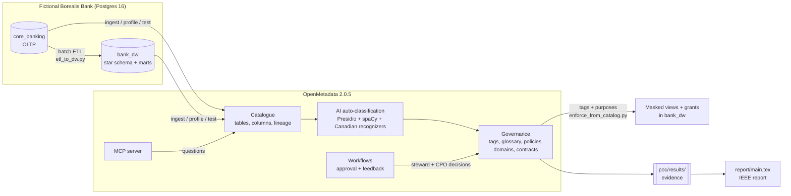
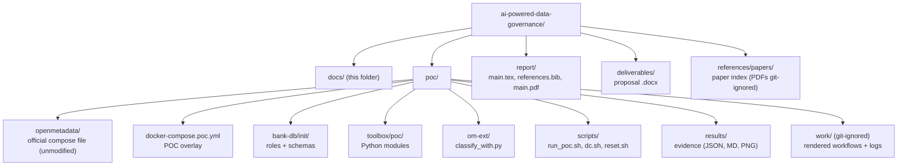

# Documentation

Technical documentation for the **Borealis Bank PIPEDA governance proof of concept** (GNG/ELG 5301, uOttawa, Fall 2026).
The bank is fictional and all data is synthetic.

The top-level [`README.md`](../README.md) gives the summary and [`poc/README.md`](../poc/README.md) the quick-start. These pages go deeper. New to the project? Start with the [research overview](research.md), then [architecture](architecture.md) and [results](results.md).

### Research

| Page | Read it when you want to know… |
|---|---|
| [Research overview](research.md) | the research question, scope, method (literature review + POC) and the answer in brief |
| [PIPEDA principle mapping](pipeda-mapping.md) | for each of the ten principles: the control, where it is implemented and which evidence file proves it |
| [Report guide](report.md) | how the report is structured, how to build it, and what must be finished before submission |

### Proof of concept

| Page | Read it when you want to know… |
|---|---|
| [Architecture](architecture.md) | which containers run, how they talk to each other, and why the compose files are layered |
| [Pipeline walkthrough](pipeline.md) | what each of the 13 steps of `run_poc.sh` does, which module runs it and what it writes |
| [Data model](data-model.md) | the OLTP and warehouse schemas, the ETL, column lineage and the planted defects |
| [Governance model](governance-model.md) | how PIPEDA is expressed as OpenMetadata classifications, recognizers, teams, roles, policies, domains and glossary |
| [AI auto-classification and evaluation](classification.md) | how auto-classification runs, the `classify_with.py` workaround, ground truth and the precision/recall method |
| [Human-in-the-loop workflows](human-in-the-loop.md) | the glossary-approval and recognizer-feedback workflows and how they are scripted |
| [Access control and enforcement](enforcement.md) | catalogue policies vs. warehouse access, and how masked views are generated from tags |
| [AI assistant (MCP)](mcp.md) | how the OpenMetadata MCP server is queried and the security caveats |
| [Results and findings](results.md) | the numbers from the last run and the product limitations found |
| [Operations guide](operations.md) | configuration, running, resuming, resetting, troubleshooting and extending |
| [Testing](testing.md) | how to run the unit and integration test suites and what they check |

### Reference

| Page | Read it when you want to know… |
|---|---|
| [Glossary](glossary.md) | what a privacy, data or OpenMetadata term means |
| [Contributing](../CONTRIBUTING.md) | the commit message conventions and branch workflow |

## The whole project on one page

## Repository map

