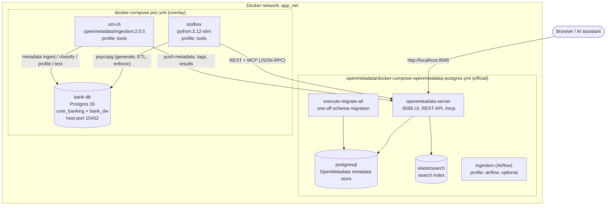
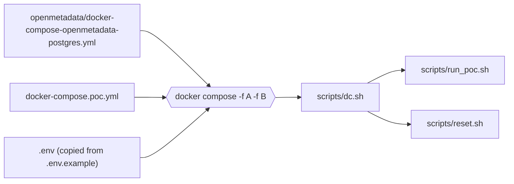
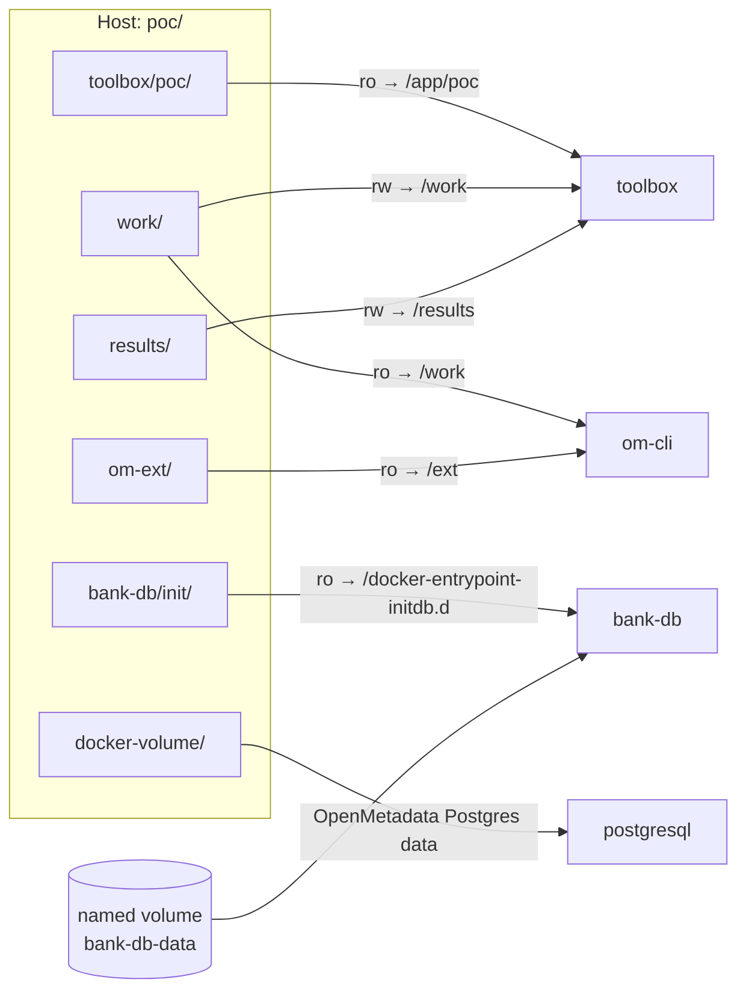
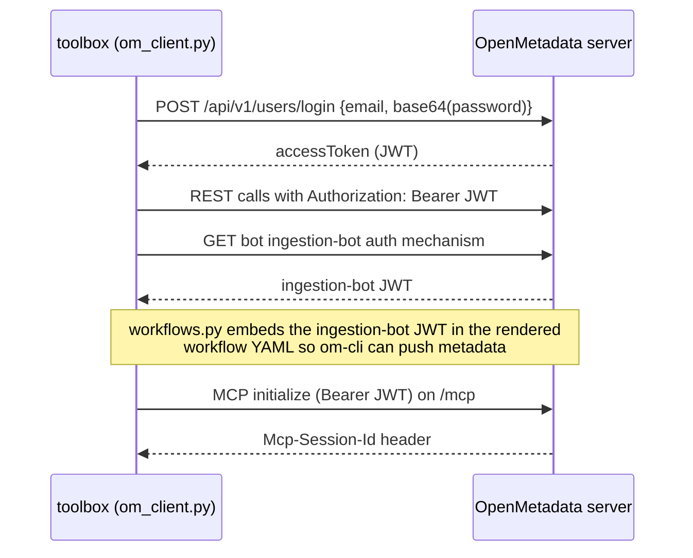

# Architecture

The POC is a Docker Compose project made of the **official, unmodified OpenMetadata 2.0.5 compose file** plus a small **overlay** that adds a fictional bank and the tooling that drives everything.

## Containers

| Service | Image | Role | Lifetime |
|---|---|---|---|
| `openmetadata-server` | official | Catalogue, governance engine, workflows, MCP endpoint | long-running |
| `postgresql` | official | OpenMetadata's own metadata database | long-running |
| `elasticsearch` | official (heap cut to 512 MB, `mem_limit: 1400m`) | Search index behind the UI and `search_metadata` | long-running |
| `ingestion` | official | Airflow scheduler for UI "Agents" | **disabled** unless `--profile airflow` |
| `bank-db` | `postgres:16-alpine` | The fictional bank: OLTP + warehouse | long-running |
| `toolbox` | built from `poc/toolbox/` | All POC Python code (`python -m poc.<module>`) | one-off (`run --rm`) |
| `om-cli` | `openmetadata/ingestion:2.0.5` | The official ingestion framework run as a CLI | one-off (`run --rm`) |

### Why a separate `om-cli` instead of Airflow

The ingestion framework that Airflow schedules is the same Python package as the `metadata` CLI. Running it as a one-off container:

* saves roughly 1.5 GB of RAM, so the stack fits a 4 GB Docker Desktop VM;
* makes every run deterministic and scriptable from `run_poc.sh`;
* produces one log file per workflow in `poc/work/`.

The trade-off is that the UI's *Agents* page shows no scheduled pipelines unless you start the stack with `--profile airflow`.

## Compose layering

`scripts/dc.sh` is the only place the two files are combined, so every other script calls `scripts/dc.sh …` instead of `docker compose`. The overlay only **adds** services and **overrides** memory settings; it never edits the official file, which keeps upgrades to a newer OpenMetadata release a matter of replacing one file.

## Volumes and mounts

* The toolbox **writes** rendered workflow YAML to `work/workflows/`; `om-cli` **reads** them. That hand-off is how Python decides what the official CLI runs.
* Python source is mounted read-only, so editing a module takes effect on the next step without rebuilding the image (only `requirements.txt` changes need a rebuild).
* `work/` and `docker-volume/` are git-ignored; `results/` is committed as evidence.

## Database roles in `bank-db`

Created by `bank-db/init/00_init.sh` on first start:

| Role | Used by | Privileges |
|---|---|---|
| `postgres` | toolbox (generate, ETL, enforce) | superuser |
| `om_reader` | om-cli (ingest, profile, classify, test) | `pg_read_all_data` + `pg_read_all_stats` (read-only) |
| `etl_service` | reserved ETL identity (the POC's ETL actually connects as `postgres`) | DML on every schema of both databases |
| `marketing_analyst` | enforcement checks | nothing at init; after step 11 only its `governed_marketing_analyst` views |
| `fraud_analyst` | enforcement checks | nothing at init; after step 11 only its `governed_fraud_analyst` views |

## Authentication

Persona users (`priya.cpo`, `dan.steward`, …) log in the same way with the local test password set in `bootstrap_governance.py`, so every scripted decision is attributed to the right person in OpenMetadata's task history.
