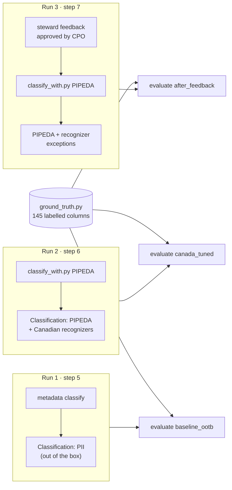
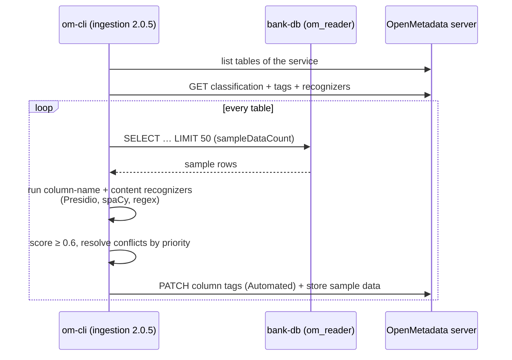
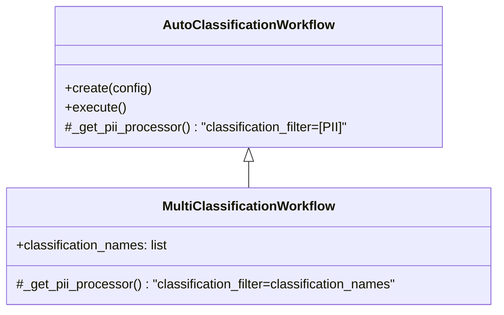
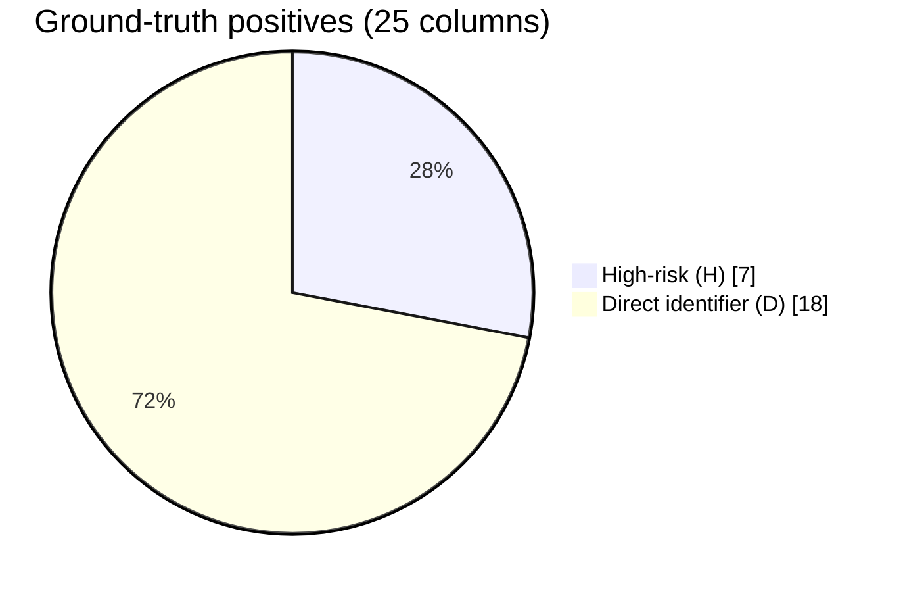
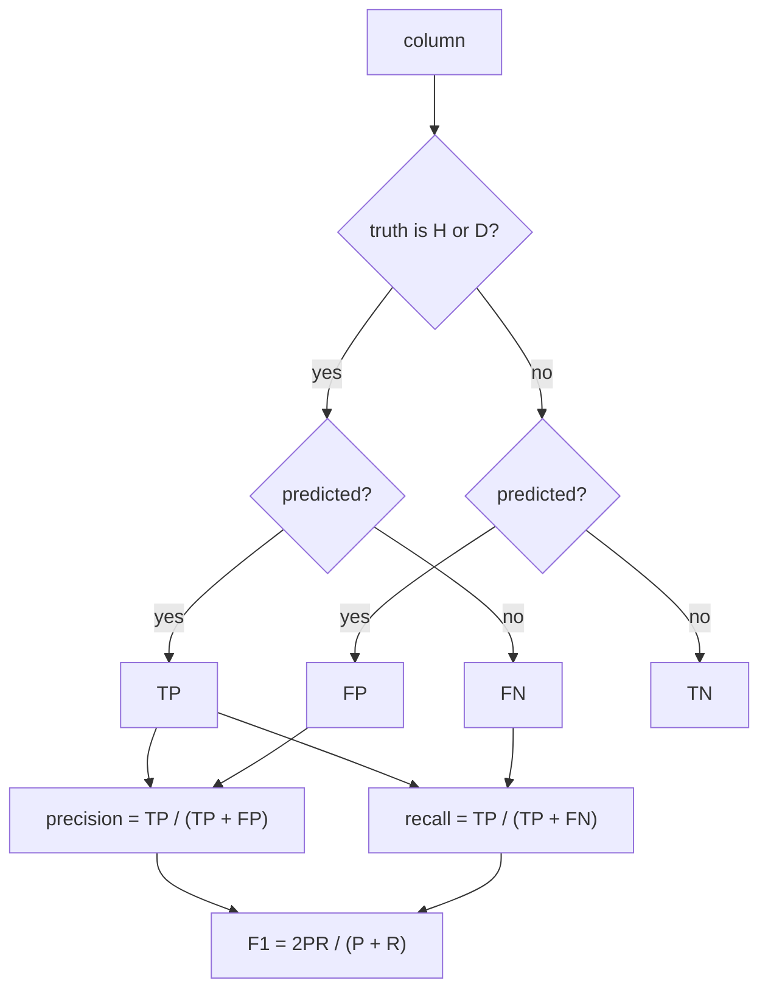
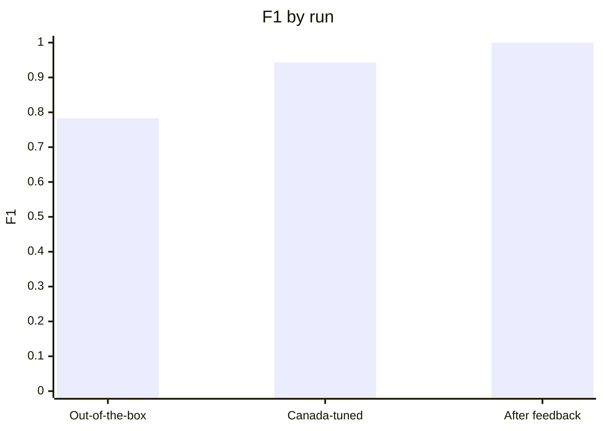
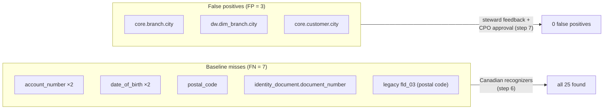

# AI auto-classification and evaluation

OpenMetadata's auto-classification samples rows from each table and runs recognizers over column names and values. In 2.0.5 the engine is built on **Microsoft Presidio** (pattern and predefined recognizers) plus **spaCy** named-entity recognition. The POC measures it three times against a known ground truth.

## The three runs



| Run | Predicted positive when the column has… |
|---|---|
| Out-of-the-box | `PII.Sensitive` |
| Canada-tuned, after feedback | `PIPEDA.HighRisk` or `PIPEDA.DirectIdentifier` |

## How one classification run works



Settings come from the rendered `…__autoclassification.yaml`: `confidence: 60`, `sampleDataCount: 50`, `storeSampleData: true`, `classificationLanguage: en`.

## The `classify_with.py` workaround

In OpenMetadata 2.0.5 OSS, the `metadata classify` command passes a hard-coded `classification_filter=[PII]` to the processor (`metadata/workflow/classification.py`). Recognizers defined on any other classification, such as `PIPEDA`, are silently ignored even though the processor itself supports them.

[`om-ext/classify_with.py`](../poc/om-ext/classify_with.py) subclasses the official `AutoClassificationWorkflow` and overrides one method so the filter comes from the command line:



It runs inside the unmodified ingestion image:

```bash
scripts/dc.sh run --rm --entrypoint python om-cli /ext/classify_with.py /work/workflows/borealis_core_banking_oltp__autoclassification.yaml PIPEDA
```

## Ground truth

Because the data is synthetic, the sensitivity of every column is known. [`ground_truth.py`](../poc/toolbox/poc/ground_truth.py) labels all 145 columns of both databases:

| Label | Meaning | Examples |
|---|---|---|
| **H** | High-risk identifier | `sin`, `card_number`, `cvv`, `account_number`, `document_number`, `fld_02` |
| **D** | Direct identifier | names, `email`, `phone_number`, `street_address`, `postal_code`, `date_of_birth`, `client_ip`, `agent_notes` |
| **Q** | Quasi-identifier | `city`, `province`, `postal_fsa`, `birth_year`, `age_band`, `occupation` |
| **F** | Financial | `annual_income`, `current_balance`, `amount` |
| **N** | Not personal | keys, codes, timestamps, reference data |

The **positive class** for precision/recall is **H or D**: what a PII scanner should flag for protection. There are 25 positive columns, 7 of them high-risk.



## Metrics

[`evaluate_classification.py`](../poc/toolbox/poc/evaluate_classification.py) snapshots every column's tags from the OpenMetadata API and computes:



It also reports **high-risk recall** (how many of the 7 H columns were caught) and **PIPEDA exact-class accuracy** (does the five-level tag match the five-level label). Per-column detail, including the recognizer's `reason` text, is saved in `results/classification_<run>.json`.

## Results

| Run | Precision | Recall | F1 | TP | FP | FN | High-risk recall |
|---|---|---|---|---|---|---|---|
| Out-of-the-box PII | 0.857 | 0.720 | 0.783 | 18 | 3 | 7 | 4/7 |
| Canada-tuned PIPEDA | 0.893 | 1.000 | 0.943 | 25 | 3 | 0 | 7/7 |
| Tuned + steward feedback | 1.000 | 1.000 | 1.000 | 25 | 0 | 0 | 7/7 |




### What each step fixed



* **Baseline:** none of the built-in recognizers targets Canadian identifiers. It caught SINs only because an *Australian TFN* and a *US ABA routing number* pattern happened to match nine-digit strings, and it missed postal codes, account numbers, the Ontario driver's licence/passport column and dates of birth.
* **Canada-tuned:** custom SIN, postal-code, licence, passport and column-name recognizers brought recall to 1.0. Three `city` columns remained over-flagged as direct identifiers by spaCy's location NER.
* **After feedback:** the three false positives were reported through the recognizer-feedback workflow; once approved, the recognizers carry exceptions for those columns and the re-run is clean.

> A perfect score on 145 synthetic columns says the method works here, not that it generalises. See *Limitations* in the report.
