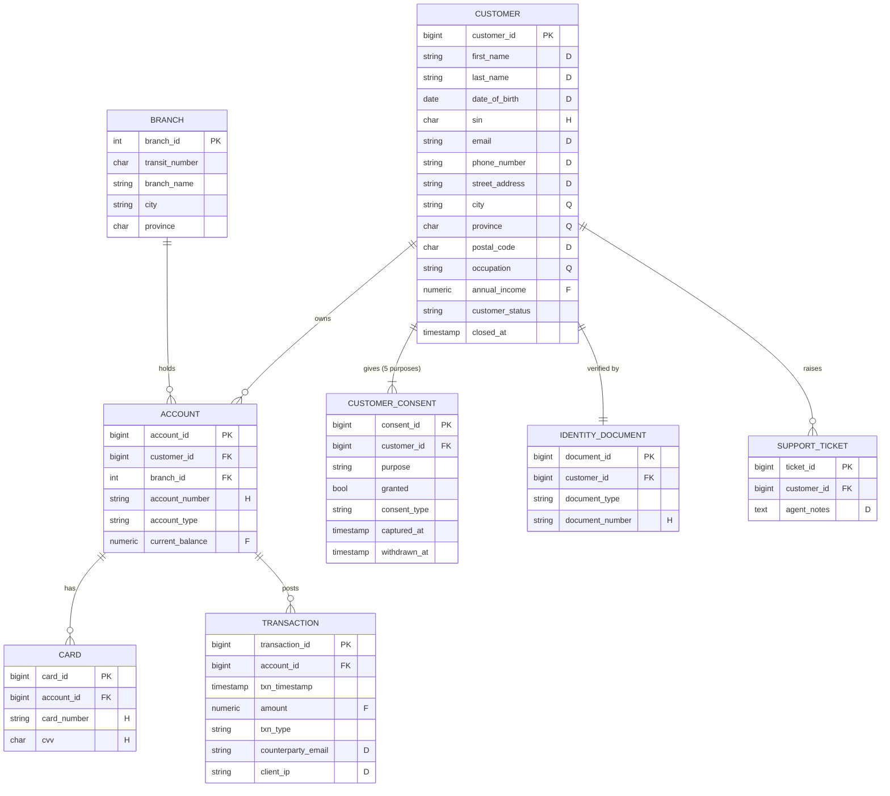
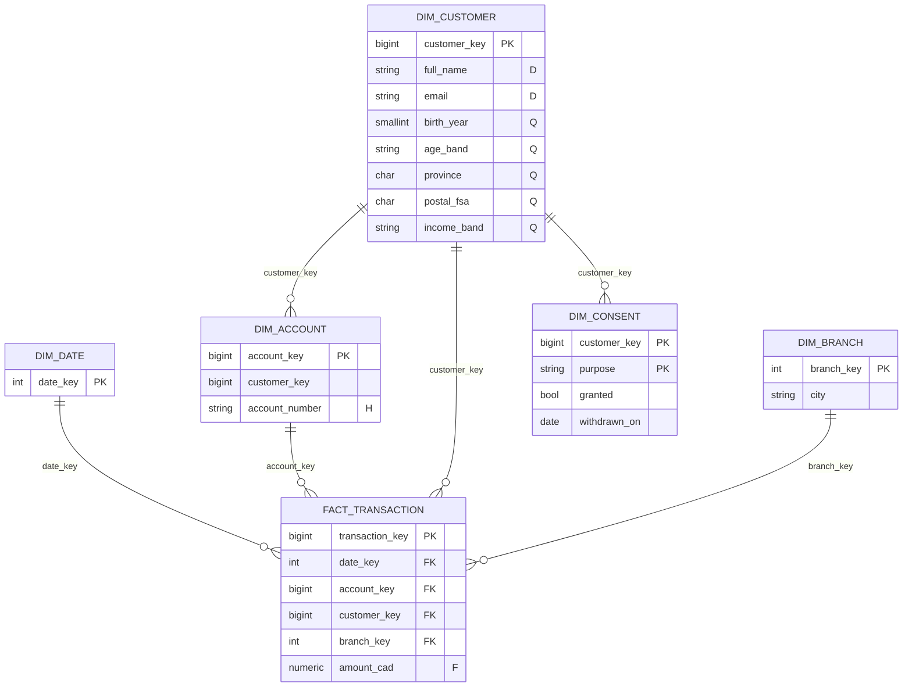
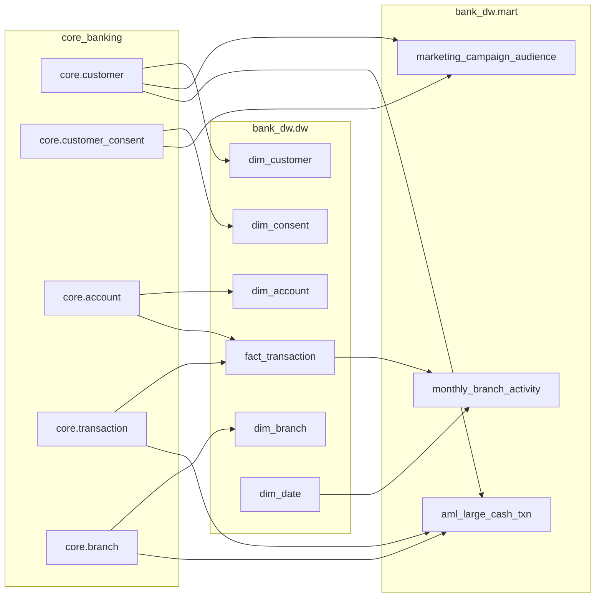
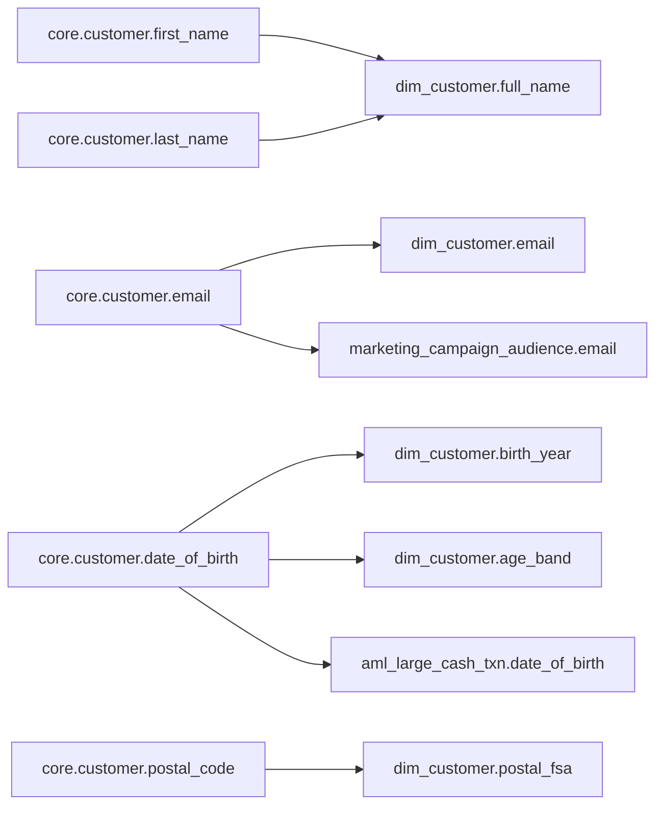

# Data model

`bank-db` holds two databases for the fictional Borealis Bank of Canada:

* **`core_banking`**: the operational (OLTP) system of record. Schemas `core`, `kyc`, `ops`.
* **`bank_dw`**: the analytical warehouse. Schemas `dw` (star schema), `mart` (purpose-specific marts), plus `governed_<role>` schemas generated in step 11.

DDL lives in [`poc/bank-db/init/sql/`](../poc/bank-db/init/sql/). Data is generated by [`generate_data.py`](../poc/toolbox/poc/generate_data.py) and loaded into the warehouse by [`etl_to_dw.py`](../poc/toolbox/poc/etl_to_dw.py).

## Synthetic data, not real people

| Field | How it is made safe |
|---|---|
| Names | Drawn from small generic first/last-name lists |
| E-mail | `first.last<n>@example.{com,org,net}` (RFC 2606 reserved domains) |
| Phone | Fictional `555-01XX` exchange |
| IP address | `198.51.100.0/24` (RFC 5737 documentation range) |
| SIN, card number | Random Luhn-valid digit strings tied to no one |
| Volume | `POC_CUSTOMERS=1500`, seed `POC_SEED=5301` → identical data on every run |

## OLTP: `core_banking`

Letters in quotes are the **ground-truth sensitivity labels** (see [classification](classification.md#ground-truth)): **H** high-risk, **D** direct identifier, **Q** quasi-identifier, **F** financial. Unlabelled columns are **N** (not personal).

Two standalone `ops` tables have no foreign keys:

* `ops.legacy_member_import` (400 rows): columns named `fld_01…fld_04` that hide a name (`fld_01`, D), a SIN with or without spaces (`fld_02`, H) and a postal code (`fld_03`, D). It exists to test **content-based** detection when column names give no hint.
* `ops.fx_rate`: daily exchange rates; a control table with no personal information.

## Warehouse: `bank_dw`

The ETL already applies some **data minimisation**: the warehouse keeps `postal_fsa` (first three characters) instead of the full postal code, and `birth_year`/`age_band`/`income_band` instead of exact values. It deliberately does **not** drop `account_number` from `dim_account`, so there is something for the classifier and enforcement layer to catch.

### Marts

| Mart | Purpose | Built from | Notable columns |
|---|---|---|---|
| `mart.marketing_campaign_audience` | E-mail campaigns | `core.customer` ⋈ `core.customer_consent` (`MARKETING_EMAIL`) | `full_name`, `email` (D), `consent_marketing` |
| `mart.aml_large_cash_txn` | FINTRAC large cash transaction reporting (≥ $10 000 cash deposits) | `transaction` ⋈ `account` ⋈ `customer` ⋈ `branch` | `full_name`, `date_of_birth` (D), `occupation` (Q) |
| `mart.monthly_branch_activity` | Aggregate analytics | `dw.fact_transaction` ⋈ `dw.dim_date` | counts and sums only |

## ETL and lineage

The ETL runs `INSERT … SELECT` statements defined in the `EXTRACTS` dictionary. The same module declares `LINEAGE` (OLTP → warehouse) and `DW_LINEAGE` (inside the warehouse) as column mappings; step 8 publishes them to OpenMetadata as **column-level lineage** attached to a registered pipeline entity, so the catalogue can answer "where does a customer's e-mail go?" (PIPEDA 4.9).

Example column mapping, as published (from `LINEAGE`):

## Planted defects

The generator and ETL plant problems on purpose so the governance controls have something real to find:

| Defect | Where | PIPEDA principle | Caught by |
|---|---|---|---|
| Marketing extract checks `granted` but ignores `withdrawn_at` (`-- BUG` in `etl_to_dw.py`) | `mart.marketing_campaign_audience` | 4.3 Consent | DQ test `p4_3_consent_not_withdrawn` (55 rows); consent row filter in governed view |
| Full card numbers and CVVs stored | `core.card` | 4.4 Limiting collection, 4.7 Safeguards | Classification (`PIPEDA.HighRisk`); DQ test `p4_4_limiting_collection_no_cvv_stored` (1 239 rows) |
| ~3 % of customers closed 2014–2018 and never purged | `core.customer`, `dw.dim_customer` | 4.5 Retention | DQ test `p4_5_retention_closed_customers_purged` (38 rows each) |
| ~1 % malformed postal codes (`90210`, `ZZZ 999`, …) | `core.customer.postal_code` | 4.6 Accuracy | DQ test `p4_6_accuracy_postal_code_format` |
| SINs, names and postal codes in anonymous `fld_*` columns | `ops.legacy_member_import` | 4.4, 4.7 | Content-based classification (baseline missed `fld_03`) |
| PI inside free-text notes | `ops.support_ticket.agent_notes` | 4.7 | spaCy NER on content |

> **Note on the e-mail accuracy test.** `p4_6_accuracy_email_format` also fails (1 260 of 1 500 match) even though no e-mail defect was planted: names such as *Chloé* or *Félix* keep their accented letters, which the ASCII-only regex rejects. The compliance summary flags this as "rule needs review"; it is an example of a test rule, not the data, being wrong.
