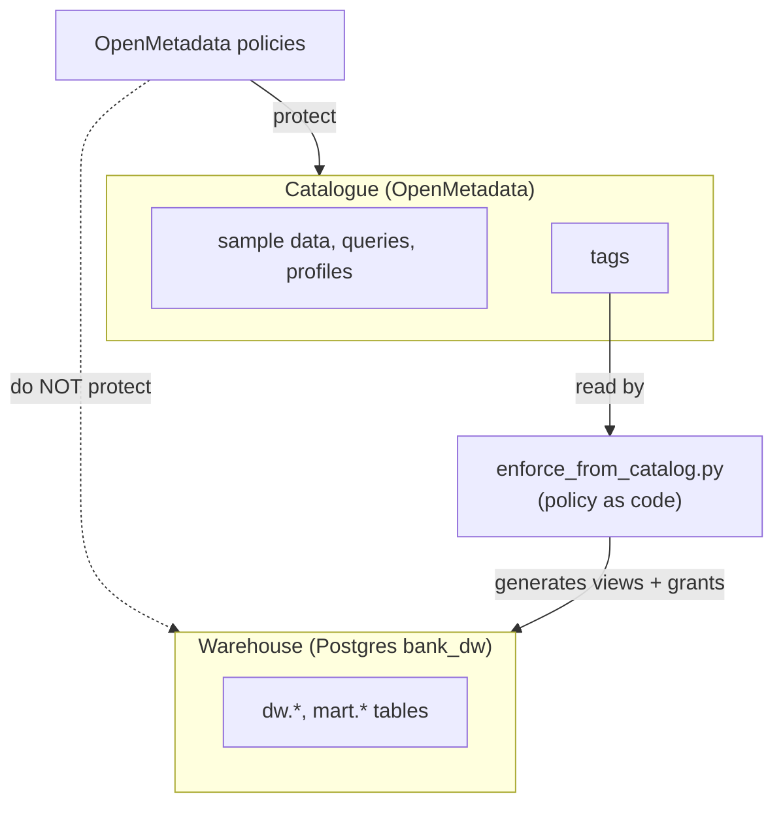
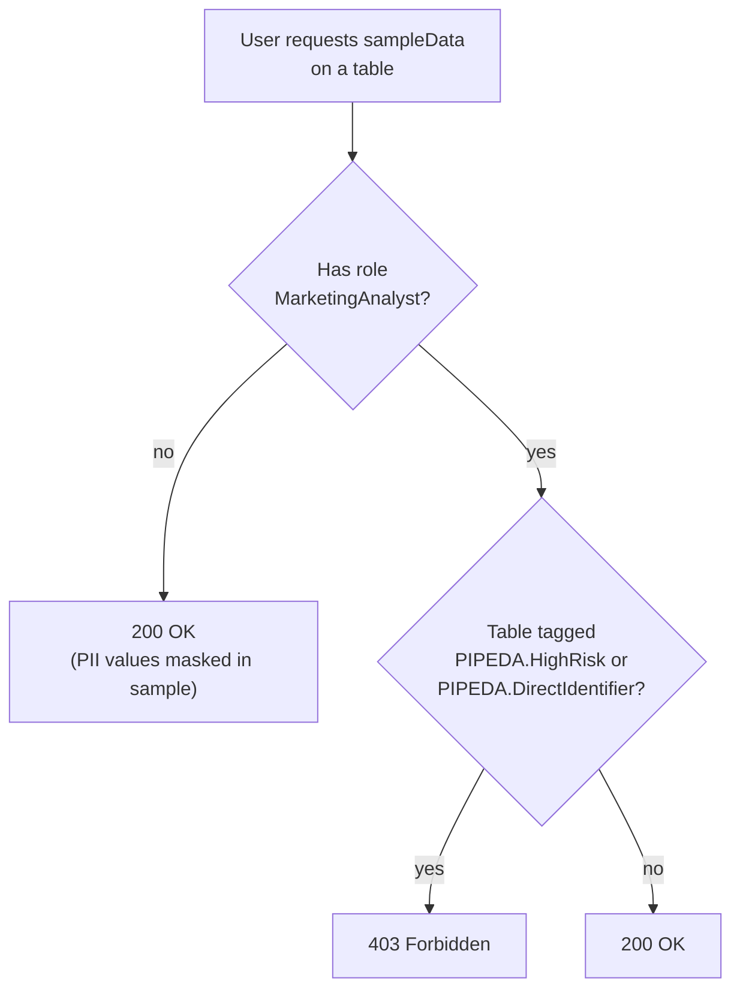
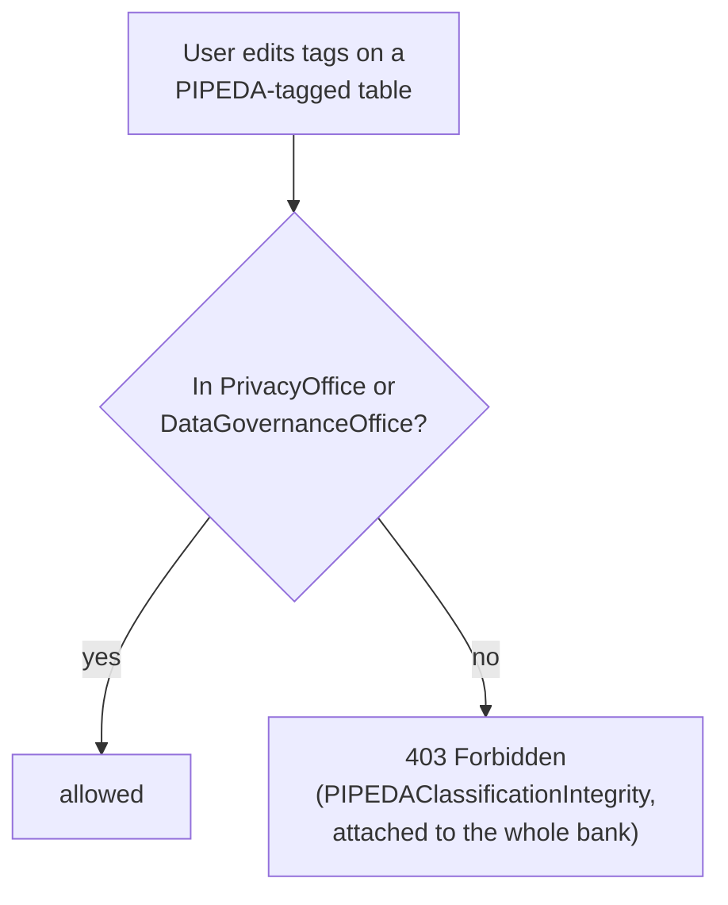
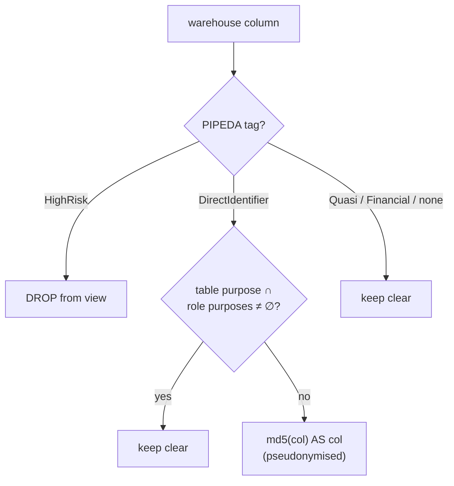
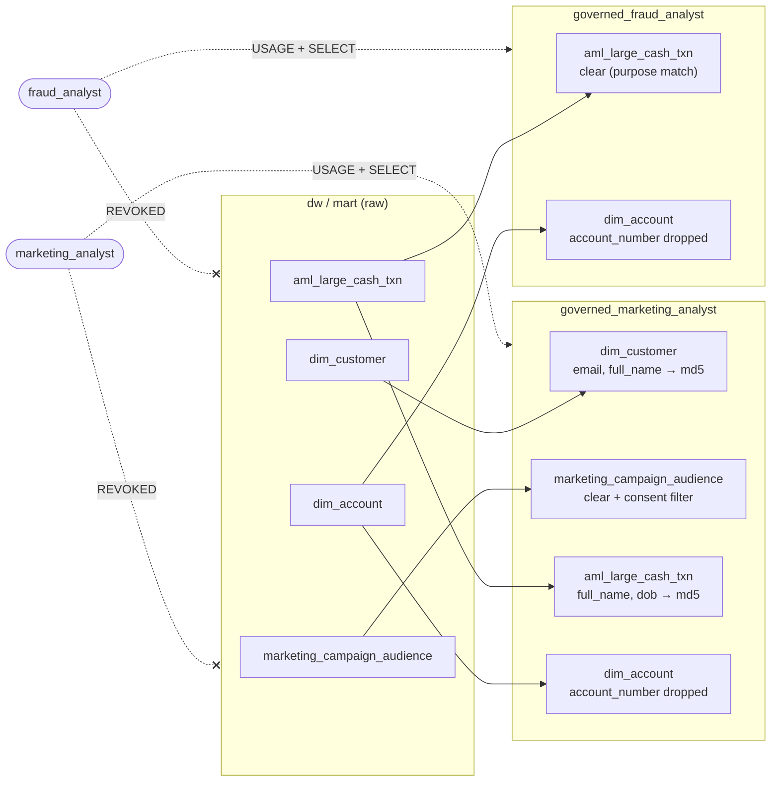

# Access control and enforcement

There are two separate places where personal information can leak, and OpenMetadata only governs one of them.



## Layer 1: catalogue policies

Defined in [`governance_model.py`](../poc/toolbox/poc/governance_model.py) (`POLICIES`) and tested in step 11 by `human_in_the_loop.py access`.





### Test results (last run)

| User | Table | Operation | HTTP |
|---|---|---|---|
| maya.marketing | `core.customer` | View sample data | 403 |
| maya.marketing | `mart.marketing_campaign_audience` | View sample data | 403 |
| maya.marketing | `mart.monthly_branch_activity` | View sample data | 200 |
| femi.aml | `core.customer` | View sample data | 200 (35 masked cells in first 5 rows) |
| priya.cpo | `core.customer` | View sample data | 200 (35 masked cells in first 5 rows) |
| maya.marketing | `core.customer` | Add a tag, keep `PIPEDA.HighRisk` | 403 |
| maya.marketing | `core.customer` | Remove `PIPEDA.HighRisk` | 403 |

The policies only work on **table-level** tags for the sample-data endpoint, hence the column-to-table roll-up in step 8.

## Layer 2: warehouse enforcement generated from the catalogue

[`enforce_from_catalog.py`](../poc/toolbox/poc/enforce_from_catalog.py) reads each warehouse table's column-level `PIPEDA` tags and table-level `PIPEDAPurpose` tags from the OpenMetadata API and generates, per business role, a schema of views plus grants.

### Rules



| Role | Purposes |
|---|---|
| `marketing_analyst` | `Marketing` |
| `fraud_analyst` | `FraudPrevention`, `RegulatoryReporting` |

When a marketing role reads a table whose purpose is `Marketing` and that has a `customer_key`, the view also gets a **consent row filter** (PIPEDA 4.3):

```sql
WHERE EXISTS (SELECT 1 FROM dw.dim_consent dc
              WHERE dc.customer_key = mart.marketing_campaign_audience.customer_key
                AND dc.purpose = 'MARKETING_EMAIL' AND dc.granted AND dc.withdrawn_on IS NULL)
```

### What gets generated



(Only representative views shown; every `dw`/`mart` table gets a view in each role's schema.)

### Verification (last run)

| Role | Query | Result |
|---|---|---|
| marketing_analyst | `SELECT email FROM governed_marketing_analyst.dim_customer` | md5 hash (no purpose match) |
| marketing_analyst | `SELECT email FROM governed_marketing_analyst.marketing_campaign_audience` | clear e-mail (purpose match) |
| marketing_analyst | `SELECT count(*) FROM governed_marketing_analyst.marketing_campaign_audience` | **556** instead of 611: the 55 withdrawn customers are filtered out |
| marketing_analyst | `SELECT email FROM dw.dim_customer` | permission denied for schema `dw` |
| marketing_analyst | `SELECT full_name FROM governed_marketing_analyst.aml_large_cash_txn` | md5 hash |
| fraud_analyst | `SELECT full_name FROM governed_fraud_analyst.aml_large_cash_txn` | clear name (purpose match) |
| fraud_analyst | `SELECT account_number FROM governed_fraud_analyst.dim_account` | column does not exist (dropped) |

The full generated SQL and every per-view decision are in `results/enforcement.json`.

## Limits of this approach

* Views are regenerated only when the script runs; a production version would run on tag-change events.
* `md5` is pseudonymisation, not anonymisation; it is reversible by dictionary attack for low-entropy values and would be replaced by a keyed hash or tokenisation.
* The POC covers the warehouse only. The OLTP database is accessed by service accounts and is out of scope.
