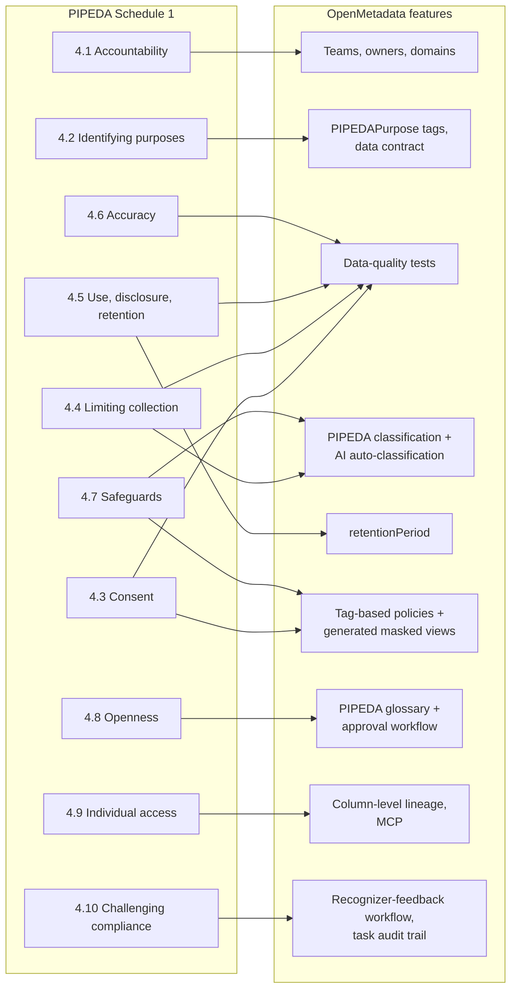
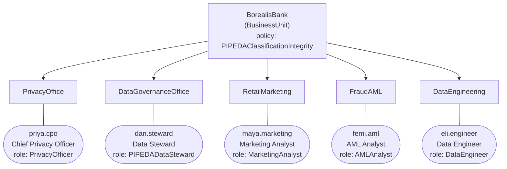
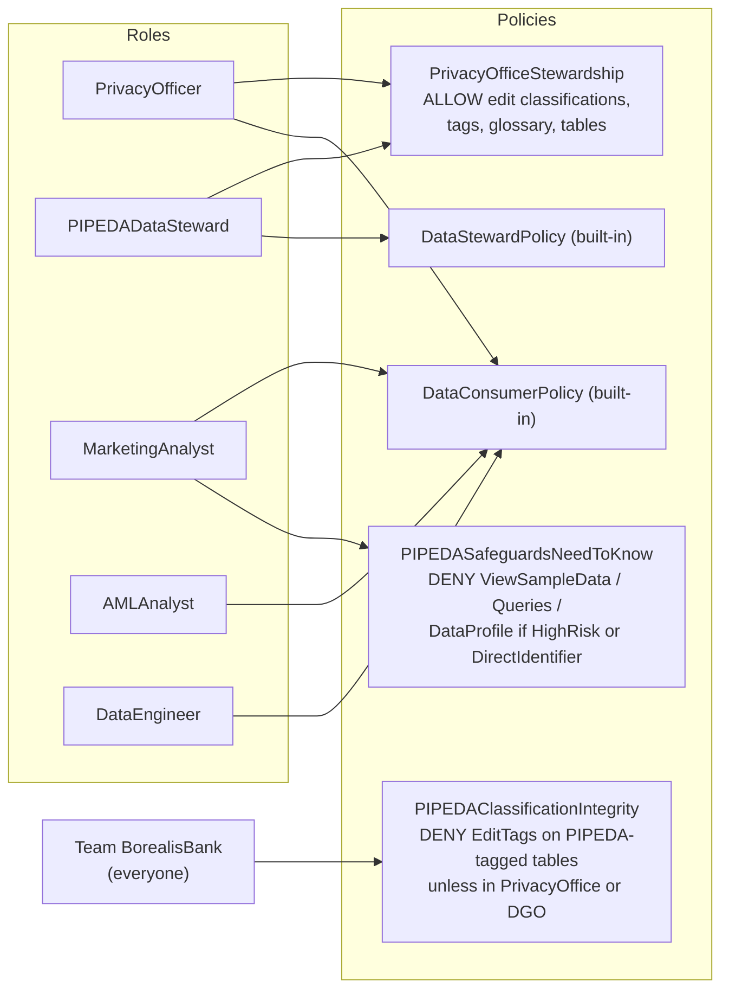
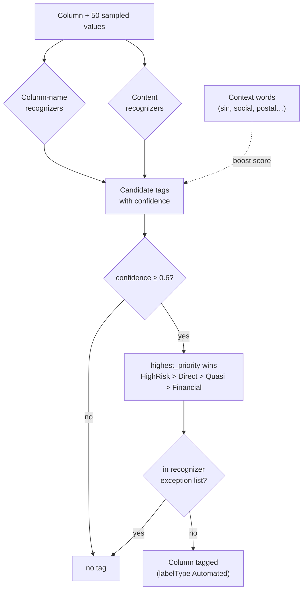
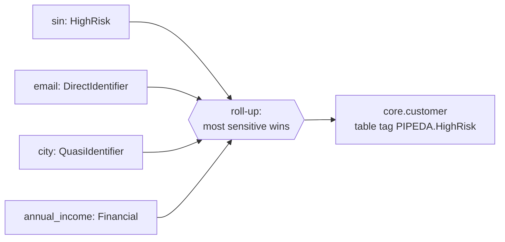
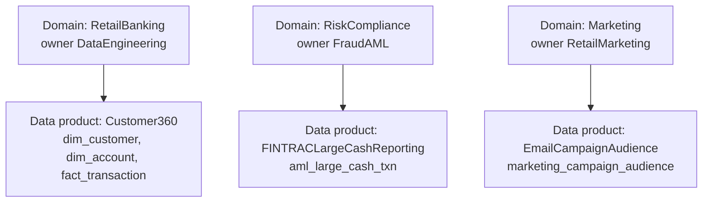
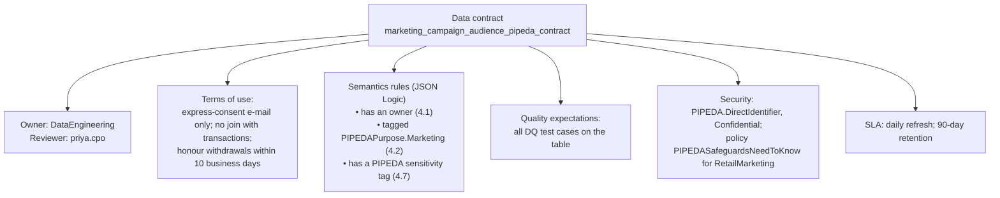

# Governance model

The whole governance model is declared as data in [`governance_model.py`](../poc/toolbox/poc/governance_model.py) and pushed into OpenMetadata by [`bootstrap_governance.py`](../poc/toolbox/poc/bootstrap_governance.py) and [`post_ingestion.py`](../poc/toolbox/poc/post_ingestion.py). Every call is an idempotent `PUT`, so the model can be edited and re-applied.

## From PIPEDA to OpenMetadata

PIPEDA Schedule 1 contains ten fair-information principles (CSA Q830). Each maps to one or more OpenMetadata features:

## Organisation

All persona users log in as `<name>@borealis.example` with a local test password.

### Roles and policies

The integrity policy is attached to the **business-unit team** rather than to a role, so it applies to everyone in the bank, including future users.

## Classifications

### `PIPEDA` (sensitivity)

Mutually exclusive, owned by the CPO, auto-classification enabled with `conflictResolution: highest_priority`, `minimumConfidence: 0.6`.

| Tag | Priority | Meaning | Recognizers |
|---|---|---|---|
| `PIPEDA.HighRisk` | 100 | Compromise creates a real risk of significant harm: SIN, card PAN, CVV, government ID, account number | SIN formatted / unformatted / column name; Presidio `CreditCardRecognizer`; card, account-number and government-ID column names; Ontario driver's licence; Canadian passport |
| `PIPEDA.DirectIdentifier` | 80 | Directly identifies or contacts a person | Presidio e-mail, phone, IP; spaCy `PERSON` NER; Canadian postal code; direct-identifier column names |
| `PIPEDA.QuasiIdentifier` | 50 | Re-identifies only in combination | Column names: city, province, FSA, birth year, age band, occupation, … |
| `PIPEDA.Financial` | 40 | Balances, income, amounts | Column names: balance, income, salary, amount, credit score |
| `PIPEDA.NonPersonal` | – | Reviewed and confirmed not personal | none (set by stewards) |

### Recognizer design notes

* **SIN.** Three recognizers work together: a formatted pattern (`NNN-NNN-NNN`, score 0.7), an unformatted 9-digit pattern (score 0.3, too weak alone) and a column-name pattern (0.9). Context words such as `sin`, `social`, `insurance`, `nas` boost the content scores. The OSS engine cannot run Python recognizers, so the Luhn checksum is not validated.
* **Postal code.** The regex excludes letters Canada Post never uses (D, F, I, O, Q, U, and W/Z in first position), which keeps US ZIP codes and random strings out.
* **Column-name recognizers** use `target: column_name` with case-insensitive matching. They are cheap and precise for well-named schemas but useless for `fld_02`, which is why content recognizers are kept as well.

### `PIPEDAPurpose` (purpose of processing)

`AccountServicing`, `RegulatoryReporting`, `FraudPrevention`, `Marketing`, `Analytics`. Applied at table level in step 8. Purposes drive enforcement: a role sees direct identifiers only on tables whose purpose matches its own (see [enforcement](enforcement.md)).

## Table-level metadata (step 8)

`TABLE_METADATA` assigns, per table, a domain, an owner team, purposes, an ISO-8601 retention period and a tier. Retention values are **assumptions** for the POC (FINTRAC requires at least five years for most records; the bank adopts seven years after the relationship ends).

Column sensitivity is then **rolled up**: each table inherits its most sensitive column-level PIPEDA tag. This is required because the sample-data endpoint only evaluates `matchAnyTag()` against table-level tags (see [results](results.md#product-limitations-found)).

## Domains and data products

## Glossary

`PIPEDAGlossary` contains 13 terms: *Personal information*, the ten principles, *Real risk of significant harm (RROSH)* and *Breach of security safeguards*. Because the glossary has the CPO as reviewer, every new term starts as *Draft* and goes through OpenMetadata's `GlossaryTermApprovalWorkflow` (see [human-in-the-loop](human-in-the-loop.md)). Only approved terms can be linked to tables; step 10 links *Consent*, *Safeguards*, *PersonalInformation* and *LimitingUseDisclosureRetention* to the relevant tables.

## Data contract

Step 10 creates `marketing_campaign_audience_pipeda_contract` on the marketing mart:

## Data-quality tests as code

Declared in `DATA_QUALITY` in [`workflows.py`](../poc/toolbox/poc/workflows.py); every test name starts with the principle it checks.

| Test | Table | Type |
|---|---|---|
| `p4_3_consent_marketing_flag_true` | `mart.marketing_campaign_audience` | `columnValuesToBeInSet` |
| `p4_3_consent_not_withdrawn` | `mart.marketing_campaign_audience` | custom SQL |
| `p4_3_consent_purpose_not_null` | `core.customer_consent` | `columnValuesToBeNotNull` |
| `p4_3_consent_withdrawal_after_capture` | `core.customer_consent` | custom SQL |
| `p4_4_limiting_collection_no_cvv_stored` | `core.card` | custom SQL |
| `p4_4_minimisation_no_full_postal_code` | `dw.dim_customer` | `columnValueLengthsToBeBetween` (3–3) |
| `p4_5_retention_closed_customers_purged` | `core.customer`, `dw.dim_customer` | custom SQL (closed > 7 years) |
| `p4_6_accuracy_email_format` | `core.customer` | `columnValuesToMatchRegex` |
| `p4_6_accuracy_postal_code_format` | `core.customer` | `columnValuesToMatchRegex` |
| `p4_6_accuracy_sin_unique` | `core.customer` | `columnValuesToBeUnique` |
| `fintrac_lctr_min_amount` | `mart.aml_large_cash_txn` | custom SQL (no row under $10 000) |
