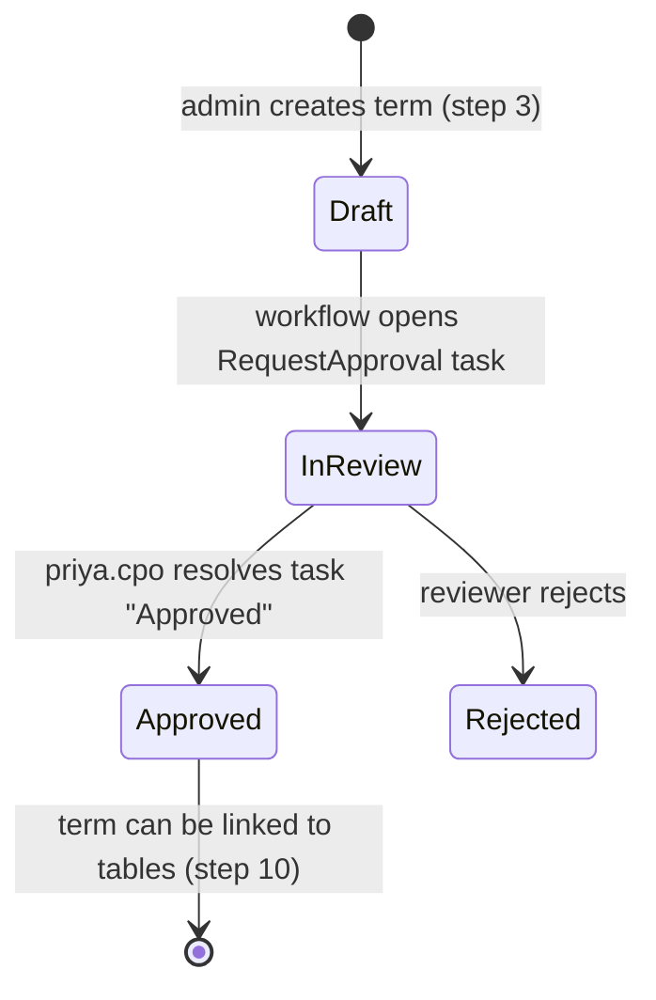
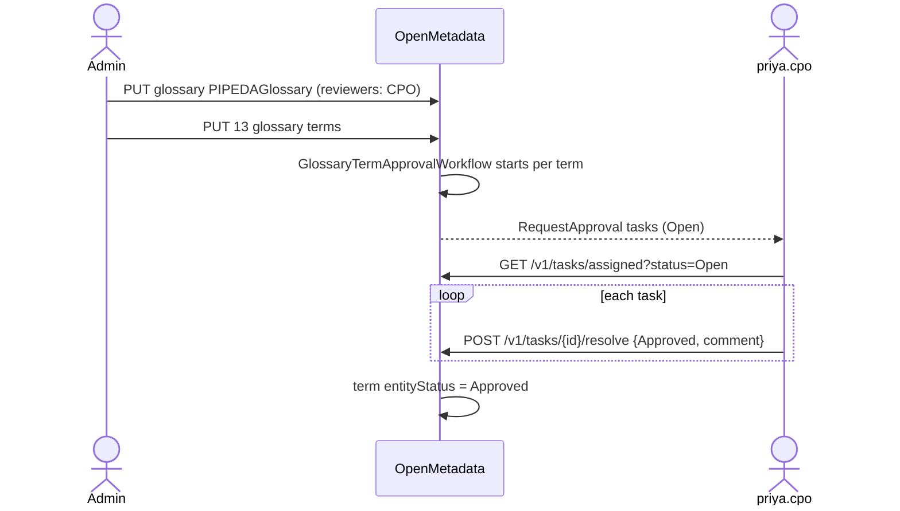
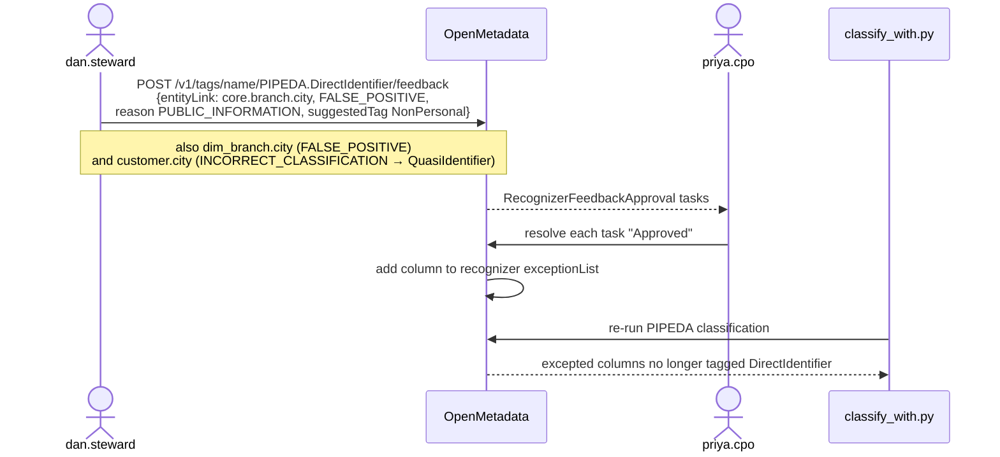
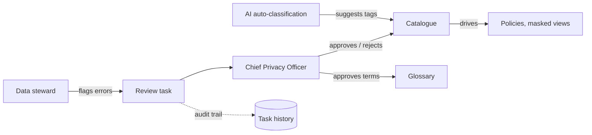

# Human-in-the-loop workflows

Auto-classification produces suggestions; people remain accountable for them (PIPEDA 4.1). The POC uses two of OpenMetadata 2.0.5's built-in governance workflows. Both create **tasks** assigned to a reviewer, and the resolved tasks form the audit trail (PIPEDA 4.10).

[`human_in_the_loop.py`](../poc/toolbox/poc/human_in_the_loop.py) logs in **as each persona** and makes the same REST calls the UI would make, so the run is reproducible. In production every decision would be a person's judgement in the UI.

## 1. Glossary term approval

The PIPEDA glossary has the CPO as reviewer, so each new term starts in *Draft* and OpenMetadata's `GlossaryTermApprovalWorkflow` opens an approval task.

Evidence: `results/workflow_audit.json` → `glossary_approval`.

## 2. Recognizer feedback (false-positive correction)

When a steward disagrees with an automated tag, they submit feedback on the tag. OpenMetadata's `RecognizerFeedbackReviewWorkflow` opens a task for the tag's reviewer; approval adds an exception to the recognizer so the same column is not re-tagged.

| Column | Feedback type | Steward's reason | Suggested tag |
|---|---|---|---|
| `core.branch.city` | False positive | Branch cities are public business addresses | `PIPEDA.NonPersonal` |
| `dw.dim_branch.city` | False positive | Public branch locations | `PIPEDA.NonPersonal` |
| `core.customer.city` | Incorrect classification | Customer city alone is a quasi-identifier | `PIPEDA.QuasiIdentifier` |

After approval the `PIPEDA.DirectIdentifier` tag carries three recognizer exceptions and the next classification run reports zero false positives (see [classification results](classification.md#results)). Evidence: `results/workflow_audit.json` → `recognizer_feedback`.

## Who decides what

The design choice worth noting: the AI never directly changes a control. It changes **tags**, and tags drive controls, so the human review sits on the one place every downstream control reads from.
