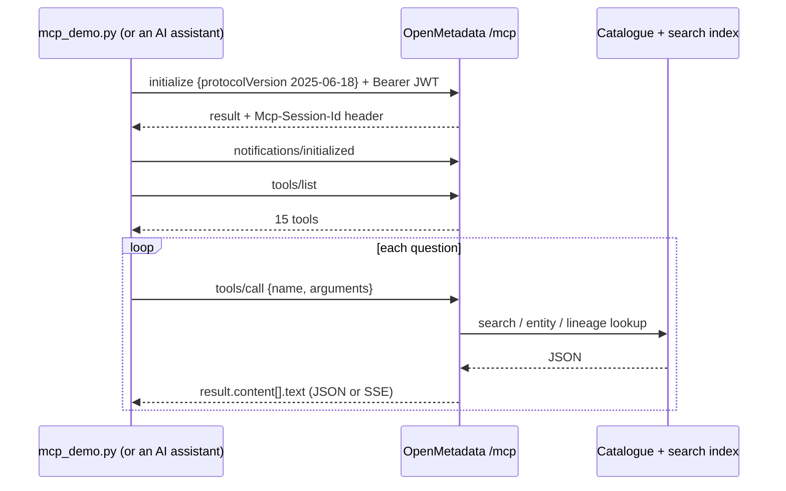
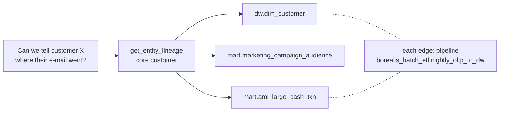
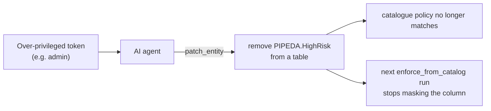

# AI assistant access through MCP

OpenMetadata 2.0.5 ships a **Model Context Protocol (MCP) server** at `http://localhost:8585/mcp`. Any MCP client (Claude Desktop, Claude Code, Cursor, …) can connect to it and use the catalogue as context. Step 12 ([`mcp_demo.py`](../poc/toolbox/poc/mcp_demo.py)) calls it directly over JSON-RPC so the answers are reproducible and saved in `results/mcp_transcript.json`.

## Protocol flow

## Tools exposed (15)

| Read | Write |
|---|---|
| `company_context`, `search_metadata`, `semantic_search`, `get_entity_details`, `get_persona_context`, `get_user_context`, `find_context`, `describe_entity_type`, `get_entity_lineage`, `get_test_definitions`, `root_cause_analysis` | `create_entity`, `patch_entity`, `create_lineage`, `create_test_case` |

## Privacy-office questions asked

| PIPEDA | Question | Tool |
|---|---|---|
| 4.7 | Which tables hold high-risk identifiers? | `search_metadata` filtered on `tags.tagFQN = PIPEDA.HighRisk` → 6 tables |
| 4.9 | A customer asks where their e-mail goes. What is downstream of `core.customer`? | `get_entity_lineage` (downstream depth 2) |
| 4.3 | Is the marketing audience consent-compliant? | `get_entity_details` with `quality` and `context` |
| 4.8 | What does "real risk of significant harm" mean here? | `search_metadata` on `glossaryTerm` |

## Connecting your own assistant

1. Log in to the UI as a **least-privilege** user (for example `maya.marketing`, not `admin`).
2. Create a personal access token under the user's profile.
3. Add the MCP server to your client following the OpenMetadata guide, using `http://localhost:8585/mcp` and the token.

## Security caveat

Because tags drive every safeguard in this design, an agent that can write tags can switch safeguards off. Mitigations used or recommended:

* Use per-user tokens with the minimum role; never the admin or bot token for an assistant.
* Keep `PIPEDAClassificationIntegrity` on the whole organisation so tag edits on sensitive tables are denied outside the Privacy Office.
* Review the task and change history for agent-made edits.

> The demo script itself uses the admin token only to make the run self-contained. Do not copy that into a real setup.
