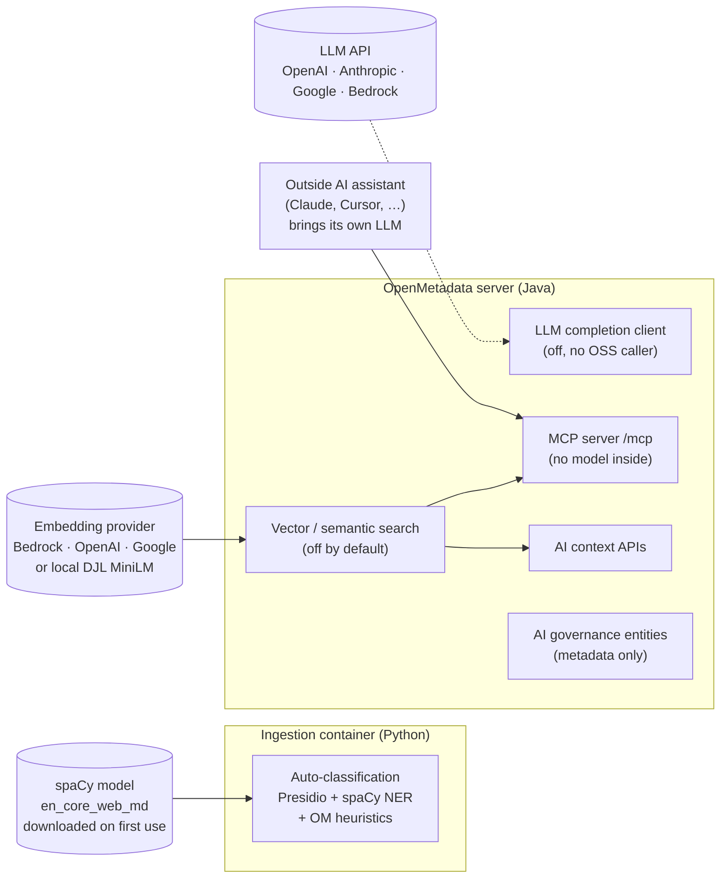

# How OpenMetadata uses AI, LLMs and machine learning

This page lists every place where OpenMetadata uses AI, large language models (LLMs) or machine learning. For each one it answers four questions:

1. **What does it do, and with which technique?**
2. **Does it need a pre-trained model?** If so, which model, and where does it come from?
3. **Does it need an API key for an outside service?**
4. **Is it OpenMetadata's own code, or a library or service it calls?**

It covers **OpenMetadata 2.0.5**, the version the POC runs. Every claim was checked against the source at the `2.0.5-release` tag. Each claim cites the file it comes from, and the official documentation where there is a page for it. Sources are numbered **[S1]**, **[S2]** and so on and listed at the [end of the page](#sources).

> **OpenMetadata vs. Collate.** OpenMetadata is the open-source project. Collate is the company behind it, and it sells a managed product of the same name with extra AI features (Collate AI, AutoPilot agents, AskCollate, anomaly detection). The open-source code has a few hooks for those features, but the features themselves are not in the open-source code. This page labels each feature **OSS** (in the open-source 2.0.5 code) or **Collate** (paid product only).

## Short answers

| Question | Answer |
|---|---|
| **Does OpenMetadata use AI / ML?** | Yes, in one feature that is on by default: **auto-classification** of PII. It uses Microsoft Presidio and a spaCy named-entity recognition (NER) model to tag sensitive columns. A second feature, **semantic (vector) search**, is optional and **off by default**. When switched on it uses text-embedding models, and the MCP server's `semantic_search` tool and the AI-context APIs build on it. A generic **LLM chat-completion client** exists too, but it is off by default, and no 2.0.5 open-source feature calls it. |
| **Does it need pre-trained models?** | **Yes.** Auto-classification needs a pre-trained **spaCy pipeline**: `en_core_web_md` for English, or one of the language models mapped for 82 languages. It is **downloaded on first use** if missing, and the Docker image does not include it. Semantic search needs an **embedding model**: either a hosted one (Amazon Titan, OpenAI `text-embedding-3-small`, Google `gemini-embedding-001`) or a local Hugging Face model run through DJL (`sentence-transformers/all-MiniLM-L6-v2`, downloaded on first use). OpenMetadata **does not train or fine-tune any model**. |
| **Does it need API keys for existing services?** | **Not for the default features.** Auto-classification runs entirely inside the ingestion container. **Yes, if you switch on** semantic search or the LLM client with a hosted provider: an AWS Bedrock IAM identity or keys, an OpenAI or Azure OpenAI key, a Google Gemini key, or an Anthropic key. The DJL embedding option needs no key. The MCP server needs no LLM key either, because the AI assistant that connects to it brings its own model. Collate's AI features use Collate's own back end, configured with a **WAII** API host and token. |
| **Does it have its own AI implementation?** | **No model of its own.** OpenMetadata's own code is the logic *around* models. It has a heuristic scoring layer on top of Presidio and spaCy, regex column-name rules, conflict resolution between tags, and the steward-feedback loop. That loop adds exceptions to recognizers; it does not retrain anything. It also has the plumbing for vector search: building text to embed, chunking it, k-nearest-neighbour (KNN) and hybrid queries. Finally, it has provider-neutral client wrappers for outside LLM and embedding APIs. The ML itself comes from Presidio, spaCy, DJL/PyTorch or a hosted API. |

## Every AI and ML touchpoint at a glance

| # | Feature | Edition | Technique | Pre-trained model | API key | Default |
|---|---|---|---|---|---|---|
| 1 | [Auto-classification (PII tagging)](#1-auto-classification-pii-tagging) | OSS | Regex, checksums and context words (Presidio), spaCy statistical NER, and OpenMetadata heuristics | spaCy `en_core_web_md` (or a per-language model) | No | **On** when you run an auto-classification workflow |
| 2 | [Semantic (vector) search](#2-semantic-vector-search-and-embeddings) | OSS | Text embeddings plus KNN, with optional hybrid search (BM25 + vector, rank fusion) | Hosted embedding model, or local `all-MiniLM-L6-v2` via DJL | Yes for Bedrock, OpenAI, Azure OpenAI or Google; no for DJL | **Off** (`SEMANTIC_SEARCH_ENABLED=false`) |
| 3 | [LLM completion client](#3-generic-llm-completion-client) | OSS (plumbing only) | Chat-completion API calls | Hosted LLM (GPT-4o-mini, Claude, Gemini, Bedrock) | Yes | **Off** (`LLM_ENABLED=false`); no caller in 2.0.5 OSS |
| 4 | [Natural-language query (NLQ) hook](#4-natural-language-query-nlq-hook) | Interface in OSS, provider in Collate | Converts a plain-language search into a search query | Depends on the plug-in | Depends on the plug-in | **Off**; OSS ships only a no-op |
| 5 | [MCP server](#5-mcp-server-for-ai-assistants) | OSS | None inside the server; an outside LLM client calls the server's tools | None on the server | None on the server (the client needs its own) | Enabled at `/mcp` |
| 6 | [AI context / context profiles](#6-ai-context-and-context-profiles) | OSS | Puts metadata together as text for an LLM to read; vector look-ups when #2 is on | Only through #2 | Only through #2 | Available |
| 7 | [AI governance entities](#7-ai-governance-catalogue-of-ai-assets) | OSS | None: a catalogue *of* AI systems, with hard-coded compliance rules | None | None (connection settings are stored as metadata) | Available |
| 8 | [ML model cataloguing](#8-ml-model-cataloguing-mlflow-sagemaker-scikit-learn) | OSS | None: records the metadata of ML models | None | Credentials for MLflow or SageMaker, not AI keys | Per connector |
| 9 | [Dynamic assertions / anomaly detection](#9-dynamic-assertions-and-anomaly-detection) | Flag in OSS, engine in Collate | Learned baselines and seasonality (algorithm not published) | Unknown (not open source) | Collate subscription | No engine in OSS |
| 10 | [RDF "semantic" embedding service](#10-rdf-semantic-embedding-placeholder) | OSS | **Placeholder**: random vectors seeded from a hash of the text, not ML | None | None | Only used by the RDF feature |
| 11 | [Collate AI / AutoPilot / AskCollate](#11-collate-only-ai-features) | Collate | Generative AI agents for documentation, tiers, data-quality tests, chat and SQL | Not disclosed | Collate back end (WAII host and token) | Paid product |

---

## 1. Auto-classification (PII tagging)

**Edition:** OSS. **Default:** used whenever an auto-classification ingestion workflow runs.

### What it does

The auto-classification workflow reads sample rows from every table (`sampleDataCount`). It then scores each column against the recognizers attached to the tags of a classification, for example `PII.Sensitive` or `PII.NonSensitive`. A tag is applied when its score passes the confidence threshold (default `0.6`). The documentation describes two parts: a column-name scanner based on regular expressions, and an NLP entity recognizer that reads the sample values [S1][S2].

### Techniques and libraries

| Layer | What it is | ML? | Source |
|---|---|---|---|
| **Microsoft Presidio Analyzer** `2.2.358` | Microsoft's open-source PII-detection framework. It supplies the pattern, checksum and context-word recognizers and runs the NLP engine. | Framework | `ingestion/setup.py` pins `presidio-analyzer==2.2.358` and installs it with the `pii-processor` extra [S3] |
| **spaCy** `>=3.8.2,<3.9` | NLP library. Presidio's `SpacyNlpEngine` loads a spaCy pipeline and uses its statistical named-entity recognizer (labels such as `PERSON`, `GPE`/`LOC`, `DATE`). | **Yes**: a pre-trained neural NER model | `ingestion/setup.py` [S3]; `presidio_utils.py` builds a `SpacyNlpEngine` [S4] |
| **Predefined recognizers** | 42 Presidio recognizer classes can be selected. The seeded `PII.Sensitive` tag carries 38 recognizers covering credit cards, US SSN/ITIN/passport/licence/bank account, UK NHS/NINO, AU ABN/ACN/TFN/Medicare, IN PAN/Aadhaar, ES NIF/NIE, IT fiscal code, IBAN, IP, e-mail, crypto wallets, ABA routing numbers and more, plus a CVV pattern. Most are regex plus a checksum. **`SpacyRecognizer` is the only ML-based one** in the seed data. | Mostly rules; `SpacyRecognizer` is ML | `predefinedRecognizer.json` enum [S5]; seed file `piiTagsWithRecognizers.json` [S6] |
| **Recognizer types defined by OpenMetadata** | `pattern` (regex), `exact_terms`, `context` (context words) and `predefined` work. `custom` is in the schema, but the factory **refuses to run user-supplied Python** and returns nothing. | Rules | `recognizer.json` [S7]; `_create_custom_recognizer` [S8] |
| **OpenMetadata's heuristic scorer** | OpenMetadata's own code. It skips data types that cannot hold PII. It skips columns with low relative cardinality (unique/total < 0.01). It adds **+0.5** when the column name also matches a pattern for that tag, applies a score cut-off, and averages per sensitivity level. A `ConflictResolver` then picks one tag per classification by priority. | **No**: hand-tuned heuristics, not a trained model | `HeuristicPIIClassifier` in `classifiers.py` [S9]; `TagScorer` in `tag_scoring.py` [S10]; `conflict_resolver.py` [S11] |
| **Recognizer feedback** | When a steward reports a false positive and the report is approved, an entry is added to that recognizer's `exceptionList`, so the recognizer no longer runs on that column. **Nothing is retrained.** | No | `recognizer.json` (`exceptionList`, `recognizerException.feedbackId`) [S7]; workflow nodes `applyRecognizerFeedbackTask.json` [S12] |

### Pre-trained model: yes (spaCy)

* The English default is **`en_core_web_md`**, and other languages use a mapped model. `constants.py` maps the 82 values of `classificationLanguage` to spaCy pipelines, for example `fr_core_news_md` and `de_core_news_md`, and falls back to the multilingual `xx_ent_wiki_sm` [S13].
* **How it is obtained:** `_load_spacy_model()` calls `spacy.load(model)`. If that raises `OSError`, it calls `spacy.cli.download(model)`, which installs the model package from spaCy's GitHub releases at run time [S4]. The ingestion `Dockerfile` installs `openmetadata-ingestion[all]`, which includes the libraries but **not the model file** [S14].
* **Consequence:** the first classification run on a host without the model needs internet access to fetch it. For an air-gapped or locked-down deployment, install the model wheel into the ingestion image ahead of time.
* **Presidio's ML recognizers.** The predefined enum also lists `TransformersRecognizer`, `GLiNERRecognizer`, `StanzaRecognizer` and `AzureAILanguageRecognizer` [S5]. They can be selected in the schema, but their libraries (`transformers`, `gliner`, `stanza`, Azure AI Language SDK) are **not** among the ingestion dependencies [S3], and `AzureAILanguageRecognizer` would also need an Azure key. They are not usable out of the box. This was not tested in the POC.

### API keys: none

Everything runs inside the ingestion process. Sample values are scored locally, and only the resulting tags (with a `reason` and recognizer metadata) are sent to the OpenMetadata server.

### Own implementation?

Partly. The ML comes from spaCy, and the rules from Presidio. OpenMetadata wrote the orchestration, the heuristic scoring, the column-name patterns, the conflict resolution, the recognizer-as-metadata model and the feedback workflow.

> **Project link.** This is the feature the POC measures in [classification.md](classification.md). It is also the one where the POC added Canadian recognizers (SIN, postal code, Ontario driver's licence, passport). See [governance-model.md](governance-model.md).

---

## 2. Semantic (vector) search and embeddings

**Edition:** OSS. **Default:** **off** (`elasticsearch.naturalLanguageSearch.semanticSearchEnabled: ${SEMANTIC_SEARCH_ENABLED:-false}`) [S15].

### What it does

When it is on, the server turns each catalogue entity into one or more text chunks, embeds each chunk with an embedding model, and stores the vectors in Elasticsearch or OpenSearch. Queries are embedded the same way and answered with **KNN** similarity search. On OpenSearch the server also sets up a **hybrid** pipeline that fuses lexical (BM25) and vector results with reciprocal-rank fusion [S16]. Embeddings are kept up to date as entities change, and a reindex backfills existing entities [S17].

* REST endpoint: `POST /api/v1/search/vector/query` (`VectorSearchResource`) [S18].
* Consumers: the MCP `semantic_search` and `find_context` tools, and the AI-context APIs (sections [5](#5-mcp-server-for-ai-assistants) and [6](#6-ai-context-and-context-profiles)).

### What text is embedded

The **metadata** of each entity, not table rows: a phrase naming the entity (name, type, tags, domains, tier and similar), its description with HTML removed, the list of column names for tables, and context from child entities. See `buildSemanticBodyText` and `buildSemanticMetaLightText` in `VectorDocBuilder.java` [S19]. Sample data is not part of the embedded text. Descriptions and glossary text are, and they could contain personal information if someone wrote it there.

### Providers, models and keys

The provider is set in `llmConfiguration.embeddings`. Credentials are reused from the LLM provider blocks [S15]. Client classes are in `search/vector/client/` [S20].

| Provider (`EMBEDDING_PROVIDER`) | Default model | Dimension | Runs where | Credentials |
|---|---|---|---|---|
| `bedrock` (**default provider**) | `amazon.titan-embed-text-v2:0` | 512 | AWS Bedrock (hosted) | AWS IAM role or `AWS_ACCESS_KEY_ID`/`AWS_SECRET_ACCESS_KEY`, plus region |
| `openai` | `text-embedding-3-small` | 1536 | OpenAI, or Azure OpenAI when `endpoint` and `deploymentName` are set | `LLM_OPENAI_API_KEY` |
| `google` | `gemini-embedding-001` | 768 | Google Gemini API | `LLM_GOOGLE_API_KEY` |
| `djl` | `ai.djl.huggingface.pytorch/sentence-transformers/all-MiniLM-L6-v2` | detected (384) | **Locally inside the OpenMetadata server JVM**, through Deep Java Library and PyTorch | **None** |

* **Pre-trained model: yes**, always. For `djl`, `DjlEmbeddingClient` loads the model from the DJL model zoo (`djl://…`) with the PyTorch engine and a Hugging Face tokenizer, so it is fetched on first start [S21]. The server `pom.xml` adds `ai.djl:api`, `ai.djl.pytorch:pytorch-engine` and `ai.djl.huggingface:tokenizers` `0.34.0` [S22].
* **Search back end:** the v2.0.x documentation says Elasticsearch or OpenSearch. Older versions (1.12, 1.13) required OpenSearch [S17].

### Own implementation?

The chunking, the embedding text, the index mappings, the KNN and hybrid query builders and the model-change fingerprinting are OpenMetadata code. The embeddings come from the chosen model or API.

---

## 3. Generic LLM completion client

**Edition:** OSS (plumbing only). **Default:** **off** (`llmConfiguration.enabled: ${LLM_ENABLED:-false}`, `provider: noop`) [S15].

* `LLMCompletionClient` is a provider-neutral chat-completion wrapper. It limits concurrent requests with a semaphore (default 5), and `completeStructured()` parses the model's JSON-array answer, retrying once if the JSON is invalid [S23].
* Implementations: `OpenAICompletionClient` (OpenAI and Azure OpenAI), `AnthropicCompletionClient`, `GoogleCompletionClient` and `BedrockCompletionClient`, chosen by `LLMCompletionClientFactory` [S23].

| Provider | Default model in `openmetadata.yaml` | Key / variable |
|---|---|---|
| `openai` / `azureOpenAI` | `gpt-4o-mini` | `LLM_OPENAI_API_KEY` (+ `LLM_OPENAI_ENDPOINT`, `LLM_OPENAI_DEPLOYMENT` for Azure) |
| `anthropic` | `claude-3-5-sonnet-20240620` | `LLM_ANTHROPIC_API_KEY` |
| `google` | `gemini-2.5-flash` | `LLM_GOOGLE_API_KEY` |
| `bedrock` | `eu.anthropic.claude-haiku-4-5-20251001-v1:0` | AWS IAM role or keys |

**Finding:** in 2.0.5 the server builds the client at start-up (`LLMClientHolder.initialize(...)` in `OpenMetadataApplication.java` [S24]). A search of all non-test Java code found **no caller of `LLMClientHolder.get()`**. The comment in `openmetadata.yaml` describes it as a generic home for "any feature that needs LLM completions or embeddings" [S15]. Today only the embeddings part is used. Setting an LLM key in OSS 2.0.5 therefore turns on no user-facing feature.

---

## 4. Natural-language query (NLQ) hook

**Edition:** interface in OSS; real provider expected from Collate or a plug-in. **Default:** off.

`NLQServiceFactory` reads `elasticsearch.naturalLanguageSearch.enabled` and `providerClass`, and loads that class by reflection. When OpenSearch is the back end, `OpenSearchSearchManager` calls `nlqService.transformNaturalLanguageQuery(...)` to turn a plain-language question into a search query, and caches the result [S25]. **OSS ships only `NoOpNLQService`**; no class in the repository actually translates questions. Any model or key requirement depends on the provider class you plug in.

---

## 5. MCP server for AI assistants

**Edition:** OSS. **Default:** served at `{OM_URL}/mcp` (Streamable HTTP; OAuth 2.0 or JWT / personal access token) [S26].

* The server exposes **15 tools** in 2.0.5: `search_metadata`, `semantic_search`, `get_entity_details`, `get_entity_lineage`, `root_cause_analysis`, `find_context`, `company_context`, `get_persona_context`, `get_user_context`, `describe_entity_type`, `get_test_definitions`, `create_entity`, `patch_entity`, `create_lineage` and `create_test_case` [S27].
* **No model runs inside the MCP server, and the server needs no LLM key.** The language model belongs to the client that connects (Claude Desktop, Claude Code, Cursor, VS Code, Goose and others) and is paid for and configured on the client side [S26]. The server's job is to return metadata in a compact form an LLM can read. For example, `GetEntityTool` drops bulky fields "to optimize LLM context usage" [S27].
* `semantic_search` only works when [semantic search](#2-semantic-vector-search-and-embeddings) is on. Otherwise it returns *"Semantic search is not enabled. Configure vector embeddings in the OpenMetadata server settings."* [S28].
* There is also an **MCP ingestion connector** that *discovers and catalogues* other MCP servers (their tools, resources and prompts) for AI governance [S29]. This is metadata collection, not AI.

> **Project link.** The POC calls this server in step 12. See [mcp.md](mcp.md), which also covers the token and least-privilege risks. The POC runs Elasticsearch with semantic search left off, so `semantic_search` is listed but not used.

---

## 6. AI context and context profiles

**Edition:** OSS. `/api/v1/ai/context/*` (`AIContextResource`) and `AIContextBuilder` / `AIContextFinder` put together a deterministic, size-limited **"LLM-ready" Markdown/JSON summary** of an asset or persona: its structure plus attached glossary terms, metrics and Context Center articles. Agents can then load it into their prompt [S30][S31]. The code calls no LLM. It **uses vector search when it is on**, to pick the passages most relevant to a question, and otherwise falls back to a fixed preview [S31]. The model and key needs are those of section 2.

---

## 7. AI governance: catalogue of AI assets

**Edition:** OSS. This is governance **of** AI, not AI. OpenMetadata 2.0.5 adds entity types to record and assess AI systems:

| Entity | Purpose (from its JSON schema) |
|---|---|
| `LLMModel` | A registered LLM deployment, fine-tune or base model |
| `AIApplication` | Chatbots, agents and copilots that use models, tools and data |
| `McpServer`, `McpExecution` | MCP server deployments and the tool calls made in each session |
| `AgentExecution` | One run of an AI agent: inputs, outputs, lineage, metrics |
| `PromptTemplate` | Reusable prompts |
| `AIGovernancePolicy`, `AIGovernanceFramework`, `AIFrameworkControl` | Policies and control libraries, for example EU AI Act articles |
| `AuditReport` | Evidence packs (JSON or PDF) for auditors |
| `LLMService` | LLM providers. Connection schemas exist for OpenAI, Azure OpenAI, Anthropic, Bedrock, Hugging Face, Ollama, Vertex AI and custom endpoints. |

Sources: `openmetadata-spec/.../entity/ai/*.json`, `entity/services/llmService.json`, `connections/llm/*.json` and `type/aiCompliance.json` (risk levels *Minimal, Limited, High, Unacceptable*) [S32].

* `PolicyEvaluator` checks AI assets against a **hard-coded** set of rules built from entity fields, for example how recent a fairness check is (90 days). Its own comment says a real rule engine will come in "Phase 4" [S33]. **No ML.**
* The server ships **demo seed data**, such as `gpt_4o_claims_prod.json`, `claude_3_hr_screening.json` and "Shadow AI" fixtures [S34]. These are examples, not working integrations.
* The 2.0.5 Python ingestion package has no `llmService` connector. LLM-service connection settings are stored as metadata, and nothing in OSS calls those providers' APIs from them.

---

## 8. ML model cataloguing (MLflow, SageMaker, scikit-learn)

**Edition:** OSS. The MLflow and SageMaker connectors, and the Python SDK helper `get_mlmodel_sklearn()`, *read the metadata of* ML models: features, hyper-parameters, algorithm, lineage to source tables [S35]. OpenMetadata does not train or run those models. The `scikit-learn` dependency exists only so the SDK can inspect `BaseEstimator` objects [S3][S35].

---

## 9. Dynamic assertions and anomaly detection

**Edition:** flag in OSS, engine in Collate.

* The OSS schema has `testDefinition.supportsDynamicAssertion` and `testCase.useDynamicAssertion` ("use dynamic assertion to evaluate the test case"), and the UI shows a "Dynamic Assertion" option [S36].
* The 2.0.5 Python data-quality runner (`ingestion/src/metadata/data_quality`) contains **no dynamic-assertion logic**. The flag is only stored and passed through, for example by `sample_data.py`.
* Collate's documentation describes the engine. It "dynamically learns from your data patterns through regular profiling", detects seasonality, and needs about **five weeks** of profiling before expected ranges are set [S37]. The algorithm and models are **not published**, so whether they are pre-trained, and what they need, cannot be checked.

---

## 10. RDF "semantic" embedding (placeholder)

**Edition:** OSS. `rdf/semantic/EmbeddingService.java` (used by the RDF / knowledge-graph resource) has a `LocalEmbeddingProvider`. It **seeds a random number generator with `text.hashCode()`** and returns a normalised random 384-dimensional vector. The comments say this is "for demo purposes", and the constructor carries `// TODO: Add configuration support for different providers`. A `SentenceTransformerProvider` stub also falls back to the hash method (`TODO: Implement ONNX runtime inference`) [S38]. **This is not machine learning.** These vectors carry no meaning, so do not treat RDF "semantic" similarity as real semantic search.

---

## 11. Collate-only AI features

These are **not** in OpenMetadata open source. They are listed because OSS documentation and code point to them, and people often mix them up with OSS features.

| Feature | What Collate says it does | Source |
|---|---|---|
| **Collate AI** | A generative-AI layer for metadata: documentation, SQL generation and optimisation, data exploration in plain language | [S39] |
| **AutoPilot agents** | **Documentation Agent** (writes table and column descriptions), **Tier Agent** (suggests tiers from usage and lineage), **Data Quality Agent** (creates tests). They run at onboarding and on a schedule, and their output is either applied or raised as *suggestions* to accept or reject. | [S40][S41] |
| **AskCollate / Collate AI Chat** | Conversational analytics over the knowledge graph. It runs read-only SQL (`SELECT`, `WITH`, `SHOW`, …) under the user's permissions and can turn answers into charts. | [S42] |
| **AI Studio / AI SDK** | Build or adjust agents, and call them from Python, TypeScript, Java or a CLI with a bot JWT | [S43] |
| **Anomaly detection** | See [section 9](#9-dynamic-assertions-and-anomaly-detection) | [S37] |

**What the OSS code shows about how this is wired:**

* `collateAIAppConfig.json` has `filter` and `patchIfEmpty`. With `patchIfEmpty` on, the app writes a description straight onto an asset whose description is empty, instead of raising a suggestion. `collateAIAppPrivateConfig.json` **requires `waiiInstance` ("WAII API host URL"), `collateURL` and `token` ("WAII API Token")** [S44]. So the Collate AI app calls an **outside AI back end (WAII)** with an API token. Collate does not say which LLMs sit behind it.
* The OSS **`Suggestion`** entity ("User or Bot who made the suggestion") lets these agents propose descriptions and tags for people to review [S45].

---

## Summary tables

### Pre-trained models OpenMetadata can use

| Model | Kind | Used by | How it is obtained | Needed by default? |
|---|---|---|---|---|
| spaCy `en_core_web_md` (or a per-language `*_core_news_md`, or `xx_ent_wiki_sm`) | Statistical NER pipeline | Auto-classification | `spacy.cli.download` on first use [S4][S13] | **Yes**, for auto-classification |
| `sentence-transformers/all-MiniLM-L6-v2` | Sentence-embedding transformer | Semantic search (`djl`) | DJL model zoo on first start [S21] | No |
| Amazon Titan Text Embeddings v2 | Hosted embedding model | Semantic search (`bedrock`, the default provider) | AWS Bedrock API | No |
| OpenAI `text-embedding-3-small` | Hosted embedding model | Semantic search (`openai`) | OpenAI / Azure OpenAI API | No |
| Google `gemini-embedding-001` | Hosted embedding model | Semantic search (`google`) | Gemini API | No |
| GPT-4o-mini, Claude, Gemini 2.5 Flash, Claude Haiku on Bedrock | Hosted chat LLMs | LLM completion client (no OSS caller) | Provider API | No |

### API keys and credentials

| Variable(s) | Needed for | Source |
|---|---|---|
| *(none)* | Auto-classification, MCP server, AI governance entities, DJL embeddings | [S4][S21][S26] |
| `AWS_DEFAULT_REGION`, `AWS_ACCESS_KEY_ID`, `AWS_SECRET_ACCESS_KEY`, `AWS_SESSION_TOKEN` (or an IAM role; `BEDROCK_AWS_IAM_AUTH_ENABLED`) | Bedrock embeddings or completions | [S15] |
| `LLM_OPENAI_API_KEY` (+ `LLM_OPENAI_ENDPOINT`, `LLM_OPENAI_DEPLOYMENT`, `LLM_OPENAI_API_VERSION` for Azure) | OpenAI / Azure OpenAI embeddings or completions | [S15] |
| `LLM_GOOGLE_API_KEY` | Gemini embeddings or completions | [S15] |
| `LLM_ANTHROPIC_API_KEY` | Anthropic completions (no Anthropic embeddings) | [S15] |
| Switches: `SEMANTIC_SEARCH_ENABLED`, `EMBEDDING_PROVIDER`, `LLM_ENABLED`, `LLM_PROVIDER` | Turn on #2 and #3 | [S15] |
| WAII host and token | Collate AI (paid product) | [S44] |
| The AI client's own LLM key or subscription | Using the MCP server from Claude, Cursor and so on | [S26] |

---

## What this means for the project (PIPEDA)

* **The POC sends no data to an outside AI service.** It uses only auto-classification, which runs Presidio and spaCy inside the `om-cli` ingestion container. The POC compose files do not set `SEMANTIC_SEARCH_ENABLED` or `LLM_ENABLED`, so both stay off. The search back end is Elasticsearch ([`poc/openmetadata/docker-compose-openmetadata-postgres.yml`](../poc/openmetadata/docker-compose-openmetadata-postgres.yml)).
* **Switching on semantic search with a hosted provider is a transfer of data for processing.** Names, descriptions, column names and glossary text would go to AWS, OpenAI or Google. Under PIPEDA Principle 4.1.3, the bank stays accountable and needs contractual protection. Free-text descriptions can contain personal information. The local `djl` provider avoids the transfer.
* **The first classification run needs internet access** to download the spaCy model, unless the model is installed in the image beforehand. Plan for this in a locked-down bank network.
* **Recognizer feedback is a rules exception, not learning.** Corrections apply only to the columns reported. The model does not get better in general, and the [human-in-the-loop](human-in-the-loop.md) controls stay necessary.
* **The MCP server moves the AI risk to the client.** The LLM and its data handling are whatever assistant the user connects. See the token caveats in [mcp.md](mcp.md).

## How this was researched

1. Cloned `open-metadata/OpenMetadata` at the tag `2.0.5-release` (commit `34b871b`).
2. Searched the Java, Python and JSON sources for `presidio`, `spacy`, `openai`, `bedrock`, `anthropic`, `embedding`, `djl`, `llm`, `vector`, `sklearn`, `dynamicAssertion` and `CollateAI`, then read each hit.
3. Traced how each feature is wired: who builds each client, who calls it, and what the default configuration is.
4. Checked against the official OpenMetadata and Collate documentation. Where the documentation and the code disagree, this page follows the code.

## Sources

Source links point to the `2.0.5-release` tag. `OM` = `https://github.com/open-metadata/OpenMetadata/blob/2.0.5-release`.

* **[S1]** OpenMetadata docs (v2.0.x), *Auto Classification*: https://docs.open-metadata.org/v2.0.x/how-to-guides/data-governance/classification/auto-classification
* **[S2]** OpenMetadata docs (v2.0.x), *Auto PII Tagging*: https://docs.open-metadata.org/v2.0.x/how-to-guides/data-quality-observability/profiler/auto-pii-tagging.md; v1.12.x (Presidio entities, `confidence`): https://docs.open-metadata.org/v1.12.x/how-to-guides/data-governance/classification/auto-classification/auto-pii-tagging.md
* **[S3]** `OM/ingestion/setup.py`, version pins (`presidio-analyzer==2.2.358` L90, `spacy>=3.8.2,<3.9` L68, `scikit-learn` L60) and the `pii-processor` extra (L451): https://github.com/open-metadata/OpenMetadata/blob/2.0.5-release/ingestion/setup.py
* **[S4]** `OM/ingestion/src/metadata/pii/algorithms/presidio_utils.py`: `load_nlp_engine`, `build_analyzer_engine` (L118), `_load_spacy_model` with download fallback (L148): https://github.com/open-metadata/OpenMetadata/blob/2.0.5-release/ingestion/src/metadata/pii/algorithms/presidio_utils.py
* **[S5]** `OM/openmetadata-spec/src/main/resources/json/schema/type/predefinedRecognizer.json` (enum of 42 Presidio recognizers): https://github.com/open-metadata/OpenMetadata/blob/2.0.5-release/openmetadata-spec/src/main/resources/json/schema/type/predefinedRecognizer.json
* **[S6]** `OM/openmetadata-service/src/main/resources/json/data/tags/piiTagsWithRecognizers.json` (seeded PII tags and recognizers): https://github.com/open-metadata/OpenMetadata/blob/2.0.5-release/openmetadata-service/src/main/resources/json/data/tags/piiTagsWithRecognizers.json
* **[S7]** `OM/openmetadata-spec/src/main/resources/json/schema/type/recognizer.json` (recognizer types, `confidenceThreshold` 0.6, `exceptionList`): https://github.com/open-metadata/OpenMetadata/blob/2.0.5-release/openmetadata-spec/src/main/resources/json/schema/type/recognizer.json
* **[S8]** `OM/ingestion/src/metadata/pii/algorithms/presidio_recognizer_factory.py` (`_create_custom_recognizer` L179, `_create_predefined_recognizer`): https://github.com/open-metadata/OpenMetadata/blob/2.0.5-release/ingestion/src/metadata/pii/algorithms/presidio_recognizer_factory.py
* **[S9]** `OM/ingestion/src/metadata/pii/algorithms/classifiers.py` (`HeuristicPIIClassifier` L82): https://github.com/open-metadata/OpenMetadata/blob/2.0.5-release/ingestion/src/metadata/pii/algorithms/classifiers.py
* **[S10]** `OM/ingestion/src/metadata/pii/algorithms/tag_scoring.py` (`TagScorer`): https://github.com/open-metadata/OpenMetadata/blob/2.0.5-release/ingestion/src/metadata/pii/algorithms/tag_scoring.py
* **[S11]** `OM/ingestion/src/metadata/pii/conflict_resolver.py`: https://github.com/open-metadata/OpenMetadata/blob/2.0.5-release/ingestion/src/metadata/pii/conflict_resolver.py
* **[S12]** `OM/openmetadata-spec/src/main/resources/json/schema/governance/workflows/elements/nodes/automatedTask/applyRecognizerFeedbackTask.json`: https://github.com/open-metadata/OpenMetadata/blob/2.0.5-release/openmetadata-spec/src/main/resources/json/schema/governance/workflows/elements/nodes/automatedTask/applyRecognizerFeedbackTask.json
* **[S13]** `OM/ingestion/src/metadata/pii/constants.py` (`SPACY_EN_MODEL = "en_core_web_md"` L25, `LANGUAGE_MODEL_MAPPING`) and `type/classificationLanguages.json` (82 languages): https://github.com/open-metadata/OpenMetadata/blob/2.0.5-release/ingestion/src/metadata/pii/constants.py
* **[S14]** `OM/ingestion/Dockerfile` (`INGESTION_DEPENDENCY="all"`, no spaCy model download): https://github.com/open-metadata/OpenMetadata/blob/2.0.5-release/ingestion/Dockerfile
* **[S15]** `OM/conf/openmetadata.yaml`, `naturalLanguageSearch` (L607) and `llmConfiguration` with `embeddings` (L615 to L660): https://github.com/open-metadata/OpenMetadata/blob/2.0.5-release/conf/openmetadata.yaml#L607-L660
* **[S16]** `OM/openmetadata-service/src/main/java/org/openmetadata/service/search/SearchRepository.java` (`initializeVectorSearchService`, `ensureHybridSearchPipeline`, `createEmbeddingClient` L4379): https://github.com/open-metadata/OpenMetadata/blob/2.0.5-release/openmetadata-service/src/main/java/org/openmetadata/service/search/SearchRepository.java
* **[S17]** OpenMetadata docs (v2.0.x), *Semantic Search* deployment guide: https://docs.open-metadata.org/v2.0.x/deployment/semantic-search.md; MCP semantic search: https://docs.open-metadata.org/v2.0.x/how-to-guides/mcp/semantic-search.md; v1.12.x (OpenSearch only): https://docs.open-metadata.org/v1.12.x/deployment/semantic-search
* **[S18]** `OM/openmetadata-service/src/main/java/org/openmetadata/service/resources/search/VectorSearchResource.java`: https://github.com/open-metadata/OpenMetadata/blob/2.0.5-release/openmetadata-service/src/main/java/org/openmetadata/service/resources/search/VectorSearchResource.java
* **[S19]** `OM/openmetadata-service/src/main/java/org/openmetadata/service/search/vector/VectorDocBuilder.java` (`buildSemanticBodyText` L913): https://github.com/open-metadata/OpenMetadata/blob/2.0.5-release/openmetadata-service/src/main/java/org/openmetadata/service/search/vector/VectorDocBuilder.java
* **[S20]** `OM/openmetadata-service/src/main/java/org/openmetadata/service/search/vector/client/` (Bedrock, OpenAI, Google, DJL clients): https://github.com/open-metadata/OpenMetadata/tree/2.0.5-release/openmetadata-service/src/main/java/org/openmetadata/service/search/vector/client
* **[S21]** `OM/.../search/vector/client/DjlEmbeddingClient.java` (DJL `Criteria`, PyTorch engine, `TextEmbeddingTranslatorFactory`): https://github.com/open-metadata/OpenMetadata/blob/2.0.5-release/openmetadata-service/src/main/java/org/openmetadata/service/search/vector/client/DjlEmbeddingClient.java
* **[S22]** `OM/openmetadata-service/pom.xml` (DJL 0.34.0 and AWS `bedrockruntime` dependencies, around L551 to L571): https://github.com/open-metadata/OpenMetadata/blob/2.0.5-release/openmetadata-service/pom.xml
* **[S23]** `OM/openmetadata-service/src/main/java/org/openmetadata/service/llm/` (`LLMCompletionClient`, `LLMCompletionClientFactory`, provider clients): https://github.com/open-metadata/OpenMetadata/tree/2.0.5-release/openmetadata-service/src/main/java/org/openmetadata/service/llm
* **[S24]** `OM/openmetadata-service/src/main/java/org/openmetadata/service/OpenMetadataApplication.java` L283 to L284: https://github.com/open-metadata/OpenMetadata/blob/2.0.5-release/openmetadata-service/src/main/java/org/openmetadata/service/OpenMetadataApplication.java#L283-L284
* **[S25]** `OM/openmetadata-service/src/main/java/org/openmetadata/service/search/nlq/` (`NLQServiceFactory`, `NoOpNLQService`) and `search/opensearch/OpenSearchSearchManager.java`: https://github.com/open-metadata/OpenMetadata/tree/2.0.5-release/openmetadata-service/src/main/java/org/openmetadata/service/search/nlq
* **[S26]** OpenMetadata docs (v2.0.x), *MCP*: https://docs.open-metadata.org/v2.0.x/how-to-guides/mcp.md and *Connect*: https://docs.open-metadata.org/v2.0.x/how-to-guides/mcp/connect
* **[S27]** `OM/openmetadata-mcp/src/main/resources/json/data/mcp/tools.json` and `openmetadata-mcp/src/main/java/org/openmetadata/mcp/tools/GetEntityTool.java`: https://github.com/open-metadata/OpenMetadata/blob/2.0.5-release/openmetadata-mcp/src/main/resources/json/data/mcp/tools.json
* **[S28]** `OM/openmetadata-mcp/src/main/java/org/openmetadata/mcp/tools/SemanticSearchTool.java` L82: https://github.com/open-metadata/OpenMetadata/blob/2.0.5-release/openmetadata-mcp/src/main/java/org/openmetadata/mcp/tools/SemanticSearchTool.java#L82
* **[S29]** `OM/ingestion/src/metadata/ingestion/source/mcp/metadata.py`: https://github.com/open-metadata/OpenMetadata/blob/2.0.5-release/ingestion/src/metadata/ingestion/source/mcp/metadata.py
* **[S30]** `OM/openmetadata-spec/src/main/resources/json/schema/type/aiContext.json`: https://github.com/open-metadata/OpenMetadata/blob/2.0.5-release/openmetadata-spec/src/main/resources/json/schema/type/aiContext.json
* **[S31]** `OM/openmetadata-service/src/main/java/org/openmetadata/service/aicontext/` (`AIContextBuilder`, `AIContextFinder`) and `resources/ai/AIContextResource.java`: https://github.com/open-metadata/OpenMetadata/tree/2.0.5-release/openmetadata-service/src/main/java/org/openmetadata/service/aicontext
* **[S32]** `OM/openmetadata-spec/src/main/resources/json/schema/entity/ai/`, `entity/services/llmService.json`, `entity/services/connections/llm/` and `type/aiCompliance.json`: https://github.com/open-metadata/OpenMetadata/tree/2.0.5-release/openmetadata-spec/src/main/resources/json/schema/entity/ai
* **[S33]** `OM/openmetadata-service/src/main/java/org/openmetadata/service/resources/ai/PolicyEvaluator.java` (L47, "Phase 4"): https://github.com/open-metadata/OpenMetadata/blob/2.0.5-release/openmetadata-service/src/main/java/org/openmetadata/service/resources/ai/PolicyEvaluator.java
* **[S34]** `OM/openmetadata-service/src/main/resources/json/data/aiGovernance/` (demo seeds) and `ShadowAISeedLoader.java`: https://github.com/open-metadata/OpenMetadata/tree/2.0.5-release/openmetadata-service/src/main/resources/json/data/aiGovernance
* **[S35]** `OM/ingestion/src/metadata/ingestion/ometa/mixins/mlmodel_mixin.py` (`get_mlmodel_sklearn` L94) and `ingestion/source/mlmodel/`: https://github.com/open-metadata/OpenMetadata/blob/2.0.5-release/ingestion/src/metadata/ingestion/ometa/mixins/mlmodel_mixin.py
* **[S36]** `OM/openmetadata-spec/src/main/resources/json/schema/tests/testCase.json` (`useDynamicAssertion` L159) and `tests/testDefinition.json` (`supportsDynamicAssertion`): https://github.com/open-metadata/OpenMetadata/blob/2.0.5-release/openmetadata-spec/src/main/resources/json/schema/tests/testCase.json#L159
* **[S37]** Collate docs, *Anomaly Detection*: https://docs.getcollate.io/how-to-guides/data-quality-observability/anomaly-detection and *Setting up*: https://docs.getcollate.io/how-to-guides/data-quality-observability/anomaly-detection/setting-up; OpenMetadata docs v1.12.x page: https://docs.open-metadata.org/v1.12.x/how-to-guides/data-quality-observability/anomaly-detection
* **[S38]** `OM/openmetadata-service/src/main/java/org/openmetadata/service/rdf/semantic/EmbeddingService.java` (`LocalEmbeddingProvider` L33, TODO L128): https://github.com/open-metadata/OpenMetadata/blob/2.0.5-release/openmetadata-service/src/main/java/org/openmetadata/service/rdf/semantic/EmbeddingService.java
* **[S39]** Collate docs, *Collate AI*: https://docs.getcollate.io/collate-ai
* **[S40]** Collate docs, *Collate AI AutoPilot workflows*: https://docs.getcollate.io/collate-ai/collate-ai-autopilot-workflows; Collate blog, *Collate AI AutoPilot*: https://www.getcollate.io/blog/collate-autopilot-supercharges-data-team-productivity; *Announcing Collate 1.7*: https://www.getcollate.io/blog/announcing-collate-17
* **[S41]** Collate docs, *Tier Agent*: https://docs.getcollate.io/collate-ai/tier-agent
* **[S42]** Collate docs, *Collate AI Chat*: https://docs.getcollate.io/ai-2-0/collate-ai/collate-ai-chat and *AI Insights*: https://docs.getcollate.io/collate-ai/ai-insights
* **[S43]** Collate docs, *AI Studio*: https://docs.getcollate.io/collate-ai/ai-studio.md and *AI SDK*: https://docs.getcollate.io/sdk/ai-sdk
* **[S44]** `OM/openmetadata-spec/src/main/resources/json/schema/entity/applications/configuration/external/collateAIAppConfig.json` and `.../private/external/collateAIAppPrivateConfig.json` (`waiiInstance`, `token`): https://github.com/open-metadata/OpenMetadata/blob/2.0.5-release/openmetadata-spec/src/main/resources/json/schema/entity/applications/configuration/private/external/collateAIAppPrivateConfig.json
* **[S45]** `OM/openmetadata-spec/src/main/resources/json/schema/entity/feed/suggestion.json`: https://github.com/open-metadata/OpenMetadata/blob/2.0.5-release/openmetadata-spec/src/main/resources/json/schema/entity/feed/suggestion.json

> **Caveat.** The OpenMetadata documentation site could not be fetched from the research environment, so documentation claims come from the official pages' search-indexed content. All code claims were read directly from the 2.0.5 source. The Collate product is closed source, so its internals (which models, how anomaly detection learns) are described only as far as Collate publishes them.
