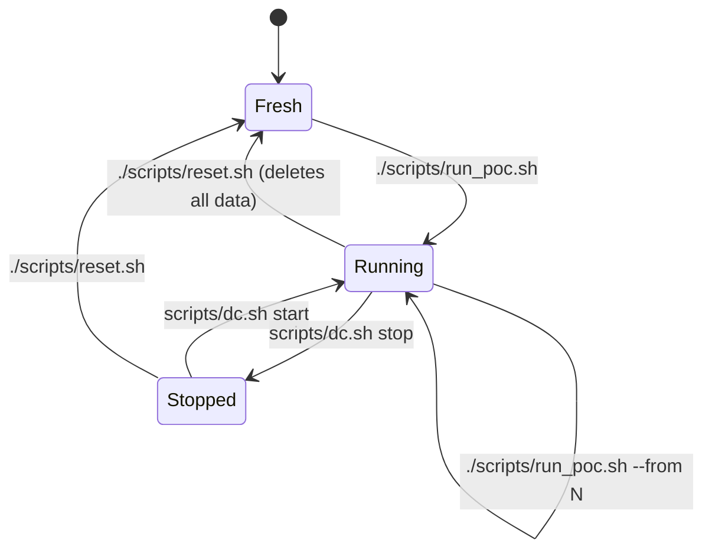
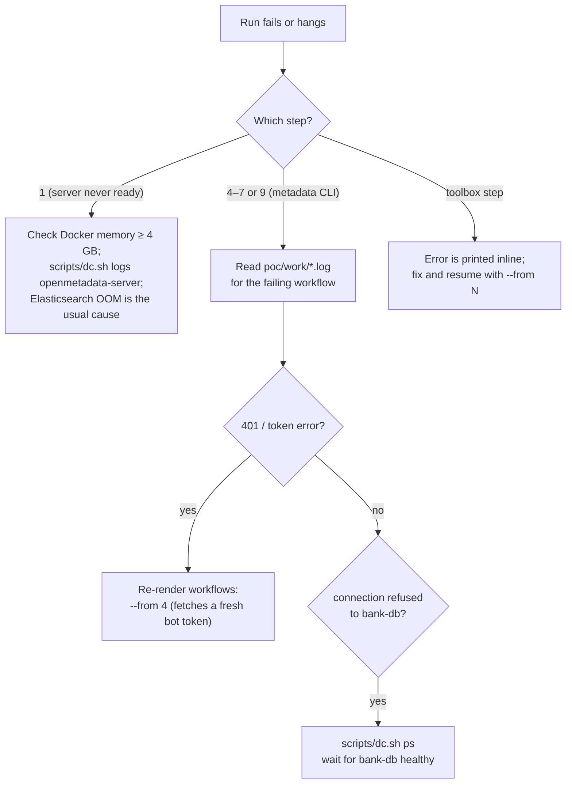
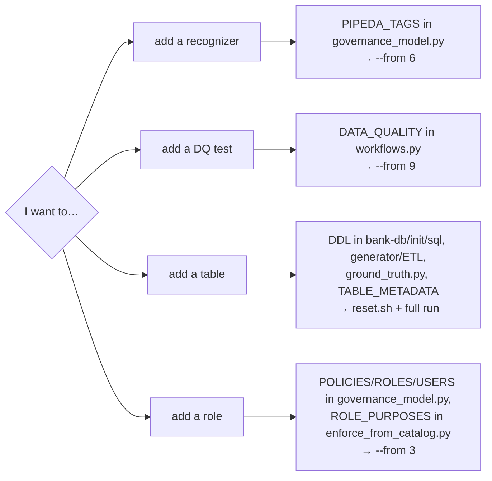

# Operations guide

## Prerequisites

| Need | Minimum | Comfortable |
|---|---|---|
| Docker Desktop (or Engine + Compose v2) | 4 GB memory for the VM | 6 GB |
| Disk | ~8 GB (images + volumes) | |
| Free ports | `8585` (OpenMetadata), `15432` (bank DB) | |
| Time | ~15–20 min for a full run | |

No local Python is needed; everything runs in containers.

## Lifecycle



All commands run from `poc/`.

```bash
./scripts/run_poc.sh
```

```bash
./scripts/run_poc.sh --from 8
```

```bash
./scripts/reset.sh
```

`reset.sh` runs `down -v`, then deletes `docker-volume/`, `work/` and `results/`. It **deletes the committed evidence in `results/` too**; commit or copy it first if you need it.

## Configuration (`.env`)

`run_poc.sh` copies `.env.example` to `.env` on first run. All values are local-only.

| Variable | Default | Used for |
|---|---|---|
| `COMPOSE_PROJECT_NAME` | `borealis-pipeda-poc` | Container/volume name prefix |
| `OPENMETADATA_HEAP_OPTS` | `-Xmx768m -Xms768m` | Server JVM heap (official default is 1 GB) |
| `ES_JAVA_OPTS` | `-Xms512m -Xmx512m` | Elasticsearch heap |
| `BANK_DB_ADMIN_PASSWORD` | `borealis-admin-local` | `postgres` superuser on `bank-db` |
| `OM_READER_PASSWORD` | `om-reader-local` | Connector account used by ingestion |
| `ETL_PASSWORD` | `etl-local` | `etl_service` role |
| `ANALYST_PASSWORD` | `analyst-local` | `marketing_analyst`, `fraud_analyst` |
| `OM_ADMIN_EMAIL` / `OM_ADMIN_PASSWORD` | `admin@open-metadata.org` / `admin` | Quickstart admin |
| `POC_SEED` | `5301` | Random seed; same seed → same data and results |
| `POC_CUSTOMERS` | `1500` | Number of synthetic customers |

Database role passwords are only applied when `bank-db` initialises its volume, so change them **before** the first run or after `reset.sh`.

## Useful commands

Everything goes through `scripts/dc.sh`, which combines both compose files.

```bash
scripts/dc.sh ps
```

```bash
scripts/dc.sh logs -f openmetadata-server
```

```bash
scripts/dc.sh --profile tools run --rm toolbox poc.evaluate_classification adhoc
```

```bash
scripts/dc.sh exec bank-db psql -U postgres -d bank_dw
```

```bash
psql "host=localhost port=15432 dbname=bank_dw user=marketing_analyst password=analyst-local" -c "select count(*) from governed_marketing_analyst.marketing_campaign_audience"
```

```bash
scripts/dc.sh --profile airflow up -d ingestion
```

## Where to look in the UI

| To see | Go to |
|---|---|
| Classified columns and their recognizer reasons | Explore → a table → Schema tab |
| PIPEDA classification and recognizers | Govern → Classification → PIPEDA |
| Glossary and its approval state | Govern → Glossary → PIPEDA & Privacy Glossary |
| Approval and feedback tasks | log in as `priya.cpo` → Tasks |
| Lineage through the ETL pipeline | a warehouse table → Lineage tab |
| Data-quality results | Observability → Data Quality |
| Data contract | `marketing_campaign_audience` → Contract tab |
| Policies and roles | Settings → Access Control |

## Troubleshooting



| Symptom | Likely cause | Fix |
|---|---|---|
| Step 1 waits ~15 min, then "did not become ready" | Not enough Docker memory | Raise the VM to 6 GB, `reset.sh`, re-run |
| `port is already allocated` | Something else on 8585 or 15432 | Stop it, or change the host port in the compose files |
| Step 6 tags nothing | `metadata classify` used instead of `classify_with.py` | Use the `omx` helper / step 6 as written |
| Step 7 resolves 0 tasks | Workflow tasks not created yet | Re-run `--from 7`; `_open_tasks` waits 60 s |
| Glossary links fail in step 10 | Terms still Draft | Run step 7 (glossary approval) first |
| Step 9 prints "reported errors" | Failing DQ tests | Expected; see `results/pipeda_compliance_summary.md` §2 |
| Toolbox changes not picked up | Only `requirements.txt` needs a rebuild | `scripts/dc.sh --profile tools build toolbox` |

## Extending the POC



When adding a table, also label every column in `ground_truth.py`; otherwise it shows as `?` and is excluded from the metrics.

## Upgrading OpenMetadata

1. Replace `openmetadata/docker-compose-openmetadata-postgres.yml` with the official file for the new release.
2. Bump the `om-cli` image tag in `docker-compose.poc.yml` to the same version.
3. Check whether `metadata classify` still hard-codes the `PII` filter; if not, step 6 can use `om classify` directly.
4. `reset.sh`, then a full run, and compare `results/summary.json` with the previous one.
