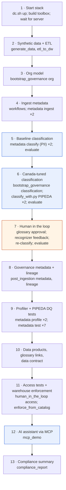
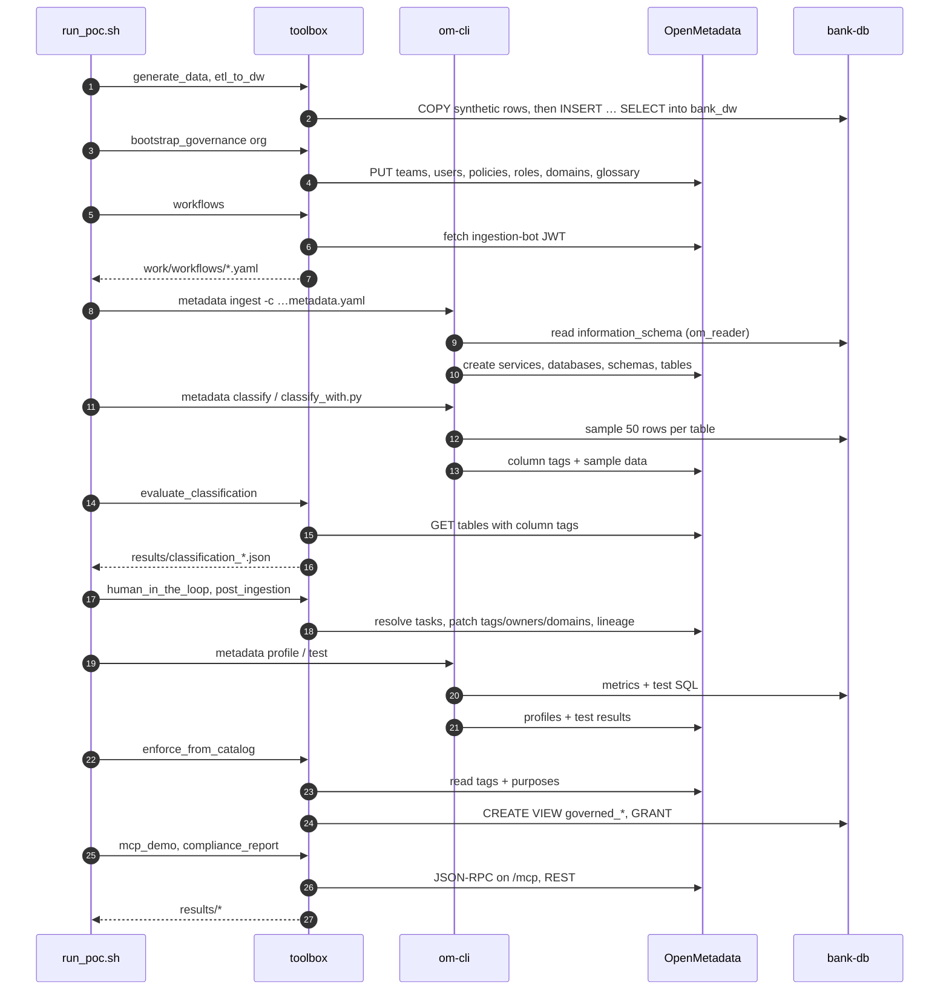
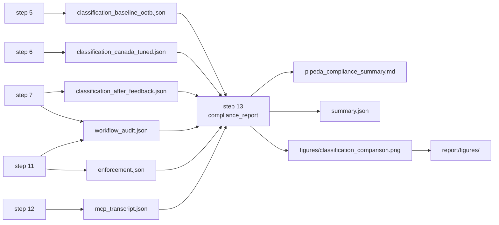

# Pipeline walkthrough (`scripts/run_poc.sh`)

`run_poc.sh` runs 13 numbered steps. Each step is either a **toolbox** module (`python -m poc.<module>`) or the official **`metadata` CLI** inside `om-cli`. Steps are idempotent, so a run can be resumed with `--from N`.

## Overview

Blue steps use OpenMetadata's AI features; the orange step represents human decisions.

## Step by step

| # | What happens | Runs | Writes |
|---|---|---|---|
| 1 | `docker compose up -d`, build the toolbox image, block until `GET /api/v1/system/version` returns 200 (up to 15 min) | `dc.sh`, `poc.workflows` | – |
| 2 | Create 1 500 synthetic customers (seed 5301) and related rows in `core_banking`; batch-load the warehouse | `poc.generate_data`, `poc.etl_to_dw` | `bank-db` |
| 3 | Teams, persona users, policies, roles, domains, `PIPEDAPurpose` tags, PIPEDA glossary (with reviewers → approval workflow) | `poc.bootstrap_governance org` | OpenMetadata |
| 4 | Render workflow YAMLs with the ingestion-bot token; ingest both database services | `poc.workflows`, `metadata ingest` | `work/workflows/*.yaml`, `work/*.log` |
| 5 | Auto-classify with the out-of-the-box `PII` classification; score against ground truth | `metadata classify`, `poc.evaluate_classification baseline_ootb` | `results/classification_baseline_ootb.json` |
| 6 | Create the `PIPEDA` classification with Canadian recognizers and PIPEDA policies; classify with it | `poc.bootstrap_governance classification`, `om-ext/classify_with.py`, evaluate | `results/classification_canada_tuned.json` |
| 7 | CPO approves glossary terms; steward reports 3 false positives; CPO approves; re-classify | `poc.human_in_the_loop glossary/feedback`, `classify_with.py`, evaluate | `results/workflow_audit.json`, `results/classification_after_feedback.json` |
| 8 | Owners, domains, purposes, retention, tier, column→table sensitivity roll-up; ETL pipeline entity + column lineage | `poc.post_ingestion metadata/lineage` | OpenMetadata |
| 9 | Profile both services; run the 7 PIPEDA test suites (failures are **expected findings**) | `metadata profile`, `metadata test` | `work/dq__*.log` |
| 10 | Data products, glossary-term links on tables, data contract on the marketing mart | `poc.post_ingestion products` | OpenMetadata |
| 11 | Persona access tests against the catalogue; generate masked views + grants in `bank_dw` and verify | `poc.human_in_the_loop access`, `poc.enforce_from_catalog` | `results/workflow_audit.json`, `results/enforcement.json` |
| 12 | Ask four PIPEDA questions through the MCP server | `poc.mcp_demo` | `results/mcp_transcript.json` |
| 13 | Assemble everything into a Markdown report + chart | `poc.compliance_report` | `results/pipeda_compliance_summary.md`, `results/summary.json`, `results/figures/` |

## Who talks to whom during a run

## Helper functions in `run_poc.sh`

| Helper | Does |
|---|---|
| `step N "title"` | Prints a banner and returns success only if `N >= --from` |
| `tool <module> …` | `dc.sh run --rm toolbox <module> …` with compose noise filtered out |
| `om <cmd> -c <yaml>` | Runs the `metadata` CLI, logs to `work/<cmd>…log`, aborts the run on failure |
| `omx <yaml> <CLASSIFICATION…>` | Runs `om-ext/classify_with.py` in the ingestion image (see [classification](classification.md#the-classify_withpy-workaround)) |

Data-quality steps deliberately do **not** abort on failure: a failing test is a governance finding, not a script error.

## Evidence produced

