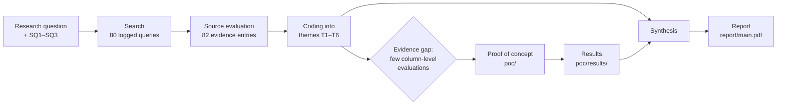

# Research overview

What the project asks, how it answers it, and where each part lives in the repo. The full argument is in the report ([`report/main.pdf`](../report/main.pdf)); this page is the map.

## Problem

A Canadian bank's customer data rarely stays where it was collected. A Social Insurance Number captured at account opening sits in the core-banking database, is copied nightly into the warehouse, and from there into marketing, AML and analytics marts. Every copy is *personal information* under PIPEDA and must respect the ten fair-information principles of Schedule 1. Most banks cannot answer basic questions about those copies: which columns hold personal information, why, who may read them, and when they should be deleted.

The OPC's investigation of the 2019 Desjardins breach (about 9.7 million people affected) traced it to failures of accountability, retention and safeguards, which is exactly this gap.

## Research question

> **How, and with what professional safeguards, can a Canadian bank use an open-source, AI-assisted metadata platform (OpenMetadata) to operationalize PIPEDA's fair information principles across its OLTP and OLAP data?**

| Sub-question | Answered mainly by |
|---|---|
| **SQ1** How accurately do AI auto-classification features locate personal information in Canadian banking data, and what improves them? | [Classification](classification.md), [Results §1](results.md#1-classification) |
| **SQ2** Which PIPEDA principles can catalogue metadata, workflows and tests support, and which remain outside their reach? | [PIPEDA mapping](pipeda-mapping.md), [Enforcement](enforcement.md) |
| **SQ3** What accountability mechanisms must surround the AI features for the resulting controls to be professionally defensible? | [Human-in-the-loop](human-in-the-loop.md), [MCP](mcp.md) |

## Scope

| In scope | Out of scope |
|---|---|
| Structured data in relational OLTP and OLAP stores | Unstructured documents and images |
| OpenMetadata 2.0.5 open source and its AI features (Presidio/spaCy auto-classification, recognizer feedback, MCP server) | Commercial catalogues (compared only through the literature) |
| PIPEDA and federal financial-sector guidance that intersects it (OSFI B-13, E-23, FINTRAC) | Provincial private-sector laws such as Quebec's Law 25; legal advice |
| A fictional bank with synthetic data | Any human-participant data (course ethics rule) |

**Assumptions:** the bank keeps records seven years after a relationship ends (consistent with FINTRAC's five-year minimum); Bill C-36 is treated as forthcoming, not as law.

## Method

The project combines a structured literature review with a proof of concept that tests specific claims from that literature.

### 1. Literature search and evaluation

- **Where:** IEEE Xplore, ACM DL, SpringerLink, Crossref/OpenAlex, arXiv, Google Patents, uOttawa Omni, plus official sites (Justice Laws, OPC, OSFI, FINTRAC, NIST, ISO, BIS, IAPP).
- **Inclusion:** peer-reviewed or authoritative (regulator, standards body, professional association, granted patent, official product docs), directly relevant to a sub-question, and verifiable through a DOI, publisher record or official URL.
- **Exclusion:** vendor marketing, undated web content, anything that could not be verified.
- **Records:** the full search log and the per-source evaluation (category, relevance, authority, bias/limitations, how it will be used) are in the proposal, [`deliverables/Team research and project proposal_Team 2.docx`](../deliverables/). The report's Appendices A–B hold the abridged evidence table and search log.
- **Full texts:** [`references/papers/README.md`](../references/papers/README.md) lists which papers are available locally, which need a manual download, and which need uOttawa Library access.

### 2. Thematic synthesis

Each retained source was coded against six themes. The report's Section IV is organised by theme, not by source.

| Theme | Claim being examined |
|---|---|
| T1 | Data governance is a system of decision rights, not a tool |
| T2 | Automated discovery works, but is context-dependent |
| T3 | Metadata, lineage and catalogues are compliance infrastructure |
| T4 | Canadian expectations converge on inventory, purpose and safeguards |
| T5 | Human oversight is necessary but fragile (automation bias) |
| T6 | There is a policy-to-data gap, and new AI interfaces (MCP) widen it |

### 3. Proof of concept as a structured test

The literature has few column-level evaluations of PII classifiers on structured banking data, so the POC measures one directly and tests the other themes on a realistic bank:

- **Bank:** fictional Borealis Bank of Canada, `core_banking` OLTP (10 tables) and `bank_dw` warehouse (9 tables). See [Data model](data-model.md).
- **Planted defects** a PIPEDA programme should catch: consent ignored by the ETL, customers kept past retention, stored CVVs, malformed postal codes.
- **Ground truth:** all 145 columns labelled by hand; precision, recall and F1 for three classifier configurations. See [Classification](classification.md#ground-truth).
- **Reproducible:** one command, about 15–20 minutes, every number regenerated. See [Operations](operations.md).

## Answer in brief

An AI-assisted metadata platform can operationalize PIPEDA **as a supervised control system, not an autonomous one**.

| Strength | Principles | Why |
|---|---|---|
| Strong | 4.2, 4.4, 4.8, 4.9 | These reduce to knowing and documenting: inventory, purposes, glossary, lineage |
| Useful but incomplete | 4.3, 4.5, 4.6 | Metadata tests *detect* consent, retention and accuracy violations; the fix lives in pipelines and processes |
| Weak without extra work | 4.7 | Catalogue policies protect the catalogue, not the database, unless tags are wired into enforcement (see [Enforcement](enforcement.md)) |

Key numbers: classification F1 rose from **0.783** (out of the box) to **0.943** (Canada-tuned recognizers) to **1.000** (after one round of steward feedback); 6 of 12 PIPEDA data-quality tests failed, finding all 5 planted defects. Details in [Results](results.md).

## Limitations

- **Optimistic scores:** the same people wrote the data generator, the defects and the recognizers.
- **Small sample:** 145 columns, 25 positives; one miss moves recall by four points.
- **Single product and version:** OpenMetadata 2.0.5 open source, default configuration.
- **Structured data only.**
- **Scripted personas:** approvals show workflow mechanics, not real reviewer behaviour.
- **Not legal advice:** PIPEDA mappings are the authors' reading of public guidance.

## Related pages

- [PIPEDA principle mapping](pipeda-mapping.md): each principle, its control, and its evidence file
- [Report guide](report.md): how the report is structured and built
- [Glossary](glossary.md): terms used across the docs
