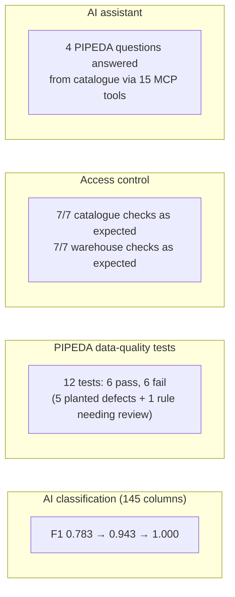
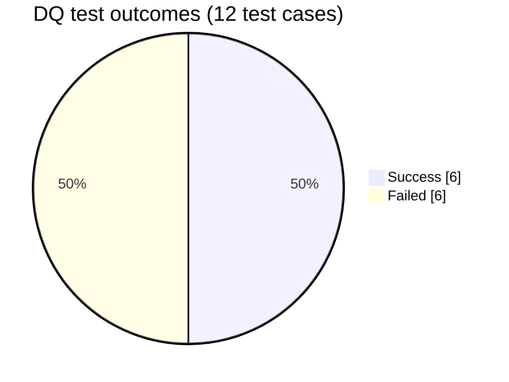
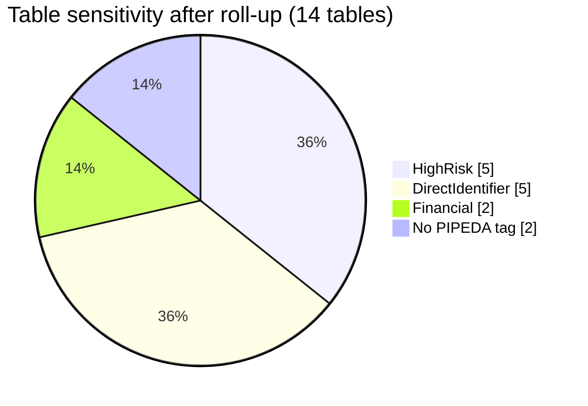

# Results and findings

Numbers below come from the committed evidence in [`poc/results/`](../poc/results/), mainly [`pipeda_compliance_summary.md`](../poc/results/pipeda_compliance_summary.md) and `summary.json`. Re-running the POC with the same seed reproduces them.

## At a glance

## 1. Classification

| Run | Precision | Recall | F1 | High-risk recall |
|---|---|---|---|---|
| Out-of-the-box PII | 0.857 | 0.720 | 0.783 | 4/7 |
| Canada-tuned PIPEDA | 0.893 | 1.000 | 0.943 | 7/7 |
| Tuned + steward feedback | 1.000 | 1.000 | 1.000 | 7/7 |

Details and error analysis: [classification](classification.md#results).

## 2. Data-quality findings

| Principle | Failing test | Rows | Root cause |
|---|---|---|---|
| 4.3 Consent | `p4_3_consent_not_withdrawn` | 55 | ETL ignores `withdrawn_at` (planted) |
| 4.4 Limiting collection | `p4_4_limiting_collection_no_cvv_stored` | 1 239 | Legacy system stores CVVs (planted) |
| 4.5 Retention | `p4_5_retention_closed_customers_purged` (OLTP) | 38 | Closed > 7 years, never purged (planted) |
| 4.5 Retention | `p4_5_retention_closed_customers_purged` (DW) | 38 | Same customers copied to the warehouse |
| 4.6 Accuracy | `p4_6_accuracy_postal_code_format` | 17 | Malformed postal codes (planted) |
| 4.6 Accuracy | `p4_6_accuracy_email_format` | 240 | Regex rejects accented letters; the **rule** needs review |

Note how the retention defect propagates: lineage shows the same 38 customers in `core.customer` and `dw.dim_customer`, so a purge has to cover both.

## 3. Personal-information inventory

14 tables carry an owner, a domain, a retention period and (except the two consent tables, which hold no tagged PI columns) a rolled-up sensitivity tag:

## 4. PIPEDA scorecard

| Principle | Control | Status |
|---|---|---|
| 4.1 Accountability | Privacy Office; CPO owns classification and glossary; table owners | Implemented |
| 4.2 Identifying purposes | `PIPEDAPurpose` on 14 tables; data contract | Implemented |
| 4.3 Consent | Consent DQ tests; consent row filter | **Gap detected** (55 withdrawn customers) |
| 4.4 Limiting collection | HighRisk inventory | **Gap detected** (1 239 CVVs) |
| 4.5 Use, disclosure, retention | `retentionPeriod`; retention tests | **Gap detected** (38 customers) |
| 4.6 Accuracy | Format and uniqueness tests | **Gap detected** (17 postal codes; e-mail rule) |
| 4.7 Safeguards | Catalogue policies; generated masked views | Implemented (POC scope) |
| 4.8 Openness | Approved glossary | Implemented |
| 4.9 Individual access | Column lineage; MCP lineage query | Partial (no per-person search) |
| 4.10 Challenging compliance | Feedback workflow; task audit trail | Partial (internal only) |

"Gap detected" is the desired outcome here: the controls found the planted problems.

## Product limitations found

These are behaviours of OpenMetadata 2.0.5 OSS discovered while building the POC.

| # | Finding | Impact | Workaround in POC |
|---|---|---|---|
| 1 | `metadata classify` hard-codes `classification_filter=[PII]` | Recognizers on custom classifications never run | [`om-ext/classify_with.py`](../poc/om-ext/classify_with.py) subclass |
| 2 | No built-in recognizer targets Canadian identifiers; SINs matched only via Australian TFN / US ABA patterns | Baseline misses postal codes, account numbers, licences | Custom PIPEDA recognizers |
| 3 | Sample-data endpoint evaluates `matchAnyTag()` on **table-level** tags only, while the permission debugger also counts column tags | Policy appears to deny but endpoint allows | Roll most sensitive column tag up to table |
| 4 | Custom Python recognizers are not implemented in OSS | No Luhn check on SINs | Regex + context words + column names |
| 5 | Catalogue policies do not reach the database | SQL users bypass catalogue safeguards | [Generate views + grants from tags](enforcement.md) |
| 6 | MCP server exposes write tools | Over-privileged agent can remove safeguarding tags | Least-privilege tokens; org-wide tag-integrity policy |

## Evidence files

| File | Contents |
|---|---|
| `classification_baseline_ootb.json`, `classification_canada_tuned.json`, `classification_after_feedback.json` | Per-column tags, reasons, metrics |
| `workflow_audit.json` | Glossary approvals, recognizer feedback, access-control tests |
| `enforcement.json` | Generated SQL, per-view decisions, verification queries |
| `mcp_transcript.json` | MCP tool list and question/answer pairs |
| `summary.json` | Machine-readable roll-up of all of the above |
| `pipeda_compliance_summary.md` | Human-readable report |
| `figures/classification_comparison.png` | Chart used in the report |
