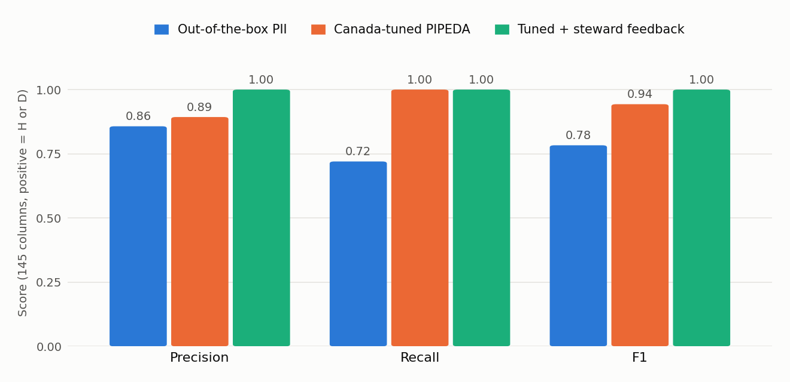

# Borealis Bank (fictional) - PIPEDA governance POC results

Generated by `poc.compliance_report` from OpenMetadata 2.0.5. All data is synthetic.

## 1. AI auto-classification vs. ground truth (145 columns)

| Run | Precision | Recall | F1 | TP | FP | FN | High-risk recall |
|---|---|---|---|---|---|---|---|
| Out-of-the-box PII | 0.857 | 0.720 | 0.783 | 18 | 3 | 7 | 4/7 |
| Canada-tuned PIPEDA | 0.893 | 1.000 | 0.943 | 25 | 3 | 0 | 7/7 |
| Tuned + steward feedback | 1.000 | 1.000 | 1.000 | 25 | 0 | 0 | 7/7 |

## 2. PIPEDA data-quality tests

| Test | Table | Status | Result |
|---|---|---|---|
| fintrac_lctr_min_amount | bank_dw.mart.aml_large_cash_txn | Success | Found 0 row(s). Test query is expected to return <= 0 row(s). |
| p4_3_consent_marketing_flag_true | bank_dw.mart.marketing_campaign_audience | Success | Found countInSet=611. |
| p4_3_consent_not_withdrawn | bank_dw.mart.marketing_campaign_audience | Failed | Found 55 row(s). Test query is expected to return <= 0 row(s). |
| p4_3_consent_purpose_not_null | core_banking.core.customer_consent | Success | Found nullCount=0. It should be 0 |
| p4_3_consent_withdrawal_after_capture | core_banking.core.customer_consent | Success | Found 0 row(s). Test query is expected to return <= 0 row(s). |
| p4_4_limiting_collection_no_cvv_stored | core_banking.core.card | Failed | Found 1239 row(s). Test query is expected to return <= 0 row(s). |
| p4_4_minimisation_no_full_postal_code | bank_dw.dw.dim_customer | Success | Found minLength=3, maxLength=3 vs. the expected minLength=3.0, maxLength=3.0. |
| p4_5_retention_closed_customers_purged | core_banking.core.customer | Failed | Found 38 row(s). Test query is expected to return <= 0 row(s). |
| p4_5_retention_closed_customers_purged | bank_dw.dw.dim_customer | Failed | Found 38 row(s). Test query is expected to return <= 0 row(s). |
| p4_6_accuracy_email_format | core_banking.core.customer | Failed | Found 1260 value(s) matching regex pattern vs 1500 value(s) in the column. |
| p4_6_accuracy_postal_code_format | core_banking.core.customer | Failed | Found 1483 value(s) matching regex pattern vs 1500 value(s) in the column. |
| p4_6_accuracy_sin_unique | core_banking.core.customer | Success | Found valuesCount=1473 vs. uniqueCount=1473. Both counts should be equal for column values to be unique. |

## 3. Personal-information inventory

| Table | Sensitivity | Purposes | Retention | Owner | Domain |
|---|---|---|---|---|---|
| core_banking.core.customer | PIPEDA.HighRisk | AccountServicing | P7Y | DataEngineering | RetailBanking |
| core_banking.core.customer_consent | - | AccountServicing | P7Y | PrivacyOffice | RetailBanking |
| core_banking.core.account | PIPEDA.HighRisk | AccountServicing | P7Y | DataEngineering | RetailBanking |
| core_banking.core.card | PIPEDA.HighRisk | AccountServicing | P2Y | DataEngineering | RetailBanking |
| core_banking.core.transaction | PIPEDA.DirectIdentifier | AccountServicing, FraudPrevention | P7Y | DataEngineering | RetailBanking |
| core_banking.kyc.identity_document | PIPEDA.HighRisk | RegulatoryReporting | P5Y | FraudAML | RiskCompliance |
| core_banking.ops.support_ticket | PIPEDA.DirectIdentifier | AccountServicing | P2Y | DataEngineering | RetailBanking |
| core_banking.ops.legacy_member_import | PIPEDA.HighRisk | - | P0D | DataEngineering | RetailBanking |
| bank_dw.dw.dim_customer | PIPEDA.DirectIdentifier | Analytics | P7Y | DataEngineering | RetailBanking |
| bank_dw.dw.dim_consent | - | Marketing, Analytics | P7Y | PrivacyOffice | RetailBanking |
| bank_dw.dw.fact_transaction | PIPEDA.Financial | Analytics, FraudPrevention | P7Y | DataEngineering | RetailBanking |
| bank_dw.mart.marketing_campaign_audience | PIPEDA.DirectIdentifier | Marketing | P90D | RetailMarketing | Marketing |
| bank_dw.mart.aml_large_cash_txn | PIPEDA.DirectIdentifier | RegulatoryReporting | P5Y | FraudAML | RiskCompliance |
| bank_dw.mart.monthly_branch_activity | PIPEDA.Financial | Analytics | P10Y | DataEngineering | RetailBanking |

## 4. Access-control tests (catalogue)

| User | Table | Operation | HTTP |
|---|---|---|---|
| maya.marketing | core_banking.core.customer | View sampleData | 403 |
| maya.marketing | bank_dw.mart.marketing_campaign_audience | View sampleData | 403 |
| maya.marketing | bank_dw.mart.monthly_branch_activity | View sampleData | 200 |
| femi.aml | core_banking.core.customer | View sampleData | 200 |
| priya.cpo | core_banking.core.customer | View sampleData | 200 |
| maya.marketing | core_banking.core.customer | Add tag, keep PIPEDA.HighRisk | 403 |
| maya.marketing | core_banking.core.customer | Remove PIPEDA.HighRisk tag | 403 |

## 5. Warehouse enforcement generated from the catalogue

| Role | Query | Result |
|---|---|---|
| marketing_analyst | `SELECT email FROM governed_marketing_analyst.dim_customer LIMIT 1` | OK: 8b7f5bedf2070d5e7020ff80... |
| marketing_analyst | `SELECT email FROM governed_marketing_analyst.marketing_campaign_audience LIMIT 1` | OK: gabriel.paquette1@exampl... |
| marketing_analyst | `SELECT count(*) FROM governed_marketing_analyst.marketing_campaign_audience` | OK: 556... |
| marketing_analyst | `SELECT email FROM dw.dim_customer LIMIT 1` | DENIED/ERROR: permission denied for schema dw |
| marketing_analyst | `SELECT full_name FROM governed_marketing_analyst.aml_large_cash_txn LIMIT 1` | OK: 0f19267e69db658a3df0e443... |
| fraud_analyst | `SELECT full_name FROM governed_fraud_analyst.aml_large_cash_txn LIMIT 1` | OK: Emma Ahmed... |
| fraud_analyst | `SELECT account_number FROM governed_fraud_analyst.dim_account LIMIT 1` | DENIED/ERROR: column "account_number" does not exist |

## 6. PIPEDA principle scorecard

| Principle | Control in POC | Status |
|---|---|---|
| 4.1 Accountability | Privacy Office team; CPO owns PIPEDA classification and glossary; table owners assigned | Implemented |
| 4.2 Identifying purposes | PIPEDAPurpose tags on 14 tables; data contract states purpose | Implemented |
| 4.3 Consent | Consent DQ tests; consent row filter in governed marketing view | Gap detected (55 withdrawn customers in audience) |
| 4.4 Limiting collection | HighRisk inventory exposes stored CVVs and legacy SINs | Gap detected (1,239 CVVs stored) |
| 4.5 Limiting use, disclosure, retention | retentionPeriod on tables; retention DQ tests | Gap detected (38 customers past retention) |
| 4.6 Accuracy | Format and uniqueness DQ tests | Gap detected (17 invalid postal codes; e-mail rule needs review) |
| 4.7 Safeguards | Tag-based catalogue policies; catalogue-generated masked views in warehouse | Implemented (POC scope) |
| 4.8 Openness | Approved PIPEDA glossary published in catalogue | Implemented |
| 4.9 Individual access | Column-level lineage OLTP->OLAP; PI inventory; MCP lineage query | Partially (no per-person search) |
| 4.10 Challenging compliance | Recognizer feedback workflow; task audit trail | Partially (internal workflow only) |
